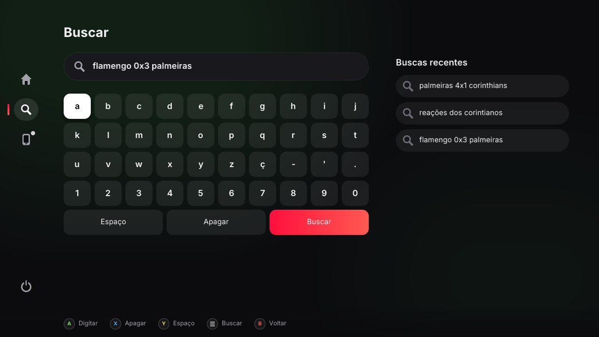
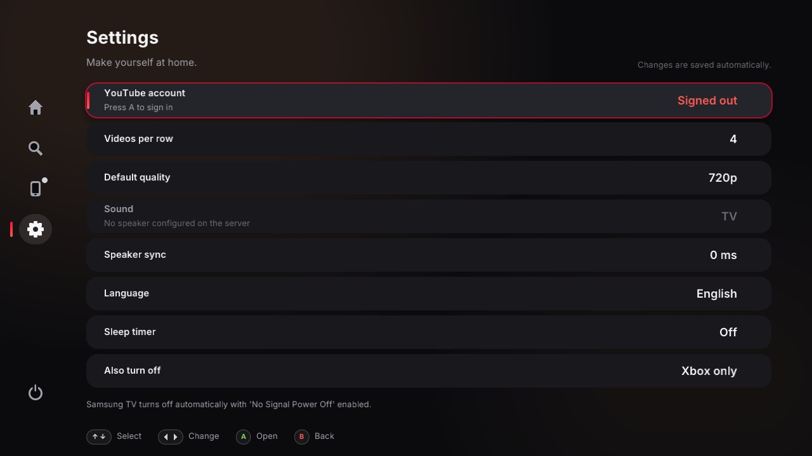
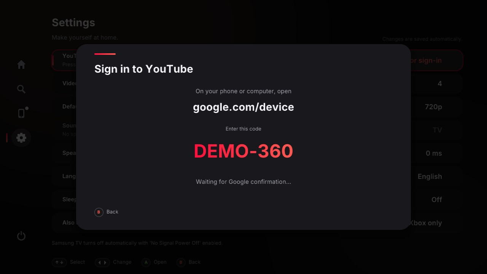
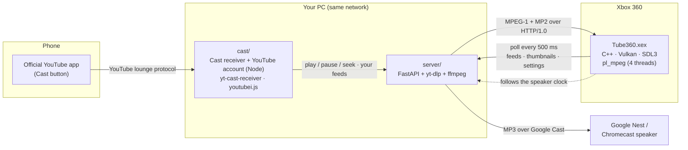

<p align="center">
  
</p>

<p align="center">
  <a href="https://github.com/PedroHenrique0713/tube360/stargazers"></a>
  
  
  <a href="LICENSE"></a>
</p>

<p align="center">
  <b>English</b> · <a href="README.pt-BR.md">Português</a>
</p>

> [!TIP]
> **Tube360 is free and MIT licensed.** If it brought your old console back to life, **give the repo a ⭐**. It's the only thing I ask, and it's how other people find it.

**Tube360** is a native YouTube client for the Xbox 360. It is a real `.xex` that opens from Aurora like any game. It has a YouTube-style home grid, search with an on-screen keyboard, your own YouTube account, and a player that decodes **720p at 30 fps on the console's own CPU**. A small server on your PC (or a cheap VPS, or an old Android phone) does the heavy lifting. You can also pick videos **from the official YouTube app on your phone** with the normal Cast button, send the sound to a **Google Nest / Chromecast speaker** in sync with the picture, and set a **sleep timer** that turns the console off (and the PC too, if you want).

No TV stick, no smart TV, no browser. Just the Xbox 360 you already have.

---

## Highlights

| | |
|---|---|
| 📺 **Native app, not a web page** | C++ with Vulkan (on the Xenos GPU through [vulkan4xenon](https://github.com/xenosworks/vulkan4xenon)) and SDL3. Shows up in Aurora with its own title ID (`0x58545542`), cover, and background. |
| ⚡ **720p at 30 fps on a 2005 CPU** | The MPEG-1 decoder is split across 4 of the Xenon's hardware threads, slice by slice. Each frame takes ~22 ms, down from ~40 ms on a single thread. |
| 👤 **Your YouTube account, no phone needed** | Sign in once on the TV with a code at google.com/device, like a smart TV app. Then the console shows your recommendations, subscriptions, continue watching (with the red progress bar) and Watch later, and what you watch goes to your YouTube history. |
| 🧭 **Channels and your library** | Open a video’s channel with Menu, browse videos/live/playlists, subscribe, find subscribed channels by avatar, and play account playlists or Watch later in sequence. |
| 🎵 **Music** | A dedicated area with square artwork, quick picks, Explore/charts and mixes, song/album/artist search, radio queues, and a Now playing screen with optional lyrics. |
| 📱 **Cast from the official YouTube app** | Tube360 shows up in the phone's Cast menu like a smart TV. Pair once with a TV code (or let the phone find it on Wi-Fi). Play, pause, seek, volume and "up next" all work from the phone. |
| 🔊 **Sound on a Google speaker, in sync** | The speaker plays the audio and the console follows its clock, which a microphone test puts within ~20 ms of the speaker's actual sound. If the speaker drops, the sound falls back to the TV on its own. |
| 👍 **Like, dislike and autoplay** | Rate in the player's options row likes or dislikes the video on your account. When a video ends, the next one YouTube suggests starts after an 8 s countdown (A to watch now, B to cancel). Members-only videos carry a badge before you open them. |
| 🔴 **Live streams** | A live opens like any video, close to the live edge, with picture and sound from the same segment (on the speaker too). Pausing and resuming jumps back to live. |
| 🌙 **Sleep timer** | 15 min to 2 h, or "end of this video". A warning 60 s before (A for +15 min, B to cancel) while the sound fades out. Then the console turns itself off, and optionally the PC too. |
| ⚙️ **Settings on the TV** | 3 or 4 videos per row, default quality, sound on the TV or the speaker, speaker sync, English or Portuguese. Button prompts in the Xbox One / Series style. |
| 🪶 **Light on your PC, or off it** | Idle: ~140 MB RAM and ~0% CPU. Streaming 720p: about three quarters of one CPU core. Runs as a low-priority service, or on [a small VPS or an old Android phone](#run-it-without-your-pc). |

## Screenshots

| Home | Search results |
|---|---|
|  |  |
| **Player** | **On-screen keyboard** |
|  |  |
| **Settings** | **Sign in to YouTube on the TV** |
|  |  |
| **Sleep timer** | **Cast from the phone** |
|  |  |
| **Like or dislike a video** | **Up next automatically** |
|  |  |

<sub>These screenshots come from the PC build of the client, which runs the same code and renderer as the console build. The demo feed is the author's choice: Palmeiras 4×1 Corinthians and Flamengo 0×3 Palmeiras. 🟢⚪ The account is a demo one, and the sign-in and Cast codes are placeholders.</sub>

---

## How it works



### Why MPEG-1?

The Xbox 360 has no open-source H.264/VP9 decoder that homebrew can use. MPEG-1 is old, but it is simple enough to decode on the CPU, and [pl_mpeg](https://github.com/phoboslab/pl_mpeg) is a single-header decoder that builds with the console toolchain without changes. So the PC asks YouTube for the video with `yt-dlp` (H.264 sources first, since AV1 costs twice the CPU to open), and `ffmpeg` converts it on the fly. For 720p on demand, the server prefers a reachable H.264 source up to 1080p at 30 fps and scales it down. Fine detail from the pitch and the stands survives the conversion better. On a 20-second football clip, VMAF rose from 83.1 to 90.1 against the best YouTube rendition scaled to 720p. The stream still starts while it converts. When only 50/60 fps is available at 1080p, the server keeps the lower-resolution source. Live keeps its HLS source up to 720p with synchronized audio.

| Quality | Size | Video bitrate | Notes |
|---|---|---|---|
| **720p** (default) | 1280×720 | 5.5 Mbit/s | 30 fps, GOP 30, 2 B-frames |
| 480p | 854×480 | 2.5 Mbit/s | toggle with **Y** in the player |
| 360p | 640×360 | 1.5 Mbit/s | |

Audio is MP2, 44.1 kHz stereo, 192 kbit/s, in the same MPEG-PS stream.

### Decoding 720p on the Xenon

Out of the box, pl_mpeg decodes real YouTube 720p content at about **40 ms per frame** on one hardware thread. That is too slow for 30 fps. Tube360 patches it in two places (`client/third_party/pl_mpeg.h`):

1. **Slice-parallel decoding.** MPEG-1 pictures are made of independent slices, one per row of macroblocks. The decoder thread finds the slice start codes, splits the picture into jobs, and runs them on 3 helper threads, each pinned to a different hardware thread (`xsdk_thread_move`). Each job gets its own copy of the bit reader, so there is no locking inside the hot loop. Result: **21–23 ms per frame** at 720p.
2. **B-frame skipping under pressure.** If the decoder falls more than 40 ms behind the clock (120 ms in speaker mode), it skips the next B-frame. A B-frame is never used as a reference, so skipping it never breaks the picture. In normal playback none are skipped.

Each heavy thread is pinned on purpose. Main/render runs on HW 0, the decoder on HW 2, the slice helpers on HW 3, 1 and 4, network on HW 4. Without pinning, xsdk threads stay on the core that created them.

### Sound on a Google speaker, in sync

When a Google Nest or Chromecast is set in `config.json`, the server sends it **only the audio**, as MP3 through Google Cast. The console gets **only the video** and uses the speaker as the master clock:

- It asks the server for the speaker position every 200 ms.
- The server stamps each position with the time the speaker's answer *arrived*. (Stamping it with "now" put the picture ~214 ms behind the sound: `pychromecast`'s `update_status()` only sends the request, so the status you read next is the previous answer.) Measured with a laptop microphone and 1 kHz beeps: the reported position is within ~20 ms of the sound.
- Responses that took more than 120 ms are thrown away, because Wi-Fi jitter would make the clock jump. Small differences are smoothed in slowly; a real jump only re-anchors after two samples in a row disagree by more than 0.5 s.
- If the speaker fails, the sound moves back to the TV and an on-screen message says so. LT/RT nudge the sync by 40 ms if your TV adds its own delay.

### Your YouTube account

The account lives in the same Node process as the Cast receiver (`cast/account.mjs`), through [YouTube.js](https://github.com/LuanRT/YouTube.js). Signing in uses the TV flow: the console shows a code, you confirm it at google.com/device, and the token stays on your PC (`~/.cache/tube360/yt-conta.json`, mode 600). A TV sign-in token is only accepted by YouTube's TV client, so feeds are read through it. Recording what you watch needs YouTube's playback tracking, which this library's TV client no longer gets ("The page needs to be reloaded"), so that one call presents itself as a Samsung TV client, the identity yt-dlp's `tv_samsung` uses. The console also keeps its own history.

If YouTube starts answering "Sign in to confirm you're not a bot" for your IP (it happens after a lot of requests), set `cookies_from_browser` in `config.json` to a browser profile where you're logged in to YouTube. The server then uses those cookies **only while YouTube asks for them**, retrying without them every 30 minutes, since a video opens in ~3 s without cookies and ~8 s with them.

### Sleep timer

The timer lives on the server, so it keeps counting even if the console is turned off by hand. When it runs out, the server stops the speaker and sends `desligar` to the console, which turns itself off through the kernel (`HalReturnToFirmware(HalPowerDownRoutine)`, resolved by ordinal from `xboxkrnl.exe`). With "Xbox and PC", the server then powers the PC off through logind 20 s later, so programs close normally.

The Xbox 360 has no HDMI-CEC, so it can't turn the TV off. Most TVs have a "power off when there is no signal" option (on Samsung: **System → Eco Solution → No-Signal Power Off**); with it on, the TV goes off a few minutes after the console.

While the console is using the server (or a timer is set), the server also holds a logind lid-switch inhibitor: you can close the laptop lid and switch off the monitor without the PC suspending in the middle of the video.

### Cast from the official app

`cast/receptor.mjs` uses [yt-cast-receiver](https://github.com/patrickkfkan/yt-cast-receiver) to speak the YouTube "Watch on TV" (lounge) protocol, and turns each phone command into a console command. The console's **Phone** panel shows a TV code. Enter it once on the phone (YouTube → Settings → Watch on TV → Enter TV code), and the phone remembers the device. On networks that pass multicast, the phone also finds Tube360 on its own through DIAL (port 8098).

---

## Requirements

**Console**
- An Xbox 360 that runs unsigned code: **BadUpdate** (tested with XeUnshackle), **RGH** or **JTAG**.
- **Aurora** (or another dashboard that launches `.xex` files).
- Network: about 6 Mbit/s for 720p. Wired or Wi-Fi both work.

**PC (on the same network)**
- Linux. Tested on Fedora. The server is plain Python and should also run on macOS or Windows, but the service scripts are systemd only.
- Python 3.11+ and `ffmpeg` in `PATH`.
- Node.js 22+. yt-dlp uses it to read YouTube's pages, and the Cast receiver and the account run on it.

## Quick start

### 1. Server on the PC

```bash
git clone https://github.com/PedroHenrique0713/tube360.git
cd tube360
python3 -m venv .venv && .venv/bin/pip install -r server/requirements.txt
cp server/config.example.json server/config.json   # edit if you want (see Configuration)
TUBE360_PYTHON=$PWD/.venv/bin/python ./server/run.sh   # listens on port 8091
```

Open `http://<your-PC-IP>:8091` in a browser: a small status page shows the server, the console, the Cast TV code and your account.

### 2. Cast receiver and YouTube account (optional)

```bash
(cd cast && npm install)
node cast/receptor.mjs
```

### 3. Run both as services (start on login, low priority)

```bash
TUBE360_NAME="Living Room TV" tools/install-services.sh
```

It also installs `tube360-update.timer`, which keeps yt-dlp up to date: it checks every hour, upgrades about once a day, and only restarts the server while nothing is playing.

### 4. Console

1. Get `default.xex` from the [Releases](https://github.com/PedroHenrique0713/tube360/releases) page, or [build it](#building-from-source).
2. Make a folder such as `Hdd1:\Games\Tube360\` and copy into it:
   - `default.xex`
   - `client/assets/inter-300.ttf`, `inter-400.ttf`, `inter-600.ttf`, `inter-700.ttf`
   - a `server.txt` file with your PC's IP and port, e.g. `192.168.0.10 8091`
3. In Aurora, add the folder to your scan paths (or rescan). Tube360 appears as a game.
4. To use your account: **Settings → YouTube account → A**, then enter the code shown on the TV at google.com/device.

> [!NOTE]
> On Linux with firewalld, open the ports: `sudo firewall-cmd --add-port=8091/tcp --add-port=8098/tcp --add-service=ssdp --permanent && sudo firewall-cmd --reload`.

## Run it without your PC

The server doesn't have to be your desktop. Anything that runs Linux and stays on can host it. Measured on one core of an Intel i5-1035G1 laptop, re-encoding 30 s of a 720p football highlight:

| Quality | CPU (one core, in real time) | Memory |
|---|---|---|
| 720p | ~73% | ~400 MB for the server and ffmpeg together, ~60 MB for the Cast receiver |
| 480p | ~52% | same |

### Option A: a small VPS

- **Size:** 2 vCPU and 1 GB of RAM for 720p. 1 vCPU is enough for 480p. 10 GB of disk is plenty.
- **Traffic:** 720p sends about 2.6 GB per hour of video to your console (≈ 5.7 Mbit/s). Two hours a day comes to about 160 GB a month, which fits the included traffic of most entry-level plans.

On Debian or Ubuntu:

```bash
sudo apt install -y git ffmpeg python3-venv ufw
# Node.js 22+ (distro packages are often older): https://nodejs.org/en/download
git clone https://github.com/PedroHenrique0713/tube360.git && cd tube360
python3 -m venv .venv && .venv/bin/pip install -r server/requirements.txt
(cd cast && npm install)
tools/install-services.sh

# the server has no password: open it only to your home IP
sudo ufw allow OpenSSH
sudo ufw allow from <your-home-IP> to any port 8091 proto tcp
sudo ufw enable
```

Then put the VPS address in the console's `server.txt` (e.g. `203.0.113.7 8091`).

> [!WARNING]
> Tube360's server has no login. Anyone who can reach port 8091 can use it and send videos to your console. Keep the firewall rule above, and update it if your home IP changes (check it with `curl ifconfig.me` from home).

What changes on a VPS:
- **Cast from the official app** works with the TV code, because pairing goes through YouTube's servers. Finding the console on Wi-Fi by itself does not.
- **The Google speaker doesn't work.** It has to be on the same network as the server.
- **The sleep timer can only turn off the Xbox**, not your PC.
- **YouTube often asks datacenter IPs to sign in** ("confirm you're not a bot"). Export a `cookies.txt` from a spare YouTube account ([yt-dlp's guide](https://github.com/yt-dlp/yt-dlp/wiki/Extractors#exporting-youtube-cookies)), copy it to the VPS and set `"cookies_file": "~/cookies.txt"` in `server/config.json`.
- Starting and seeking take a little longer, because the video now crosses the internet.

### Option B: an old Android phone

An old phone on the charger can be the server for your living room. This uses [Termux](https://termux.dev) and is **experimental**: it has not been tested across phones yet, so reports are welcome.

1. Install **Termux from [F-Droid](https://f-droid.org/packages/com.termux/)**. The Play Store version is outdated.
2. In Termux:

   ```bash
   pkg update && pkg upgrade
   pkg install git python python-pillow ffmpeg nodejs rust clang binutils
   export ANDROID_API_LEVEL=$(getprop ro.build.version.sdk)   # needed to build pydantic-core
   git clone https://github.com/PedroHenrique0713/tube360.git && cd tube360
   pip install -r server/requirements.txt    # the first run compiles pydantic-core: 10-30 min on an old phone
   (cd cast && npm install)
   termux-wake-lock
   ./server/run.sh & node cast/receptor.mjs &
   ```

3. In Android's settings, set Termux's battery use to **Unrestricted**, keep the phone plugged in, and give it a fixed IP in your router (DHCP reservation).
4. Put the phone's IP in the console's `server.txt`.
5. To start everything after a reboot, install **Termux:Boot** (also from F-Droid) and put the two start commands in a script in `~/.termux/boot/`.

**Start at 480p** (Settings → Default quality). The phone re-encodes in real time, and 720p needs about three quarters of a laptop core, which many phone CPUs only reach by spreading the work over several cores. If 480p plays smoothly, try 720p. The Google speaker and Cast by TV code both work, since the phone is on your home network.

## Controls

Button prompts in the app use the Xbox One / Series style.

| Where | Button | Action |
|---|---|---|
| **Home** | A | Watch (resumes where you stopped) |
| | X | Refresh the feed |
| | Y | Search |
| | D-pad ← (on the first column) | Side menu (Home · Search · Phone · Settings · Exit) |
| | D-pad ↑ (on the first row) | Category and account chips |
| | View | Exit to Aurora |
| **Search** | A / X / Y | Type / Delete / Space |
| | Menu | Search |
| | B | Back |
| **Player** | A or Menu | Pause / resume |
| | Any direction (bar hidden) | Show the bar, focus on the timeline |
| | D-pad ← → (on the timeline) | −10 s / +10 s |
| | D-pad ↑ (from the timeline) | Options row: captions, quality, sound, sleep timer, rate, go to channel |
| | A (on an option) | Open it; ↓ goes back to the timeline |
| | LB / RB | −1 min / +1 min |
| | Y | 720p ↔ 480p |
| | X | Sound on TV ↔ speaker |
| | LT / RT | Speaker lip-sync −40 ms / +40 ms (saved) |
| | B | Back one level (panel, options, timeline, hidden bar), then leave the video |
| | View | Back to the grid |
| **Settings** | D-pad ↑ ↓ / ← → | Choose a row / change its value |
| | A / B | Open (sign in, sign out) / Back |
| **Up next** | A / B | Watch now / Cancel |
| **Sleep warning** | A / B | +15 min / Cancel |

## Configuration

**On the console**, everything is in **Settings** and is saved to `settings.txt` next to the `.xex` (`lang`, `cols`, `quality`, `sound`, `sync_ms`, `sleep_what`). Other files next to the `.xex`:

| File | Content | What it does |
|---|---|---|
| `server.txt` | `192.168.0.10 8091` | Where the server is (required). |
| `marca.txt` | line 1: a name; line 2 (optional): `retangulo` | Custom name and logo style in the app's header. |
| `net_log.txt` | `192.168.0.10 7400` | Sends the app's log over UDP to your PC (debugging). |

Older `quality.txt` / `audio.txt` files are still read the first time, then `settings.txt` takes over.

**`server/config.json`** (copy it from `config.example.json`):

| Key | Meaning |
|---|---|
| `language` | `en` or `pt`: language of list titles, messages and YouTube's metadata. |
| `home_queries` | Topics the home grid is built from when no account is signed in. Six are picked at random on each refresh. |
| `warm_queries` | Searches preloaded in the background while the console is in use, so the category chips open instantly. |
| `nest` | `{"host": "192.168.0.20", "name": "Living Room speaker"}`. Use the IP, because many home networks block mDNS. |
| `cookies_from_browser` | e.g. `"chrome:~/.config/google-chrome/Default"`. Only used when YouTube asks to sign in (see [Your YouTube account](#your-youtube-account)). |
| `cookies_file` | Same idea with an exported `cookies.txt` (for a VPS without a browser). |
| `brand` | Name shown on the status page. |

## Building from source

**PC build** (same UI, for development, with a window and Mesa's Vulkan):

```bash
cmake -S client -B client/build -DCMAKE_BUILD_TYPE=Release
cmake --build client/build -j
XT_SERVER=127.0.0.1:8091 ./client/build/tube360
```

Needs SDL3, the Vulkan headers and `glslangValidator`. Keyboard: arrows, Enter = A, Esc = B, Backspace = X, Tab = Y, PageUp/PageDown = LB/RB, F2 = Menu, F10 = View. A gamepad also works.

**Xbox 360 build** needs the [xsdk](https://github.com/xenosworks/xsdk) toolchain, plus [vulkan4xenon](https://github.com/xenosworks/vulkan4xenon) and [SDL-xenon](https://github.com/xenosworks/SDL-xenon), already built:

```bash
export XSDK_DIR=~/src/xsdk V4X_DIR=~/src/vulkan4xenon SDL3_XENON_DIR=~/src/SDL-xenon/build-xsdk XSDK_TOOLCHAIN=~/xsdk-gcc
tools/build-xbox.sh          # → client/build-x360/tube360.xex
```

The shaders are GLSL, compiled for the Xenos GPU by vulkan4xenon's `build_shaders.py`.

## Project layout

```
client/          the console app (C++20): src/main.cpp (UI), gfx.hpp (Vulkan 2D renderer), player.hpp (decode, A/V,
                 speaker sync), i18n.hpp (English/Portuguese), settings.hpp, sleep.hpp (power off)
client/third_party/pl_mpeg.h   pl_mpeg with Tube360's slice-parallel and B-skip patches
server/          FastAPI server: feeds, thumbnails, ffmpeg streams, Google Cast audio, sleep timer, status page
cast/            Cast receiver for the official YouTube app and the YouTube account (Node)
bench/           the first decode benchmark run on the console
docs/PROTOCOL.md the console ⇄ server protocol
tools/           console build and service installer
```

## Roadmap

- [ ] Subtitles
- [x] Record what you watch on the console in your YouTube history (v0.2.0)
- [ ] A test on more Android phones

Pull requests are welcome.

## Credits & license

Tube360 is [MIT licensed](LICENSE). You can use, change and share it. Keep the copyright notice, which means giving credit. Third-party parts and their licenses are listed in [THIRD_PARTY.md](THIRD_PARTY.md). Thanks to **pl_mpeg**, **yt-dlp**, **YouTube.js**, **yt-cast-receiver**, **FFmpeg**, **PyChromecast**, and the **xsdk / vulkan4xenon / SDL-xenon** projects, which made modern homebrew on the 360 possible.

Built by [Pedro Henrique Quadro](https://github.com/PedroHenrique0713).

> [!IMPORTANT]
> Tube360 is an independent project. It is not affiliated with, endorsed by, or sponsored by Google, YouTube or Microsoft. "YouTube" and "Xbox" are trademarks of their owners. Use it for personal use, at your own risk, and respect the terms of the services you connect to.

<p align="center"><b>Found it useful? A ⭐ on the repo is the best thank-you.</b></p>
