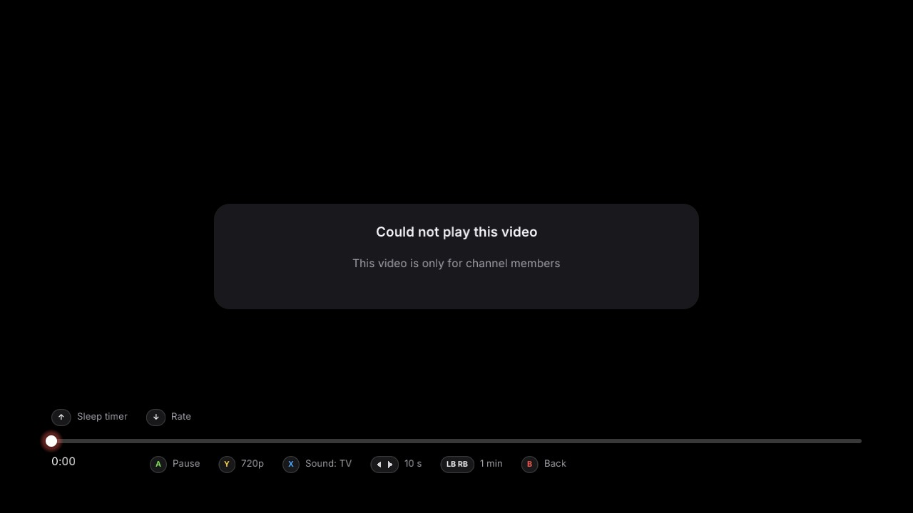
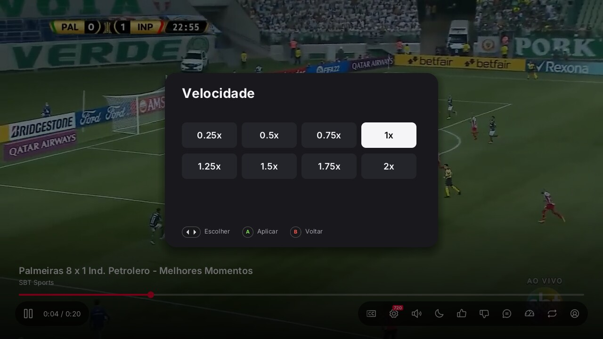
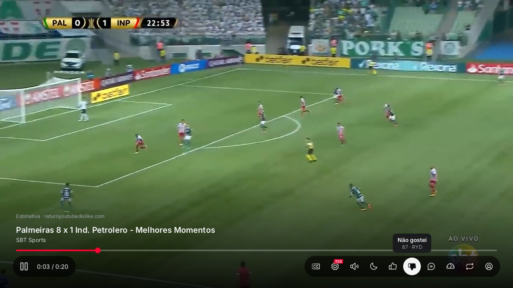
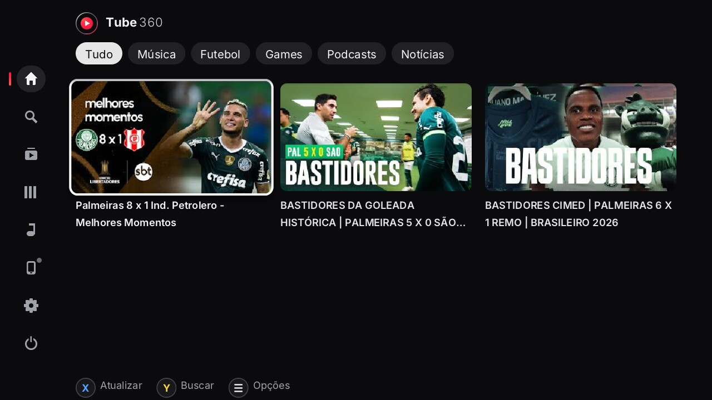
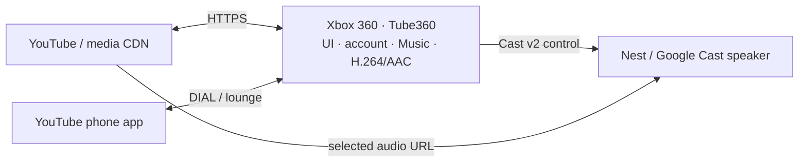

<p align="center"><a href="https://github.com/revive360"></a></p>

# YouTube on Xbox 360. No PC needed.

<p align="center">
  
</p>

<p align="center">
  <a href="https://github.com/revive360/catalog/blob/main/generated/apps/tube360.md"></a>
  <a href="https://github.com/revive360/tube360/releases/latest"></a>
  
  
  <a href="LICENSE"></a>
</p>

<p align="center">
  <b>English</b> · <a href="README.pt-BR.md">Português</a>
</p>

> [!TIP]
> **Tube360 is free and MIT licensed.** If it brought your old console back to life, **give the repo a ⭐**. It's the only thing I ask, and it's how other people find it.

**Tube360** is a native YouTube client for the Xbox 360. Open the `.xex` from Aurora, FSD or XeXMenu and watch YouTube **directly on the console, without a PC**. Your account, history, subscriptions, library, Music, phone Cast and Google Nest sound run on the Xbox too. v0.3.2 is the last version with a companion server.

A [Revive360](https://github.com/revive360) project: open source homebrew for the Xbox 360.

---


> **Privacy in 0.3.3:** automatic error reports are on by default. After a crash or a failed start, on the next launch the launcher sends version, console model/board, screen, error and up to 300 sanitized log lines to `tube360.hypermind.space`. IPs, video IDs, Cast names and tokens are removed before upload. Turn off in **Settings → Error reports** or create `no-error-reports.txt` beside `default.xex`. [Data, retention and scrubber source](docs/PRIVACY.md).

## What's new in 0.3.3

- **Search without holes**: results fill the screen like the Home grid, with no empty row between rows ([#21](https://github.com/revive360/tube360/issues/21))
- **Shorts in their own row**: smaller vertical cards in search, Home, Subscriptions and your library, so regular videos stay the main results. Settings → Show Shorts: In a row or Hide ([#22](https://github.com/revive360/tube360/issues/22))
- **Busy Nest no longer hangs the video**: if the speaker is playing Bluetooth audio from another device or doesn't answer, the video starts on the TV after about 9 seconds with a notice, and X tries the Nest again ([#12](https://github.com/revive360/tube360/issues/12))
- **Clear message for members-only videos**: they can't play on the Xbox yet, and now the app says so instead of a generic error ([#11](https://github.com/revive360/tube360/issues/11))
- **Error reports**: crashes and failed starts can now reach us without you digging for logs. On by default, easy to turn off, nothing personal sent. See the privacy note above ([#41](https://github.com/revive360/tube360/issues/41))
- **Console only, for real**: the PC server option and the notebook sleep options are gone from Settings. v0.3.2 is the last version with the PC server ([#31](https://github.com/revive360/tube360/issues/31))
- **Built by the Revive360 CI**: this release is compiled in the open by the org's GitHub Actions, with a signed build attestation you can verify

## What's new in 0.3.2

- **Real 1080p30**, decoded by the 360 itself. Set the Xbox dashboard to 1080p over HDMI to get the sharp picture. [Console results and limits](docs/CONSOLE-032-FINAL.md)
- **SponsorBlock**: Off, Skip button (default) or automatic skip. Y skips a marked segment or goes back after an automatic skip. [Behavior](bench/sponsorblock/README.md)
- **Your YouTube Music**: recently played, playlists and liked songs. [Details](docs/MUSIC-ACCOUNT.md)
- **Search suggestions and filters** with LB: type, duration, upload date, and relevance or view count order. [Controls](docs/SEARCH.md)
- **Watch later and resume without an account**, saved on the console. Nothing is uploaded. [Storage and clearing](docs/LOCAL-LIBRARY.md)
- **Pick the quality yourself** with Y while watching: 480p, 360p, 240p or 144p, besides the adaptive profiles
- **Hold LT/RT** to rewind or fast forward with a preview of where you will land
- **Arabic**: interface, search keyboard (RB switches to Latin) and Arabic titles in any language. [Arabic support](docs/ARABIC.md)
- **Long videos keep full quality**: files above 2 GiB, like 3 hour videos, used to fail on open or drop to a lighter version. [Cause and fix](bench/opening/README.md)
- **The app updates itself**: Settings → App updates, press A. Updates are signed and roll back on their own if something fails

**Fixed from your reports:** search with your account signed in; quality that dropped and never came back; the app closing on start without a word (now it shows the reason on screen and saves `startup.log`); clearer errors when the console clock is wrong or the network blocks the connection; the old "server" message in console-only mode.

### Updating

From 0.3.2: Settings → App updates, press A.

From 0.3.0 or 0.3.1: copy the whole new `Tube360` folder over the old one **one last time**. Your sign in and settings stay. `default.xex` is now the launcher and `tube360.xex` is the app: keep both side by side with all eight fonts, and never rename one over the other. From then on, updates come from Settings → App updates.

Everything else is in the [CHANGELOG](CHANGELOG.md).

## Tested on, and not tested yet

Everything was tested on the author's Xbox 360 E (Corona board) with BadUpdate. I don't own the other models, so this table also counts what users confirmed:

| Console | Status |
|---|---|
| 360 E and Slim (Corona, Winchester) | Tested on a 360 E. Runs the native video mode |
| Slim S (Trinity) | Confirmed by a user (RGH). Runs the safer video mode |
| Fat (Xenon, Zephyr, Falcon, Jasper) | Jasper confirmed by a user (BadUpdate, CRT at 480i). Xenon, Zephyr and Falcon not confirmed yet. Runs the safer video mode |
| RGH, JTAG, ABadAvatar | RGH confirmed by a user on a Slim Trinity, ABadAvatar by a user on a Corona. JTAG not confirmed yet |
| CRT TVs at 480i | Confirmed by a user on a Fat Jasper. Pick Fill (crop) in Settings to drop the black frame around 4:3 videos |
| HDMI to VGA adapter at 720p | Known crash right after the Vulkan logo, being fixed ([#7](https://github.com/revive360/tube360/issues/7)). With the dashboard at the monitor's own resolution it opens, at 640x480 |

`video-driver.txt` accepts `auto`, `safe` or `native` if you want to force a mode. [Board detection and simulation](docs/BOARD-SIMULATION.md)

### Something broke? Send the logs

1. Right after the crash or freeze, **before opening the app again**, open the `Tube360` folder over FTP. Some logs are overwritten on every launch.
2. Grab `startup.log`, `launcher.log` and every `boot-*.log`.
3. Open an [issue](https://github.com/revive360/tube360/issues) with them, your console model, exploit (BadUpdate, RGH, JTAG or ABadAvatar) and video output (HDMI, component or VGA, and 480/720/1080). A photo of the error screen helps too.

> [!WARNING]
> Never send `yt-console-account.json` or any account, cookie or pairing file. Logs include local paths and the console clock, so take a look before posting. [How to read the startup logs](docs/STARTUP-DIAGNOSTICS.md)

## Highlights

| | |
|---|---|
| 🎮 **100% on Xbox, no Xbox Live** | Install, browse and watch on the console itself. No running PC, Xbox Live login or Xbox Live subscription required. |
| 👤 **Your account on the TV** | Sign in with a TV code; recommendations, subscriptions, history/resume, Watch later, account playlists, likes and dislikes. Tokens stay on the console. |
| 🎞️ **Playback and audio choices** | Adaptive Automatic, 720p60 and 1080p30 profiles, plus fixed 480p/360p/240p/144p sources. Settings and the player's Y menu offer available H.264 qualities during playback; manual choices warn under load and keep their source. 480/720p/1080p output and original/dubbed audio are separate choices. |
| 🔴 **Captions and live** | VOD caption selection, seeking, live-edge action and autoplay. Live captions are not supported yet. |
| 🔊 **Google Nest / Google Cast speaker** | The console sends the selected YouTube audio URL directly to the speaker and follows its clock. No PC or Bluetooth pairing needed. Direct live streams currently use TV sound. |
| 📱 **Official YouTube phone app** | Pair with a TV code or find Tube360 on the local network. Play, pause, seek, volume and queues use the native Xbox receiver. |
| ⏭️ **SponsorBlock** | Skip sponsors, self promotion and subscription reminders with a button or automatically. Segments come from the SponsorBlock community and can be wrong. |
| 🕒 **Watch later without an account** | Save videos and pick up where you stopped, stored on the console. |
| 💬 **Comments and dislike counts** | Read and scroll comments while the video plays. Estimated dislike counts from Return YouTube Dislike are labeled as estimates. |
| ⏩ **0.25×–2× and repeat** | Eight speeds preserve voice pitch; repeat the current video from the player. Changed speed uses TV sound; the sleep timer takes priority over repeat. |
| 📺 **CRT TVs and large text** | 480 output in 4:3, safe margins and larger text. Fit with letterboxing or fill by cropping; large text is also available in HD. 480i/480p follows the Xbox dashboard. |
| 🔐 **Signed automatic updates** | Ed25519-verified YouTube rules at startup and periodically on Home, with automatic fallback. When YouTube changes something, a new signed rule file fixes every console without a new version. |
| 🌙 **Sleep timer** | 15 minutes to 2 hours, or end of video. A warning 60 s before (A adds 15 min, B cancels) while the volume fades, then the console turns itself off. |
| 🏷️ **Members-only badge** | Identifies channel members-only videos while browsing. Uses your account for playback when you have access; a badge does not unlock paid content. |
| 🎵 **Music** | Account Music with a TV-client alternative when the web client refuses the TV grant; recent plays, playlists, likes, mixes, search, radio, audio-only queues and optional lyrics. Public browsing remains available. [Details and limits](docs/MUSIC-ACCOUNT.md). |
| 🧭 **Channels and library** | Channel videos, live streams and playlists, subscription actions, round channel avatars and library artwork. |
| 📡 **Unreliable networks** | Resumes interrupted connections and switches to a lighter quality when needed. |
| ⚡ **YouTube straight to the Xbox** | HTTPS to YouTube, original H.264 video and AAC audio decoded locally with FFmpeg. No real-time PC conversion in normal use. |
| 🛠️ **Native app** | C++20, Vulkan through [vulkan4xenon](https://github.com/xenosworks/vulkan4xenon), SDL3 and full gamepad navigation. Its own Aurora title ID: `0x58545542`. |
| ⚙️ **Settings on the TV** | English/Portuguese/Spanish/Arabic, 2 columns in 4:3, 3/4 in HD, quality, output size, sound, sync and captions. Xbox One / Series button prompts. |

## Screenshots

| Home | Search results |
|---|---|
|  |  |
| **Player** | **On-screen keyboard** |
|  |  |
| **Settings** | **Sign in to YouTube on the TV** |
|  |  |
| **Sleep timer** | **Cast from the phone** |
|  |  |
| **Like or dislike a video** | **Up next automatically** |
|  |  |

| **TV Palmeiras channel** | **Members-only badge** |
|---|---|
|  |  |
| **Google Nest sound** | **Members-only notice** |
|  |  |

| **Comments from your controller** | **0.25× to 2× speed** |
|---|---|
|  |  |
| **Spanish interface** | **4:3 TV with fit** |
|  |  |
| **Estimated dislike count** | **Large text in HD** |
|  |  |

<sub>Captured from the current PC app in console mode (`server=off`), using the same code and renderer as Xbox. Public Palmeiras content; where needed, a fictional Demo account and illustrative codes. Membership badge/refusal examples use synthetic responses and are labeled Demo; the Nest print shows configuration, not a connection to a real speaker. Demonstration comments and counts are fictional, as documented in [capture provenance](docs/SCREENSHOTS.md). No personal account was used. Captures do not measure Xbox performance.</sub>

---

## Why Tube360

Your Xbox 360 can still be the living-room TV. Tube360 brings your account, controller, live streams close to the live edge, original audio and a Cast speaker into one app. Launch its own title in Aurora and watch without keeping another computer on or signing in to Xbox Live.

720p60 and 1080p profiles give you more choices; actual frame rate and resolution depend on the video, network and console load. These adaptive profiles can lower quality to keep playing. Fixed 480p/360p/240p/144p choices retain their source and show a warning if it struggles. The YouTube integration is unofficial and may change.

## How it works



The normal path is native H.264/AAC playback. Automatic prefers detail up to 1080p, while the 720p60 profile favors frame rate and 1080p30 limits source selection to 30 fps. A profile is a preference, not a guarantee of sustained 60 fps: the player can reduce presentation to 30 fps and choose a lighter direct rendition. 720p30 is the console target; performance still needs checking on your console and content.

Choose fixed 480p, 360p, 240p or 144p in Settings or press Y during video playback to open Quality. The video menu lists only direct H.264/AAC choices offered by that video. Manual selection keeps the exact source height, position and pause state; sustained pressure shows a message instead of changing quality. An unavailable saved quality reports an error and Y opens the available choices. Return to Automatic to resume the adaptive ladder. Without an active video, Settings saves a default from all seven choices.

Native **1080p30** now uses the measured Xenon VMX kernels, six FRAME workers on `0,2,4,1,3,5` and a larger bounded frame queue. Known H.264 1080p sources up to 30.1 fps omit the deblocking filter; smaller, unknown-rate and higher-rate sources keep it. Set `h264_loop_filter=full` in `settings.txt` and restart to retain full filtering at 1080p too, at a possible throughput cost. The isolated decoder measured 22.57 ms/frame; integrated playback with UI, sound and network passed the owner’s Xbox check on 2026-11-25. Source decoding also works with 720p output; **native 1080p output requires HDMI and 1080p progressive in the Xbox dashboard**. At 720p dashboard output the app downscales, which can show aliasing in fast motion. See the [final console results](docs/CONSOLE-032-FINAL.md).

[Architecture and qualification](docs/STANDALONE.md).

## Requirements

- Xbox 360 that runs unsigned code: **BadUpdate** (tested with XeUnshackle), **RGH** or **JTAG**.
- Aurora, FSD or XeXMenu to launch `.xex` files; writable storage for settings, account and Cast identity files.
- Internet access on the console and a correct console date/time for HTTPS. Wired networking is preferable for high-bitrate sources; original streams have variable bandwidth requirements.
- For a Nest: a configured Google Cast speaker with internet access, reachable from the Xbox on the same LAN. For phone discovery: phone and Xbox on the same LAN with multicast allowed.
- For native 1080p output: HDMI and **1080p progressive selected in the Xbox dashboard**. Selecting 1080p in Tube360 does not change HDMI timings; unsupported dashboard modes retain a 720p framebuffer.

## Install in 3 steps

### 1. Copy the app folder

Download the ZIP or .7z from [Releases](https://github.com/revive360/tube360/releases), extract it and copy the whole `Tube360` folder to `Hdd1:\Games\Tube360\` or `Usb0:\Apps\Tube360\`. Keep `default.xex` (launcher), `tube360.xex` (app), all four `inter-*.ttf` and four `noto-sans-arabic-*.ttf` fonts and the license notices together. `.example.txt` files remain inactive until renamed.

### 2. Launch from Aurora, FSD or XeXMenu

Add the folder to Aurora’s scan paths and rescan, or open `default.xex` in the file manager. Tube360 has its own title ID: `0x58545542`.

### 3. Pick a video and watch

Connect Xbox to the internet, check its date and time, and browse with your controller. Xbox Live is not required. Search and public videos work without sign-in; your account below is optional.

### YouTube account (optional)

Open **Settings → YouTube account → A**. In a browser on your phone or computer, open the URL shown on the TV (normally [google.com/device](https://www.google.com/device)), enter the displayed code and approve your account. Return to Tube360 for the connected account. No password is entered on the Xbox; a phone is optional for playback.

The local grant is saved in `yt-console-account.json` beside the XEX. Use the app's sign-out action before sharing the folder; never include this file, Cast identities, logs or ownership journals in a release. A TV grant does not guarantee access to every video or every Music endpoint.

> I use it every day with my Premium account, with no warning so far. It is an unofficial client and things can change; use a secondary account if you prefer.

The token stays only on the console, beside the XEX. It is not sent to this website or a Tube360 service. Never share the folder with a saved session.

### Google Nest / Cast speaker (optional)

Find the speaker's IP in **Google Home → device → Settings → Device information** (look for network/IP details), or in your router's connected-device/DHCP list. Menu names vary by Home version. A DHCP reservation keeps the address from changing.

Copy `nest.example.txt` to `nest.txt`, replace the address and keep the two-line layout:

```text
192.0.2.20 8009
Google Cast speaker
```

`192.0.2.20` is a documentation address: replace it with the speaker's actual local IP. The first line is **host, space, port** (8009 if omitted); the second is the display name, which can contain spaces. These first two lines must contain the values, not comments. Then choose **Settings → Sound → Speaker**, or use **X** in the player.

The speaker downloads audio from YouTube itself. It needs its own internet connection as well as working Wi-Fi between the speaker and console. Brief Wi-Fi drops are tolerated, but TV fallback waits for confirmed speaker silence, so an outage can cause a silent interval. **Press B back to browsing before closing the app**, letting STOP reach the speaker. Forced exits or lost Wi-Fi can leave direct audio playing.

### Send from your phone (optional)

Open Tube360's **Phone** panel. In the official YouTube phone app, use **Settings → Watch on TV → Enter TV code** and enter the code from that panel. This is a separate code from account sign-in. On networks with discovery enabled, Tube360 also appears in the Cast menu as `YouTube 360`. No Node receiver is needed in console mode.

### Signed updates

**Settings → App updates** shows the installed version, candidate and download size. **A Update** downloads and verifies Ed25519/SHA-256; **B** goes back or cancels. Home also announces new versions (**LB** opens details). Reopen **default.xex** to install; the next launch restores the previous app if startup is not confirmed.

**Upgrading from v0.3.0/v0.3.1:** close the app, keep the old folder as a backup, then copy the new complete folder one last time. Keep both XEX files and all eight fonts together; preserve your settings/account files if desired, but leave old update journals/candidates behind. Later app updates arrive from inside the app. Allow free space for the installed app, candidate and backup. [Details and recovery](docs/UPDATES.md).

Arabic is available in **Settings → Language** (`lang=ar`). Arabic video titles work in every interface language. Text blocks read right to left; menus and controller directions keep their positions. RB switches the Arabic search keyboard to Latin. Copy the complete folder once when upgrading to add the Noto fonts; executable-only updates cannot add missing font files. Font sources, licenses, memory costs and current limits are in [Arabic text](docs/ARABIC.md).

## Controls

Button prompts use the Xbox One / Series style (Menu / View are Start / Back on a 360 controller).

| Where | Button | Action |
|---|---|---|
| Home / browsing | A · X · Y | Open / watch · Refresh · Search |
| | D-pad left from first column | Side menu |
| | Menu | Card actions: channel, Watch later or radio |
| | B | Back one page |
| Search keyboard | A · X · Y · Menu | Type · Delete · Space · Search |
| Search / results | LB | Filters; A applies, B discards changes |
| Search keyboard | Right past the last key · Up / Down · A | Suggestions and recent searches · Choose · Search now |
| Player | A / Menu | Pause / resume (A activates the focused option when a panel is open) |
| | Direction with hidden bar | Reveal timeline |
| | Left / Right on timeline | −10 s / +10 s |
| | Down from timeline · Up from icon row | Options below the timeline · Return to timeline |
| | Left / Right, then A | Select / activate an icon: captions, quality, sound, timer, audio, like, dislike, channel or live edge |
| | LB / RB | −1 min / +1 min |
| | Y · X | SponsorBlock skip/undo or Quality menu · TV / speaker sound |
| | LT / RT | Hold to rewind / fast-forward; accelerates, release to seek |
| | B | Close one level at a time, then leave the video |
| | View | Return to browsing |
| Music Now playing | B | Stop and clear queue; return to source page |
| Settings | Up / Down · Left / Right · A / B | Choose row · Change value · Open / Back |
| Up next | A / B | Play now / Cancel |
| Sleep warning | A / B | +15 min / Cancel |

## Configuration

Use Settings on the TV; values are saved beside the XEX in `settings.txt`. The packaged [examples](docs/RELEASE.md) explain the editable keys.

**Settings → SponsorBlock** offers **Off**, **Skip button (default)** and **Skip automatically**.
During a marked segment, **Y** skips to its end. Automatic mode shows **Sponsor skipped · Y Go back**
for six seconds after the seek; returning plays that segment without skipping it again during this opening.
Outside that action, Y opens Quality; A applies a choice and B closes the menu. Sponsors, self-promotion and subscription reminders are
enabled; intros/outros are preserved. Marks appear on the timeline. Community submissions may be wrong.
The same player seek works with phone Cast and Nest sound. Live streams and audio-only Music are excluded.
The optional `sponsorblock=off|button|auto` setting is saved with the other preferences.

Segments: [SponsorBlock, sponsor.ajay.app](https://sponsor.ajay.app/), by the SponsorBlock community,
licensed under [CC BY-NC-SA 4.0](https://creativecommons.org/licenses/by-nc-sa/4.0/).
Tube360 uses the public API in this noncommercial project; these data have a separate license from the MIT
app code. Requests contain only four hexadecimal characters of the video ID's SHA-256; matching happens
locally, with a bounded session cache. Unavailable data silently leave playback unchanged.
Lookup runs alongside player resolution without a playback startup wait. On Xbox its worker temporarily
uses priority +3 on HW5, above the decoder/background workers; its previous priority is restored after the
request. One recovery attempt may run after three seconds from selection, even before the first frame.

| File | Purpose |
|---|---|
| `settings.txt` | `lang=en\|pt\|es\|ar`, `cols=3\|4`, legacy `quality=720\|480\|360`, `sound=tv\|nest`, `sync_ms`, `sponsorblock=off\|button\|auto`, `video_mode=auto\|720p60\|1080p30\|480p\|360p\|240p\|144p`, `output_height=480\|720\|1080`, `large_text=on\|off`, `video_fit=fit\|fill`, `h264_loop_filter=auto\|full`, `audio_preference=original\|interface`, `error_reports=on\|off` (default on), captions and timer target. |
| `nest.txt` | Speaker host and optional port on line 1; display name on line 2. |
| `marca.txt` | Optional custom name on line 1 and `retangulo` on line 2. |
| `net_log.txt` | Optional debug UDP destination (`<PC-IP> <port>`). Keep it private. |

Legacy `quality.txt` / `audio.txt` are read when `settings.txt` is absent. Original audio is preferred even when YouTube marks an automatic dub as default. Interface-language audio falls back to original if unavailable. Output size is separate from source quality.

## Building from source

**PC development build**, using SDL3, Vulkan headers, `glslangValidator`, CMake, a C++20 compiler and FFmpeg development libraries (or the script's pinned local build):

```bash
cmake -S client -B client/build -DCMAKE_BUILD_TYPE=Release
cmake --build client/build -j2
XT_ASSETS="$PWD/client/assets" ./client/build/tube360
```

The default assets directory is `client/assets` when run from `client/`; from the repository root set `XT_ASSETS="$PWD/client/assets"`. For isolated testing use a separate writable copy of the fonts and settings. Arrows, Enter=A, Esc=B, Backspace=X, Tab=Y, PageUp/PageDown=LB/RB, F2=Menu, F10=View, Q/E=LT/RT; gamepads work too.

**Xbox build** needs built [xsdk](https://github.com/xenosworks/xsdk), [vulkan4xenon](https://github.com/xenosworks/vulkan4xenon), [SDL-xenon](https://github.com/xenosworks/SDL-xenon), and the xsdk GCC toolchain:

```bash
export XSDK_DIR=~/src/xsdk V4X_DIR=~/src/vulkan4xenon
export SDL3_XENON_DIR=~/src/SDL-xenon/build-xsdk XSDK_TOOLCHAIN=~/xsdk-gcc
TUBE360_VERSION=0.3.2 TUBE360_BUILD_ID=7 TUBE360_F33_BENCH=OFF TUBE360_F40_BENCH=OFF tools/build-xbox.sh
python3 tools/package-xbox.py --version 0.3.2
```

The build produces `client/build-x360/tube360.xex`. The packager installs the launcher as `Tube360/default.xex` and the app as `Tube360/tube360.xex` into `.work/releases/tube360-v0.3.2-xbox360.zip`, with fonts, commented examples and license notices. It copies an explicit file list, never a used app folder. It does not publish. [Build dependencies](docs/BUILD.md) · [Packaging and matching source/relink materials](docs/RELEASE.md)

## Project layout

```text
client/          native Xbox/PC app, UI, player, account, Music, Cast and HTTPS client
server/          legacy companion server (last supported in v0.3.2)
cast/            optional PC account and phone bridge (Node)
bench/, tests/   isolated fixtures and performance checks
docs/            architecture, protocol, build and release instructions
tools/           builds, packaging and optional service installation
```

## Limitations & troubleshooting

- Phone casting: pair with the TV code from the **Phone** panel (YouTube app → Settings → Watch on TV → Enter TV code). The console does not show up by itself in the phone's cast list yet, because it cannot join the network's discovery group. If another receiver on your network uses the same name, the phone may cast to it instead.
- YouTube is an unofficial integration and can change or block clients. Age/region restrictions, DRM and paid content are not bypassed; account sign-in does not guarantee media access. Reload a failed feed or retry later.
- 720p60/1080p30 are source profiles. The Xbox may lower rate or resolution under load. Check the actual player status; native 1080p needs the dashboard HDMI mode described above. No promise of 1080p60, HDR, VP9 or AV1 decoding.
- Music tries the TV music catalogue with the existing grant before falling back to clearly labeled public browsing; account Music was validated on the owner’s Xbox on November 25, 2026; Music/TV recommendation parity is not guaranteed. [Music account behavior](docs/MUSIC-ACCOUNT.md). Lyrics are optional. Live captions and direct live Nest audio are not implemented; live uses TV sound.
- Empty text or app exits at startup: copy all eight fonts beside `default.xex`. HTTPS failures: check the console clock and internet/DNS access.
- Speaker unavailable or silent: check its IP, internet access and Wi-Fi; disable guest/client isolation between Xbox and speaker, then retry X. Do not use Bluetooth pairing. A missing silence confirmation can delay TV sound.
- Speaker still playing after exit: reconnect its Wi-Fi and reopen Tube360 so its saved pending STOP can complete, or stop Cast in Google Home. Press B to leave playback before closing the app; shutdown waits up to five seconds but cannot stop an unreachable speaker.
- Phone cannot find Tube360: use the Phone panel's TV code; allow local discovery and check that both devices can reach YouTube. Keep account and Cast pairing codes separate.
- Xbox won't turn off the TV: the console has no HDMI-CEC; use your TV's no-signal power-off option. Console mode cannot turn off an unrelated PC.

## Roadmap

Next up (0.3.3):

- [ ] Live streams with less delay
- [ ] Smoother step down from 1080p to 720p
- [ ] Music player with a seek bar and more controls
- [ ] Physical tests on Fat consoles, with the logs you send
- [ ] Arabic reviewed by a native speaker

Later:

- [ ] DeArrow (better titles and thumbnails)
- [ ] The console listed by itself in the phone's cast list
- [ ] Automatic speaker discovery, and Nest sound during live streams
- [ ] Your own YouTube Music recommendations with a Premium account

Done in 0.3.2: SponsorBlock, search filters and suggestions, Watch later and resume without an account, Arabic, real 1080p30 and app updates from inside the app. [CHANGELOG.md](CHANGELOG.md) records every delivery.

## AI and verification

**AI-assisted, reviewed and tested on a real console.** AI helps with development; decisions and review are human. Fat board families still have no physical acceptance test; Arabic still needs native-speaker review.

**VirusTotal (0.3.2):** [zip](https://www.virustotal.com/gui/file/a27f8cdc408194523e6f8813cac92f00c8f5e439c3f416349c198b8da2c6e53f) 0/63 · [default.xex](https://www.virustotal.com/gui/file/c710cfc83c4c6a47fa380d99dd1b9aee5110cf339c69dde6e16569d8f8793bde) 0/57 · [tube360.xex](https://www.virustotal.com/gui/file/7ca9fa0e387392494453a75d94869afd0513d1e4126f7274d8e314d4bb2694c7) 0/60. VirusTotal does not open a zip this size, so both executables were scanned on their own. Package hashes accompany the release files.

## Revive360

Tube360 lives in the [Revive360](https://github.com/revive360) organization, a home for open source Xbox 360 homebrew. It moved from `PedroHenrique0713/tube360` on 2026-11-25; old links redirect. [What the move means for older apps](docs/REPOSITORY-TRANSFER.md).

**Risk notice:** Homebrew can lead to an Xbox Live account/console ban, data loss or console damage. Use at your own risk. Revive360 is independent of Microsoft. Software is **as is** under its license; no badge or review guarantees safety, service access or compatibility.

**Privacy:** optional error reports are on by default; [see what is sent and how to disable them](docs/PRIVACY.md). Sign-in credentials and tokens stay on your console; never include them manually in issues or logs.

**Responsibility:** Owner: [@PedroHenrique0713](https://github.com/PedroHenrique0713). License: MIT. Membership is not certification. Security: repository **Security → Report a vulnerability**. Bugs and ideas: [issues](https://github.com/revive360/tube360/issues).

## Credits & license

Tube360 is [MIT licensed](LICENSE). You can use, change and share it. Keep the copyright notice, which means giving credit. Third-party parts and their licenses are listed in [THIRD_PARTY.md](THIRD_PARTY.md). Thanks to **pl_mpeg**, **yt-dlp**, **YouTube.js**, **yt-cast-receiver**, **FFmpeg**, **PyChromecast**, and the **xsdk / vulkan4xenon / SDL-xenon** projects, which made modern homebrew on the 360 possible.

Built by [@PedroHenrique0713](https://github.com/PedroHenrique0713).

> [!IMPORTANT]
> Tube360 is an independent project. It is not affiliated with, endorsed by, or sponsored by Google, YouTube or Microsoft. "YouTube" and "Xbox" are trademarks of their owners. Use it for personal use, at your own risk, and respect the terms of the services you connect to.

<p align="center"><b>Found it useful? A ⭐ on the repo is the best thank-you.</b></p>
