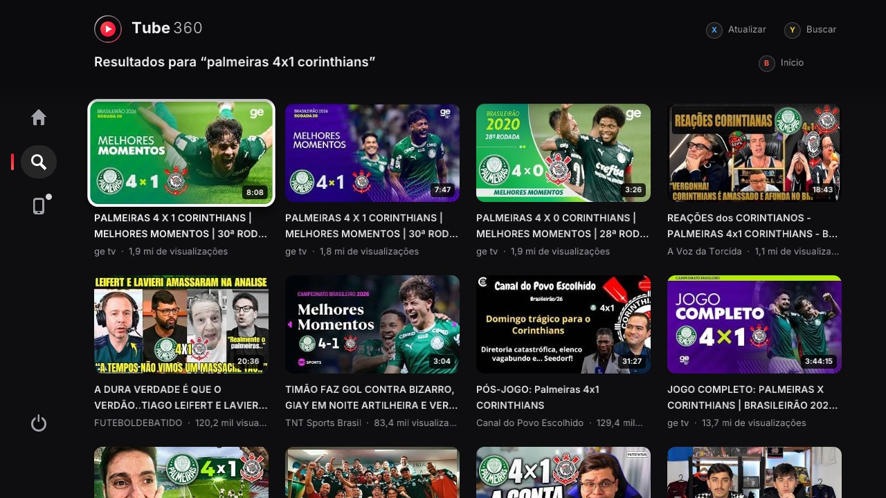
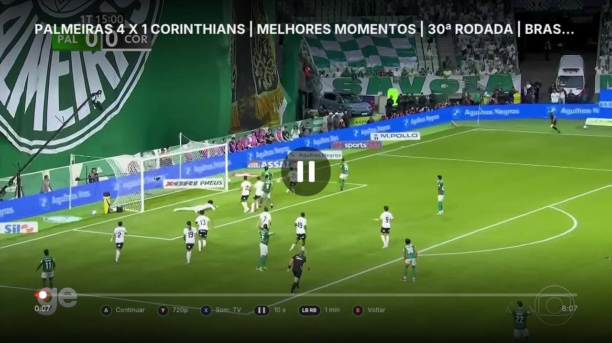
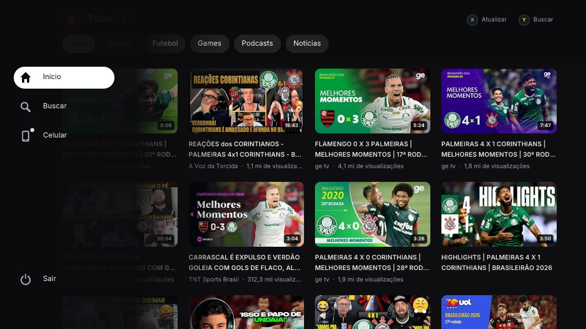
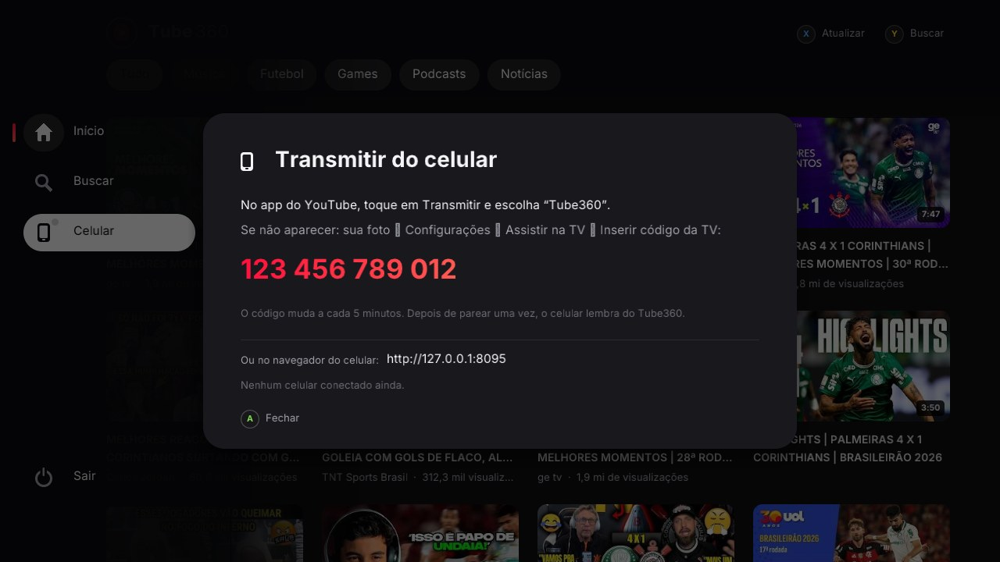
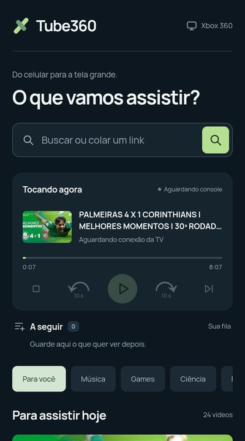
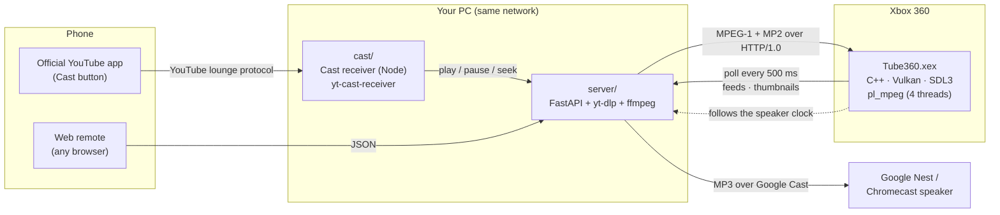

<p align="center">
  
</p>

<p align="center">
  <a href="https://github.com/PedroHenrique0713/tube360/stargazers"></a>
  
  
  <a href="LICENSE"></a>
</p>

<p align="center">
  <b>English</b> · <a href="README.pt-BR.md">Português</a>
</p>

> [!TIP]
> **Tube360 is free and MIT licensed.** If it brought your old console back to life, **give the repo a ⭐**. It's the only thing I ask, and it's how other people find it.

**Tube360** is a native YouTube client for the Xbox 360. It is a real `.xex` that opens from Aurora like any game. It has a YouTube-style home grid, search with an on-screen keyboard, and a player that decodes **720p at 30 fps on the console's own CPU**. A small server on your PC does the heavy lifting. You can also pick videos **from the official YouTube app on your phone** with the normal Cast button, and send the sound to a **Google Nest / Chromecast speaker** while the picture stays on the TV, in sync.

No TV stick, no smart TV, no browser. Just the Xbox 360 you already have.

---

## Highlights

| | |
|---|---|
| 📺 **Native app, not a web page** | C++ with Vulkan (on the Xenos GPU through [vulkan4xenon](https://github.com/xenosworks/vulkan4xenon)) and SDL3. Shows up in Aurora with its own title ID (`0x58545542`), cover, and background. |
| ⚡ **720p at 30 fps on a 2005 CPU** | The MPEG-1 decoder is split across 4 of the Xenon's hardware threads, slice by slice. Each frame takes ~22 ms, down from ~40 ms on a single thread. |
| 📱 **Cast from the official YouTube app** | Tube360 shows up in the phone's Cast menu like a smart TV. Pair once with a TV code (or let the phone find it on Wi-Fi). Play, pause, seek, volume and "up next" all work from the phone. |
| 🔊 **Sound on a Google speaker, in sync** | The speaker plays the audio and the console follows its clock. The lip-sync offset can be tuned live with the triggers. If the speaker drops, the sound falls back to the TV on its own. |
| ♾️ **Feels like YouTube** | Endless home grid, category chips, search history, thumbnails that load ahead of you, and a side menu. Button prompts in the Xbox One / Series style. |
| 🪶 **Light on your PC** | Idle: ~140 MB RAM and ~0% CPU. Streaming 720p: ffmpeg uses about 1 thread. It runs as a low-priority systemd user service with a memory cap. |

## Screenshots

| Home | Search results |
|---|---|
|  |  |
| **On-screen keyboard** | **Player** |
|  |  |
| **Side menu** | **Cast from the phone** |
|  |  |

<p align="center"><br><sub>Also included: a web remote, for phones that don't have the YouTube app.</sub></p>

<sub>These screenshots come from the PC build of the client, which runs the same code and renderer as the console build. The demo feed is the author's choice: Palmeiras 4×1 Corinthians and Flamengo 0×3 Palmeiras. 🟢⚪</sub>

---

## How it works



### Why MPEG-1?

The Xbox 360 has no open-source H.264/VP9 decoder that homebrew can use. MPEG-1 is old, but it is simple enough to decode on the CPU, and [pl_mpeg](https://github.com/phoboslab/pl_mpeg) is a single-header decoder that builds with the console toolchain without changes. So the PC asks YouTube for the video with `yt-dlp`, and `ffmpeg` converts it on the fly. The stream starts in a few seconds and is never converted in full ahead of time.

| Quality | Size | Video bitrate | Notes |
|---|---|---|---|
| **720p** (default) | 1280×720 | 5.5 Mbit/s | 30 fps, GOP 15, 2 B-frames |
| 480p | 854×480 | 2.5 Mbit/s | toggle with **Y** in the player |
| 360p | 640×360 | 1.5 Mbit/s | |

Audio is MP2, 44.1 kHz stereo, 192 kbit/s, in the same MPEG-PS stream.

### Decoding 720p on the Xenon

Out of the box, pl_mpeg decodes real YouTube 720p content at about **40 ms per frame** on one hardware thread. That is too slow for 30 fps. Tube360 patches it in two places (`client/third_party/pl_mpeg.h`):

1. **Slice-parallel decoding.** MPEG-1 pictures are made of independent slices, one per row of macroblocks. The decoder thread finds the slice start codes, splits the picture into jobs, and runs them on 3 helper threads, each pinned to a different hardware thread (`xsdk_thread_move`). Each job gets its own copy of the bit reader, so there is no locking inside the hot loop. Result: **21–23 ms per frame** at 720p.
2. **B-frame skipping under pressure.** If the decoder falls more than 40 ms behind the clock (120 ms in speaker mode), it skips the next B-frame. A B-frame is never used as a reference, so skipping it never breaks the picture. In normal playback none are skipped.

Each heavy thread is pinned on purpose. Main/render runs on HW 0, the decoder on HW 2, the slice helpers on HW 3, 1 and 4, network on HW 4. Without pinning, xsdk threads stay on the core that created them.

### Sound on a Google speaker, in sync

When a Google Nest or Chromecast is set in `config.json`, the server sends it **only the audio**, as MP3 through Google Cast. The console gets **only the video**. The console then uses the speaker as the master clock:

- It asks the server for the speaker position every 200 ms.
- Responses that took more than 120 ms are thrown away, because Wi-Fi jitter would make the clock jump.
- Small differences are smoothed in slowly (5% per sample). A real jump only re-anchors after two samples in a row disagree by more than 0.5 s.
- If the speaker stops answering, the video keeps going on the console's own clock. If the speaker fails, the sound moves back to the TV and an on-screen message says so.

In a measured 720p run: 150 frames every 5 s, 0 skipped B-frames, 0 clock jumps.

### Cast from the official app

`cast/receptor.mjs` uses [yt-cast-receiver](https://github.com/patrickkfkan/yt-cast-receiver) to speak the YouTube "Watch on TV" (lounge) protocol, and turns each phone command into a console command. The console's **Phone** panel shows a TV code. Enter it once on the phone (YouTube → Settings → Watch on TV → Enter TV code), and the phone remembers the device. On networks that pass multicast, the phone also finds Tube360 on its own through DIAL (port 8098).

---

## Requirements

**Console**
- An Xbox 360 that runs unsigned code: **BadUpdate** (tested with XeUnshackle), **RGH** or **JTAG**.
- **Aurora** (or another dashboard that launches `.xex` files).
- Network: about 6 Mbit/s for 720p. Wired or Wi-Fi both work.

**PC (on the same network)**
- Linux. Tested on Fedora. The server is plain Python and should also run on macOS or Windows, but the service scripts are systemd only.
- Python 3.11+ and `ffmpeg` in `PATH`.
- Node.js 18+ for the Cast receiver (optional).

## Quick start

### 1. Server on the PC

```bash
git clone https://github.com/PedroHenrique0713/tube360.git
cd tube360
python -m pip install -r server/requirements.txt
cp server/config.example.json server/config.json   # edit if you want (see Configuration)
./server/run.sh                                     # listens on port 8091
```

Open `http://<your-PC-IP>:8091` on your phone to check it: that is the web remote.

### 2. Cast receiver (optional, for the official YouTube app)

```bash
cd cast && npm install && cd ..
node cast/receptor.mjs
```

### 3. Run both as services (start on login, low priority)

```bash
TUBE360_NAME="Living Room TV" tools/install-services.sh
```

### 4. Console

1. Get `default.xex` from the [Releases](https://github.com/PedroHenrique0713/tube360/releases) page, or [build it](#building-from-source).
2. Make a folder such as `Hdd1:\Games\Tube360\` and copy into it:
   - `default.xex`
   - `client/assets/inter-300.ttf`, `inter-400.ttf`, `inter-600.ttf`, `inter-700.ttf`
   - a `server.txt` file with your PC's IP and port, e.g. `192.168.0.10 8091`
3. In Aurora, add the folder to your scan paths (or rescan). Tube360 appears as a game.

> [!NOTE]
> On Linux with firewalld, open the ports: `sudo firewall-cmd --add-port=8091/tcp --add-port=8098/tcp --add-service=ssdp --permanent && sudo firewall-cmd --reload`.

## Controls

Button prompts in the app use the Xbox One / Series style.

| Where | Button | Action |
|---|---|---|
| **Home** | A | Watch |
| | X | Refresh the home feed |
| | Y | Search |
| | D-pad ← (on the first column) | Side menu (Home · Search · Phone · Exit) |
| | D-pad ↑ (on the first row) | Category chips |
| | View | Exit to Aurora |
| **Search** | A / X / Y | Type / Delete / Space |
| | Menu | Search |
| | B | Back |
| **Player** | A or Menu | Pause / resume |
| | D-pad ← → | −10 s / +10 s |
| | LB / RB | −1 min / +1 min |
| | Y | 720p ↔ 480p |
| | X | Sound on TV ↔ speaker |
| | LT / RT | Speaker lip-sync −40 ms / +40 ms (saved) |
| | B or View | Back to the grid |

## Configuration

**Next to the `.xex` on the console** (plain text files, all optional except `server.txt`):

| File | Content | What it does |
|---|---|---|
| `server.txt` | `192.168.0.10 8091` | Where the server is. |
| `quality.txt` | `720`, `480` or `360` | Default quality. |
| `audio.txt` | `nest 0` or `tv 0` | Where the sound goes, plus the speaker lip-sync offset in ms. Written by the app when you press X or LT/RT. |
| `marca.txt` | line 1: a name; line 2 (optional): `retangulo` | Custom name and logo style in the app's header. |
| `net_log.txt` | `192.168.0.10 7400` | Sends the app's log over UDP to your PC (debugging). |

**`server/config.json`** (copy it from `config.example.json`):

| Key | Meaning |
|---|---|
| `home_queries` | Topics the home grid is built from. Six are picked at random on each refresh. |
| `warm_queries` | Searches preloaded in the background while the console is in use, so the category chips open instantly. |
| `nest` | `{"host": "192.168.0.20", "name": "Living Room speaker"}`. Use the IP, because many home networks block mDNS. |
| `brand` | Name shown on the web remote. |

## Building from source

**PC build** (same UI, for development, with a window and Mesa's Vulkan):

```bash
cmake -S client -B client/build -DCMAKE_BUILD_TYPE=Release
cmake --build client/build -j
XT_SERVER=127.0.0.1:8091 ./client/build/tube360
```

Needs SDL3, the Vulkan headers and `glslangValidator`. Keyboard: arrows, Enter = A, Esc = B, Backspace = X, Tab = Y, PageUp/PageDown = LB/RB, F2 = Menu, F10 = View. A gamepad also works.

**Xbox 360 build** needs the [xsdk](https://github.com/xenosworks/xsdk) toolchain, plus [vulkan4xenon](https://github.com/xenosworks/vulkan4xenon) and [SDL-xenon](https://github.com/xenosworks/SDL-xenon), already built:

```bash
export XSDK_DIR=~/src/xsdk V4X_DIR=~/src/vulkan4xenon SDL3_XENON_DIR=~/src/SDL-xenon/build-xsdk XSDK_TOOLCHAIN=~/xsdk-gcc
tools/build-xbox.sh          # → client/build-x360/tube360.xex
```

The shaders are GLSL, compiled for the Xenos GPU by vulkan4xenon's `build_shaders.py`.

## Project layout

```
client/          the console app (C++20): src/main.cpp (UI), gfx.hpp (Vulkan 2D renderer), player.hpp (decode, A/V, speaker sync)
client/third_party/pl_mpeg.h   pl_mpeg with Tube360's slice-parallel and B-skip patches
server/          FastAPI server: feeds, thumbnails, ffmpeg streams, Google Cast audio, remote
cast/            Cast receiver for the official YouTube app (Node)
bench/           the first decode benchmark run on the console
docs/PROTOCOL.md the console ⇄ server protocol
tools/           console build and service installer
```

## Roadmap

- [ ] Sign in with a YouTube account: history, subscriptions, Watch later
- [ ] Settings screen: 3 or 4 videos per row, quality, sound
- [ ] English UI (the interface is in Brazilian Portuguese today)
- [ ] Subtitles

Pull requests are welcome.

## Credits & license

Tube360 is [MIT licensed](LICENSE). You can use, change and share it. Keep the copyright notice, which means giving credit. Third-party parts and their licenses are listed in [THIRD_PARTY.md](THIRD_PARTY.md). Thanks to **pl_mpeg**, **yt-dlp**, **yt-cast-receiver**, **FFmpeg**, **PyChromecast**, and the **xsdk / vulkan4xenon / SDL-xenon** projects, which made modern homebrew on the 360 possible.

Built by [Pedro Henrique Quadro](https://github.com/PedroHenrique0713).

> [!IMPORTANT]
> Tube360 is an independent project. It is not affiliated with, endorsed by, or sponsored by Google, YouTube or Microsoft. "YouTube" and "Xbox" are trademarks of their owners. Use it for personal use, at your own risk, and respect the terms of the services you connect to.

<p align="center"><b>Found it useful? A ⭐ on the repo is the best thank-you.</b></p>
