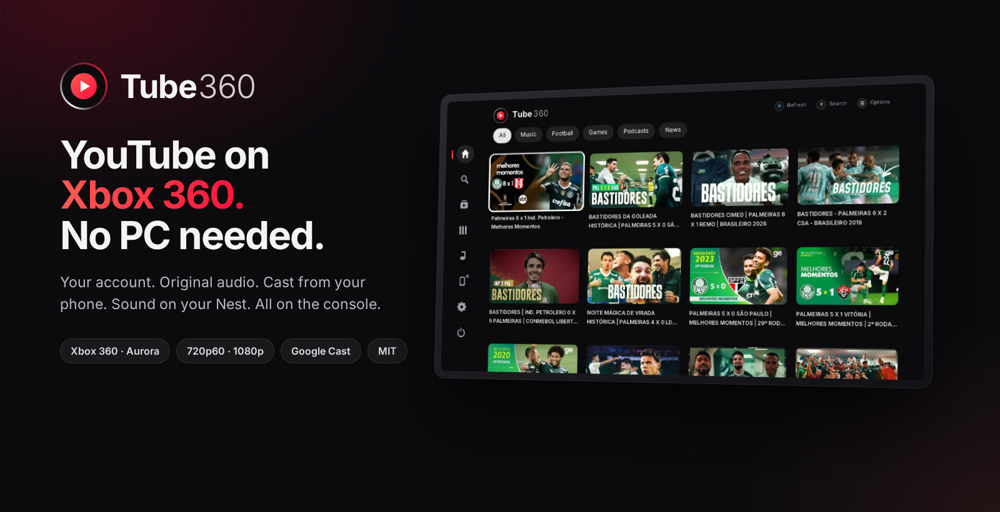
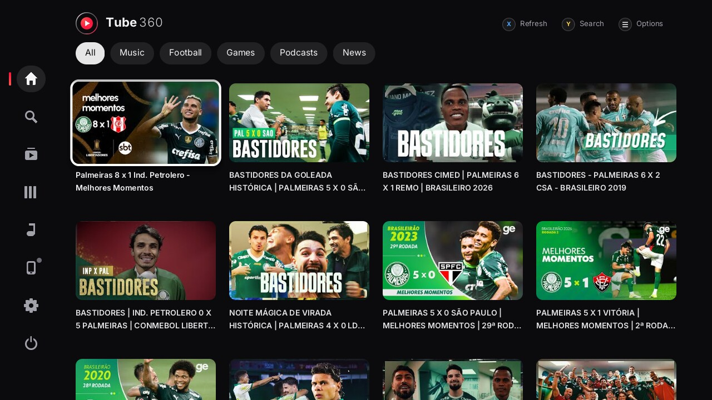
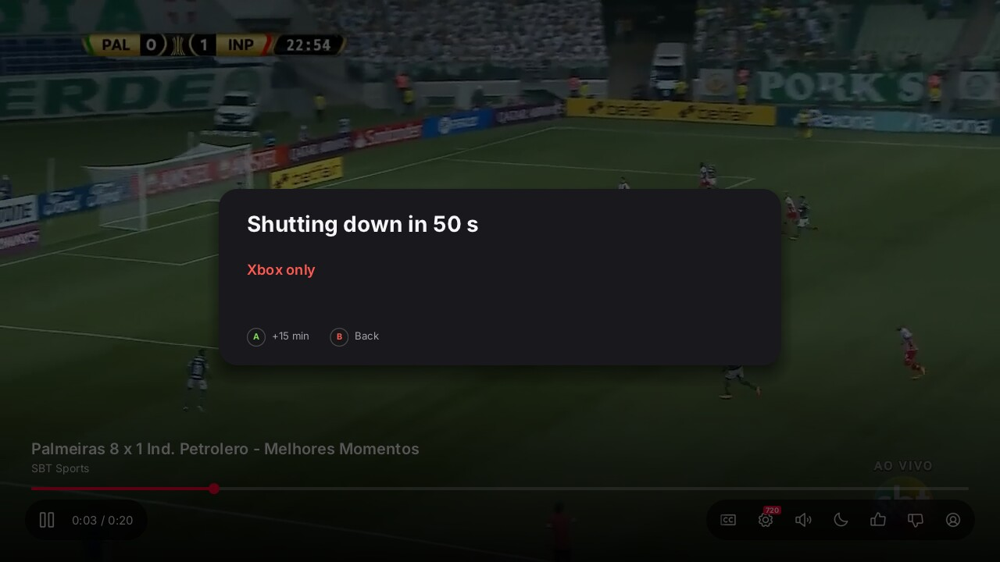
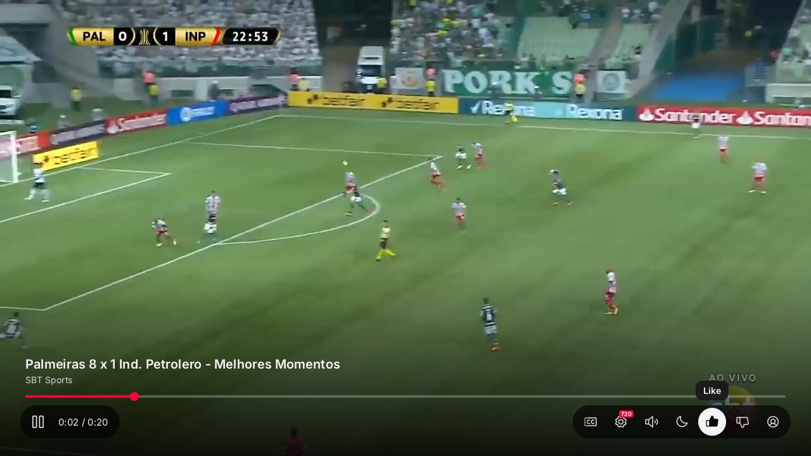
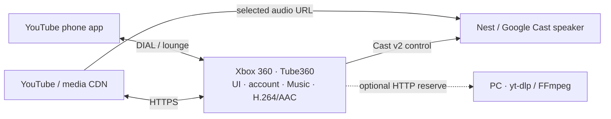

# YouTube on Xbox 360. No PC needed.

<p align="center">
  
</p>

<p align="center">
  <a href="https://github.com/PedroHenrique0713/tube360/releases"></a>
  <a href="https://github.com/PedroHenrique0713/tube360/stargazers"></a>
  
  
  <a href="LICENSE"></a>
</p>

<p align="center">
  <b>English</b> · <a href="README.pt-BR.md">Português</a>
</p>

> [!TIP]
> **Tube360 is free and MIT licensed.** If it brought your old console back to life, **give the repo a ⭐**. It's the only thing I ask, and it's how other people find it.

**Tube360** is a native YouTube client for the Xbox 360. Open the `.xex` from Aurora, FSD or XeXMenu and watch YouTube **directly on the console, without a PC**. Your account, history, subscriptions, library, Music, phone Cast and Google Nest sound run on the Xbox too. A PC server is an optional playback reserve.

---

## Highlights

| | |
|---|---|
| 🎮 **100% on Xbox, no Xbox Live** | Install, browse and watch on the console itself. No running PC, Xbox Live login or Xbox Live subscription required. |
| 🏷️ **Members-only badge** | Identifies channel members-only videos while browsing. Uses your account for playback when you have access; a badge does not unlock paid content. |
| 📡 **Unreliable networks** | Resumes interrupted connections and switches to a lighter quality when needed. |
| 📺 **Native app** | C++20, Vulkan through [vulkan4xenon](https://github.com/xenosworks/vulkan4xenon), SDL3 and full gamepad navigation. Its own Aurora title ID: `0x58545542`. |
| ⚡ **YouTube straight to the Xbox** | HTTPS to YouTube, original H.264 video and AAC audio decoded locally with FFmpeg. No real-time PC conversion in normal use. |
| 👤 **Your account on the TV** | Sign in with a TV code; recommendations, subscriptions, history/resume, Watch later, account playlists, likes and dislikes. Tokens stay on the console. |
| 🧭 **Channels and library** | Channel videos, live streams and playlists, subscription actions, round channel avatars and library artwork. |
| 🎵 **Music** | Quick picks, Explore/charts, mixes, song/album/artist search, radio and local queues, audio-only Now playing and optional lyrics. |
| 📱 **Official YouTube phone app** | Pair with a TV code or find Tube360 on the local network. Play, pause, seek, volume and queues use the native Xbox receiver. |
| 🔊 **Google Nest / Google Cast speaker** | The console sends the selected YouTube audio URL directly to the speaker and follows its clock. No PC or Bluetooth pairing needed. Direct live streams currently use TV sound. |
| 🎞️ **Playback and audio choices** | Automatic, 720p60 and 1080p30 source profiles; 720p/1080p output; original audio by default, with offered dubbed tracks selectable in the player. Actual resolution and frame rate adapt to the source, network and console load. |
| 💬 **Captions and live** | VOD caption selection, seeking, live-edge action and autoplay. Live captions are not supported yet. |
| 🌙 **Sleep timer** | 15 minutes to 2 hours, or end of video. A warning 60 s before (A adds 15 min, B cancels) while the volume fades, then the console turns itself off. |
| ⚙️ **Settings on the TV** | English/Portuguese, 3/4 columns, quality, output size, sound, sync and captions. Xbox One / Series button prompts. |

## Screenshots

| Home | Search results |
|---|---|
|  |  |
| **Player** | **On-screen keyboard** |
|  |  |
| **Settings** | **Sign in to YouTube on the TV** |
|  |  |
| **Sleep timer** | **Cast from the phone** |
|  |  |
| **Like or dislike a video** | **Up next automatically** |
|  |  |

| **TV Palmeiras channel** | **Members-only badge** |
|---|---|
|  |  |
| **Google Nest sound** | **Members-only notice** |
|  |  |

<sub>Captured from the current PC app in console mode (`server=off`), using the same code and renderer as Xbox. Public Palmeiras content; where needed, a fictional Demo account and illustrative codes. Membership badge/refusal examples use synthetic responses and are labeled Demo; the Nest print shows configuration, not a connection to a real speaker. No personal account was used. Captures do not measure Xbox performance.</sub>

---

## Why Tube360

Your Xbox 360 can still be the living-room TV. Tube360 brings your account, controller, live streams close to the live edge, original audio and a Cast speaker into one app. Launch its own title in Aurora and watch without keeping another computer on or signing in to Xbox Live.

720p60 and 1080p profiles give you more choices; actual frame rate and resolution depend on the video, network and console load. The app can lower quality to keep playing. The YouTube integration is unofficial and may change.

## How it works



The normal path is native H.264/AAC playback. Automatic prefers detail up to 1080p, while the 720p60 profile favors frame rate and 1080p30 limits source selection to 30 fps. A profile is a preference, not a guarantee of sustained 60 fps: the player can reduce presentation to 30 fps and choose a lighter direct rendition before trying a configured PC reserve. 720p30 is the console target; performance still needs checking on your console and content.

MPEG-1 + MP2 is the compatibility path supplied by the optional server, up to 720p30. The older slice-parallel pl_mpeg decoder remains for that path. It is no longer the main YouTube playback route. [Architecture and qualification](docs/STANDALONE.md) · [Optional server protocol](docs/PROTOCOL.md)

## Requirements

- Xbox 360 that runs unsigned code: **BadUpdate** (tested with XeUnshackle), **RGH** or **JTAG**.
- Aurora, FSD or XeXMenu to launch `.xex` files; writable storage for settings, account and Cast identity files.
- Internet access on the console and a correct console date/time for HTTPS. Wired networking is preferable for high-bitrate sources; original streams have variable bandwidth requirements.
- For a Nest: a configured Google Cast speaker with internet access, reachable from the Xbox on the same LAN. For phone discovery: phone and Xbox on the same LAN with multicast allowed.
- For native 1080p output: HDMI and **1080p progressive selected in the Xbox dashboard**. Selecting 1080p in Tube360 does not change HDMI timings; unsupported dashboard modes retain a 720p framebuffer.

## Install in 3 steps

### 1. Copy the app folder

Download the ZIP or .7z from [Releases](https://github.com/PedroHenrique0713/tube360/releases), extract it and copy the whole `Tube360` folder to `Hdd1:\Games\Tube360\` or `Usb0:\Apps\Tube360\`. Keep `default.xex`, all four `inter-*.ttf` fonts and the license notices together. **Leave `server.txt` absent** for console-only use; `.example.txt` files remain inactive until renamed.

### 2. Launch from Aurora, FSD or XeXMenu

Add the folder to Aurora’s scan paths and rescan, or open `default.xex` in the file manager. Tube360 has its own title ID: `0x58545542`.

### 3. Pick a video and watch

Connect Xbox to the internet, check its date and time, and browse with your controller. Xbox Live is not required. Search and public videos work without sign-in; your account below is optional.

### YouTube account (optional)

Open **Settings → YouTube account → A**. In a browser on your phone or computer, open the URL shown on the TV (normally [google.com/device](https://www.google.com/device)), enter the displayed code and approve your account. Return to Tube360 for the connected account. No password is entered on the Xbox; a phone is optional for playback.

The local grant is saved in `yt-console-account.json` beside the XEX. Use the app's sign-out action before sharing the folder; never include this file, Cast identities, logs or ownership journals in a release. A TV grant does not guarantee access to every video or every Music endpoint.

> I use it every day with my Premium account, with no warning so far. It is an unofficial client and things can change; use a secondary account if you prefer.

The token stays only on the console, beside the XEX. It is not sent to this website or a Tube360 service. Never share the folder with a saved session.

### Google Nest / Cast speaker (optional)

Find the speaker's IP in **Google Home → device → Settings → Device information** (look for network/IP details), or in your router's connected-device/DHCP list. Menu names vary by Home version. A DHCP reservation keeps the address from changing.

Copy `nest.example.txt` to `nest.txt`, replace the address and keep the two-line layout:

```text
192.0.2.20 8009
Google Cast speaker
```

`192.0.2.20` is a documentation address: replace it with the speaker's actual local IP. The first line is **host, space, port** (8009 if omitted); the second is the display name, which can contain spaces. These first two lines must contain the values, not comments. Then choose **Settings → Sound → Speaker**, or use **X** in the player.

The speaker downloads audio from YouTube itself. It needs its own internet connection as well as working Wi-Fi between the speaker and console. Brief Wi-Fi drops are tolerated, but TV fallback waits for confirmed speaker silence, so an outage can cause a silent interval. **Press B back to browsing before closing the app**, letting STOP reach the speaker. Forced exits or lost Wi-Fi can leave direct audio playing.

### Send from your phone (optional)

Open Tube360's **Phone** panel. In the official YouTube phone app, use **Settings → Watch on TV → Enter TV code** and enter the code from that panel. This is a separate code from account sign-in. On networks with discovery enabled, Tube360 also appears in the Cast menu as `YouTube 360`. No Node receiver is needed in console mode.

## Controls

Button prompts use the Xbox One / Series style (Menu / View are Start / Back on a 360 controller).

| Where | Button | Action |
|---|---|---|
| Home / browsing | A · X · Y | Open / watch · Refresh · Search |
| | D-pad left from first column | Side menu |
| | Menu | Card actions: channel, Watch later or radio |
| | B | Back one page |
| Search keyboard | A · X · Y · Menu | Type · Delete · Space · Search |
| Player | A / Menu | Pause / resume (A activates the focused option when a panel is open) |
| | Direction with hidden bar | Reveal timeline |
| | Left / Right on timeline | −10 s / +10 s |
| | Down from timeline · Up from icon row | Options below the timeline · Return to timeline |
| | Left / Right, then A | Select / activate an icon: captions, quality, sound, timer, audio, like, dislike, channel or live edge |
| | LB / RB | −1 min / +1 min |
| | Y · X | Toggle quality · TV / speaker sound |
| | LT / RT | Speaker sync −40 ms / +40 ms (saved) |
| | B | Close one level at a time, then leave the video |
| | View | Return to browsing |
| Music Now playing | B | Stop and clear queue; return to source page |
| Settings | Up / Down · Left / Right · A / B | Choose row · Change value · Open / Back |
| Up next | A / B | Play now / Cancel |
| Sleep warning | A / B | +15 min / Cancel |

## Configuration

Use Settings on the TV; values are saved beside the XEX in `settings.txt`. The packaged [examples](docs/RELEASE.md) explain the editable keys.

| File | Purpose |
|---|---|
| `settings.txt` | `lang=en|pt`, `cols=3|4`, `quality=720|480|360`, `sound=tv|nest`, `sync_ms`, `server=auto|off`, `video_mode=auto|720p60|1080p30`, `output_height=720|1080`, `audio_preference=original|interface`, captions and timer target. |
| `nest.txt` | Speaker host and optional port on line 1; display name on line 2. |
| `server.txt` | Optional reserve PC IP and port on the first line, e.g. `192.0.2.10 8091`. Without it, console only. `server=off` also disables the reserve when the address is present. |
| `marca.txt` | Optional custom name on line 1 and `retangulo` on line 2. |
| `net_log.txt` | Optional debug UDP destination (`<PC-IP> <port>`). Keep it private. |

Legacy `quality.txt` / `audio.txt` are read when `settings.txt` is absent. Original audio is preferred even when YouTube marks an automatic dub as default. Interface-language audio falls back to original if unavailable. Output size is separate from source quality.

## Optional PC server (reserve)

Set this up only if you want a reserve for blocked or incompatible direct media. Console account, phone Cast and Nest work without it. Some account/navigation operations in `server=auto` still use PC services; no `server.txt` is the clearest way to keep everything native.

Linux is the tested host (Fedora). Install Python 3.11+, FFmpeg and Node.js 22+ in PATH:

```bash
git clone https://github.com/PedroHenrique0713/tube360.git
cd tube360
python3 -m venv .venv
.venv/bin/pip install -r server/requirements.txt
cp server/config.example.json server/config.json
TUBE360_PYTHON="$PWD/.venv/bin/python" ./server/run.sh
```

For the optional server's account/navigation bridge, in another terminal:

```bash
cd cast
npm install
node receptor.mjs
```

Open `http://<PC-IP>:8091` to see status. On the Xbox, copy `server.example.txt` to `server.txt`, put the PC's actual IP and `8091` on its first line, and select **Server → Automatic**. Direct sources are tried before the reserve. Keep PC and Xbox on the same LAN and allow TCP 8091 from the Xbox through the host firewall.

`server/config.json` controls server-side `language`, `home_queries`, `warm_queries`, `brand`, optional `nest` (`host` and `name`), and `cookies_file` / `cookies_from_browser` if YouTube challenges the server. Browser cookies are not copied to the console. Nest in this file is only for reserve playback; the console uses `nest.txt` for direct playback. The HTTP API has no account authentication; keep it on a trusted LAN. Native phone discovery uses UDP 1900/TCP 8134; the optional Node receiver uses 8098 and can advertise a second device, so it is unnecessary for native phone pairing.

`tools/install-services.sh` is optional Linux/systemd setup. PC shutdown at timer expiry and laptop-lid inhibition apply only to the server path. A remote host or Termux setup is experimental, needs extra networking/security configuration, and cannot replace a local Cast connection to your speaker. See [protocol](docs/PROTOCOL.md).

## Building from source

**PC development build**, using SDL3, Vulkan headers, `glslangValidator`, CMake, a C++20 compiler and FFmpeg development libraries (or the script's pinned local build):

```bash
cmake -S client -B client/build -DCMAKE_BUILD_TYPE=Release
cmake --build client/build -j3
XT_ASSETS="$PWD/client/assets" ./client/build/tube360
```

The default assets directory is `client/assets` when run from `client/`; from the repository root set `XT_ASSETS="$PWD/client/assets"`. For isolated testing use a separate writable copy of the fonts and settings. Arrows, Enter=A, Esc=B, Backspace=X, Tab=Y, PageUp/PageDown=LB/RB, F2=Menu, F10=View; gamepads work too.

**Xbox build** needs built [xsdk](https://github.com/xenosworks/xsdk), [vulkan4xenon](https://github.com/xenosworks/vulkan4xenon), [SDL-xenon](https://github.com/xenosworks/SDL-xenon), and the xsdk GCC toolchain:

```bash
export XSDK_DIR=~/src/xsdk V4X_DIR=~/src/vulkan4xenon
export SDL3_XENON_DIR=~/src/SDL-xenon/build-xsdk XSDK_TOOLCHAIN=~/xsdk-gcc
tools/build-xbox.sh
python3 tools/package-xbox.py --version 0.3.0
```

The build produces `client/build-x360/tube360.xex`. The packager copies it as `Tube360/default.xex` into `.work/releases/tube360-v0.3.0-xbox360.zip`, with fonts, commented examples and license notices. It copies an explicit file list, never a used app folder. It does not publish. [Build dependencies](docs/BUILD.md) · [Packaging and matching source/relink materials](docs/RELEASE.md)

## Project layout

```text
client/          native Xbox/PC app, UI, player, account, Music, Cast and HTTPS client
server/          optional FastAPI / yt-dlp / FFmpeg reserve
cast/            optional PC account and phone bridge (Node)
bench/, tests/   isolated fixtures and performance checks
docs/            architecture, protocol, build and release instructions
tools/           builds, packaging and optional service installation
```

## Limitations & troubleshooting

- YouTube is an unofficial integration and can change or block clients. Age/region restrictions, DRM and paid content are not bypassed; account sign-in does not guarantee media access. Reload a failed feed or retry later; an optional server reserve may help.
- 720p60/1080p30 are source profiles. The Xbox may lower rate or resolution under load. Check the actual player status; native 1080p needs the dashboard HDMI mode described above. No promise of 1080p60, HDR, VP9 or AV1 decoding.
- Music can fall back to public browsing when the account's TV grant is refused by Music. Lyrics are optional. Live captions and direct live Nest audio are not implemented; live uses TV sound.
- Empty text or app exits at startup: copy all four fonts beside `default.xex`. HTTPS failures: check the console clock and internet/DNS access.
- Speaker unavailable or silent: check its IP, internet access and Wi-Fi; disable guest/client isolation between Xbox and speaker, then retry X. Do not use Bluetooth pairing. A missing silence confirmation can delay TV sound.
- Speaker still playing after exit: reconnect its Wi-Fi and reopen Tube360 so its saved pending STOP can complete, or stop Cast in Google Home. Press B to leave playback before closing the app; shutdown waits up to five seconds but cannot stop an unreachable speaker.
- Phone cannot find Tube360: use the Phone panel's TV code; allow local discovery and check that both devices can reach YouTube. Keep account and Cast pairing codes separate.
- Xbox won't turn off the TV: the console has no HDMI-CEC; use your TV's no-signal power-off option. Console mode cannot turn off an unrelated PC.

## v0.4 roadmap

- [ ] Automatic updates
- [ ] Premium account Music (broader, verified account access)
- [ ] Search filters
- [ ] Download videos to the HDD
- [ ] Comments
- [ ] Playback speed
- [ ] 4:3 / CRT support
- [ ] Spanish

These features are planned, not part of v0.3.0. [CHANGELOG.md](CHANGELOG.md) records what has already been integrated.

## AI and verification

**AI-assisted, reviewed and tested on a real console.** AI helps with development; decisions and review are human. Final acceptance of this build remains with the coordinator on Xbox.

**VirusTotal:** the coordinator will fill in the scan link and `default.xex` SHA-256 after scanning the final build. No scan result is published for this build yet. Package hashes accompany the release files.

<!-- VIRUSTOTAL_URL: PENDING · DEFAULT_XEX_SHA256: PENDING -->

## Credits & license

Tube360 is [MIT licensed](LICENSE). You can use, change and share it. Keep the copyright notice, which means giving credit. Third-party parts and their licenses are listed in [THIRD_PARTY.md](THIRD_PARTY.md). Thanks to **pl_mpeg**, **yt-dlp**, **YouTube.js**, **yt-cast-receiver**, **FFmpeg**, **PyChromecast**, and the **xsdk / vulkan4xenon / SDL-xenon** projects, which made modern homebrew on the 360 possible.

Built by [Pedro Henrique Quadro](https://github.com/PedroHenrique0713).

> [!IMPORTANT]
> Tube360 is an independent project. It is not affiliated with, endorsed by, or sponsored by Google, YouTube or Microsoft. "YouTube" and "Xbox" are trademarks of their owners. Use it for personal use, at your own risk, and respect the terms of the services you connect to.

<p align="center"><b>Found it useful? A ⭐ on the repo is the best thank-you.</b></p>
