<a href="https://github.com/revive360/catalog/blob/main/generated/apps/tube360.md"></a>

# YouTube no Xbox 360, sem PC.

<p align="center">
  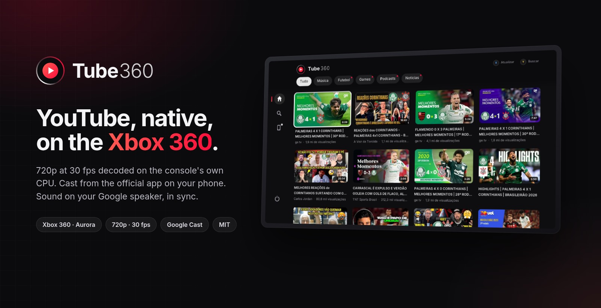
</p>

<p align="center">
  <a href="https://github.com/revive360/catalog/blob/main/generated/apps/tube360.md"></a><br>
  <a href="https://github.com/revive360/tube360/releases/latest"></a>
  
  
  <a href="LICENSE"></a>
</p>

<p align="center">
  <a href="README.md">English</a> · <b>Português</b>
</p>

> [!TIP]
> **O Tube360 é grátis e tem licença MIT.** Se ele ressuscitou o seu console, **deixa uma ⭐ no repositório**. É a única coisa que eu peço, e é assim que outras pessoas acham o projeto.

O **Tube360** é um cliente nativo do YouTube para Xbox 360. Abra o `.xex` pelo Aurora, FSD ou XeXMenu e assista ao YouTube **direto no console, sem PC**. Conta, histórico, inscrições, biblioteca, Música, transmissão pelo celular e som no Google Nest também rodam no Xbox. A v0.3.2 é a última versão com servidor auxiliar.

Um projeto da [Revive360](https://github.com/revive360): homebrew open source para o Xbox 360.

Sem TV stick, sem smart TV, sem navegador. Só o Xbox 360 que você já tem.

---


> **Privacidade na 0.3.3:** relatórios automáticos de falhas vêm ligados. Depois de um travamento ou de uma abertura que falhou, na próxima abertura o launcher envia versão, modelo/placa, tela, erro e até 300 linhas de log limpas para `tube360.hypermind.space`. IPs, IDs de vídeo, nomes Cast e tokens são removidos antes do envio. Desligue em **Configurações → Relatórios de erro** ou crie `no-error-reports.txt` junto de `default.xex`. [Dados, retenção e código da limpeza](docs/PRIVACY.md).

## Novidades da 0.3.3

- **Busca sem buracos**: os resultados enchem a tela como a grade da Início, sem fileira vazia entre as fileiras ([#21](https://github.com/revive360/tube360/issues/21))
- **Shorts na fileira deles**: cartões verticais menores na busca, na Início, em Inscrições e na biblioteca, e os vídeos comuns continuam sendo o principal. Configurações → Mostrar Shorts: Em fileira ou Esconder ([#22](https://github.com/revive360/tube360/issues/22))
- **Nest ocupado não trava mais o vídeo**: se a caixa estiver tocando Bluetooth de outro aparelho ou não responder, o vídeo começa na TV em uns 9 segundos com um aviso, e o X tenta o Nest de novo ([#12](https://github.com/revive360/tube360/issues/12))
- **Mensagem clara em vídeo de membros**: eles ainda não tocam no Xbox, e agora o app diz isso em vez de um erro genérico ([#11](https://github.com/revive360/tube360/issues/11))
- **Relatórios de erro**: travamentos e aberturas que falham chegam até nós sem você precisar caçar log. Vêm ligados, desligam fácil e não mandam nada pessoal. Veja o aviso de privacidade acima ([#41](https://github.com/revive360/tube360/issues/41))
- **Só console, de verdade**: a opção de servidor no PC e o timer de desligar o notebook saíram das Configurações. A v0.3.2 é a última com servidor no PC ([#31](https://github.com/revive360/tube360/issues/31))
- **Compilado pelo CI da Revive360**: esta versão é compilada às claras pelo GitHub Actions da org, com atestação de build assinada que você pode conferir

## Novidades da 0.3.2

- **1080p30 de verdade**, decodificado pelo próprio 360. Deixe o painel do Xbox em 1080p no HDMI para a imagem nítida. [Resultados e limites no console](docs/CONSOLE-032-FINAL.md)
- **SponsorBlock**: Desligado, Botão "Pular" (padrão) ou pulo automático. Y pula o trecho marcado ou volta depois do pulo automático. [Funcionamento](bench/sponsorblock/README.md)
- **O seu YouTube Music**: tocadas recentemente, playlists e músicas curtidas. [Detalhes](docs/MUSIC-ACCOUNT.md)
- **Sugestões e filtros na busca** com LB: tipo, duração, data de envio e ordem por relevância ou visualizações. [Controles](docs/SEARCH.md)
- **Assistir mais tarde e continuar de onde parou sem conta**, salvo no console. Nada é enviado. [Armazenamento e limpeza](docs/LOCAL-LIBRARY.md)
- **Escolha a qualidade você mesmo** com Y durante o vídeo: 480p, 360p, 240p ou 144p, além dos perfis adaptativos
- **Segure LT/RT** para voltar ou avançar, com prévia de onde vai parar
- **Árabe**: interface, teclado da busca (RB troca para latim) e títulos em árabe em qualquer idioma. [Suporte ao árabe](docs/ARABIC.md)
- **Vídeos longos mantêm a qualidade**: arquivos acima de 2 GiB, como vídeos de 3 horas, falhavam ao abrir ou caíam para uma versão mais leve. [Causa e correção](bench/opening/README.md)
- **O app se atualiza sozinho**: Configurações → Atualizações do app, aperte A. As atualizações são assinadas e voltam sozinhas se algo der errado

**Corrigido a partir dos relatos de vocês:** busca com a conta conectada; qualidade que caía e não voltava; o app fechando ao abrir sem dizer nada (agora mostra o motivo na tela e salva o `startup.log`); erros mais claros quando o relógio do console está errado ou a rede bloqueia a conexão; a mensagem antiga de "servidor" no modo só console.

### Atualizando

Da 0.3.2: Configurações → Atualizações do app, aperte A.

Da 0.3.0 ou 0.3.1: copie a pasta `Tube360` nova inteira por cima da antiga **uma última vez**. A conta e as configurações continuam. Agora o `default.xex` é o lançador e o `tube360.xex` é o app: mantenha os dois lado a lado com as oito fontes, e nunca renomeie um por cima do outro. Daí em diante, as atualizações vêm de Configurações → Atualizações do app.

O resto está no [CHANGELOG](CHANGELOG.md).

## Testado em, e o que ainda não foi testado

Tudo foi testado no Xbox 360 E do autor (placa Corona) com BadUpdate. Eu não tenho os outros modelos, então a tabela também conta o que os usuários confirmaram:

| Console | Situação |
|---|---|
| 360 E e Slim (Corona, Winchester) | Testado num 360 E. Usa o modo de vídeo nativo |
| Slim S (Trinity) | Confirmado por um usuário (RGH). Usa o modo de vídeo mais seguro |
| Fat (Xenon, Zephyr, Falcon, Jasper) | Jasper confirmado por um usuário (BadUpdate, TV de tubo em 480i). Xenon, Zephyr e Falcon ainda sem confirmação. Usa o modo de vídeo mais seguro |
| RGH, JTAG, ABadAvatar | RGH confirmado por um usuário num Slim Trinity, ABadAvatar por um usuário num Corona. JTAG ainda não confirmado |
| TV de tubo em 480i | Confirmado por um usuário num Fat Jasper. Escolha Preencher (cortar) nas Configurações para tirar a moldura preta dos vídeos 4:3 |
| Adaptador HDMI→VGA em 720p | Trava conhecida logo depois do logo do Vulkan, em correção ([#7](https://github.com/revive360/tube360/issues/7)). Com o painel na resolução do próprio monitor ele abre, em 640x480 |

`video-driver.txt` aceita `auto`, `safe` ou `native` se você quiser forçar um modo. [Detecção de placa e simulação](docs/BOARD-SIMULATION.md)

### Deu problema? Mande os logs

1. Logo depois do travamento, **antes de abrir o app de novo**, abra a pasta `Tube360` por FTP. Alguns logs são sobrescritos a cada abertura.
2. Pegue o `startup.log`, o `launcher.log` e todos os `boot-*.log`.
3. Abra uma [issue](https://github.com/revive360/tube360/issues) com eles, o modelo do console, o desbloqueio (BadUpdate, RGH, JTAG ou ABadAvatar) e a saída de vídeo (HDMI, componente ou VGA, e 480/720/1080). Uma foto da tela de erro também ajuda.

> [!WARNING]
> Nunca mande o `yt-console-account.json` nem nenhum arquivo de conta, cookie ou pareamento. Os logs têm caminhos locais e o relógio do console, então confira antes de postar. [Como ler os logs de abertura](docs/STARTUP-DIAGNOSTICS.md)

## Destaques

| | |
|---|---|
| 🎮 **100% no Xbox, sem Xbox Live** | Instale, navegue e assista no próprio console. Sem PC ligado e sem assinatura ou login no Xbox Live. |
| 👤 **Sua conta na TV** | Login por código, recomendações, inscrições, histórico e retomada, Assistir mais tarde, playlists, gostei e não gostei. O token fica no console. |
| 🎞️ **Imagem e faixa de áudio** | Perfis Automático, 720p60 e 1080p30; saída 480/720p/1080p; faixa original por padrão e dublagens oferecidas pelo vídeo no player. Resolução e cadência se adaptam à fonte, à rede e à carga do console. |
| 🔴 **Legendas e lives** | Legendas em VOD, busca de posição, botão para voltar ao vivo e próximo automático. Legendas ao vivo ainda não são suportadas. |
| 🔊 **Google Nest / caixa Google Cast** | O console manda a URL da faixa do YouTube à caixa e segue o relógio dela. Sem PC ou pareamento Bluetooth. Lives diretas usam som na TV por enquanto. |
| 📱 **App oficial do YouTube no celular** | Pareamento por código de TV ou descoberta na rede. Play, pausa, busca de posição, volume e filas usam o receptor nativo do Xbox. |
| ⏭️ **SponsorBlock** | Pule patrocínios, autopromoção e lembretes de inscrição com um botão ou automaticamente. Os trechos vêm da comunidade do SponsorBlock e podem errar. |
| 🕒 **Assistir mais tarde sem conta** | Salve vídeos e continue de onde parou, guardado no console. |
| 💬 **Comentários e não gostei** | Leia e role comentários sem sair do vídeo. Contagem de não gostei estimada pelo Return YouTube Dislike, identificada como estimativa. |
| ⏩ **0,25×–2× e repetir** | Oito velocidades com preservação do tom da voz; Repetir vídeo no player. Velocidade diferente de 1× usa som na TV; o timer tem prioridade sobre a repetição. |
| 📺 **TV de tubo e texto grande** | Saída 480 em 4:3, área segura e texto ampliado. Ajustar com faixas ou preencher com recorte; texto grande também em HD. 480i/480p segue o painel do Xbox. |
| 🔐 **Atualização automática assinada** | Regras verificadas por Ed25519 ao abrir e periodicamente na Home, com reserva automática. Quando o YouTube muda algo, um arquivo de regras assinado conserta todos os consoles sem versão nova. |
| 🌙 **Timer de dormir** | De 15 minutos a 2 horas, ou fim do vídeo, com aviso 60 s antes (A soma 15 min, B cancela) e o volume baixando. Depois o console se desliga sozinho. |
| 🏷️ **Selo de membros** | Identifica vídeos exclusivos do canal na navegação. Usa a sua conta para tentar reproduzir quando ela tem acesso; o selo não libera conteúdo pago. |
| 🎵 **Música** | Alternativa pelo cliente de TV quando o Music web recusa a conta; recentes, playlists, curtidas, mixes, busca, rádio, filas só com áudio e letras opcionais. Navegação pública continua disponível. [Detalhes e limites](docs/MUSIC-ACCOUNT.md). |
| 🧭 **Canais e biblioteca** | Vídeos, lives e playlists do canal, inscrição, avatares redondos e capas da biblioteca. |
| 📡 **Rede fraca** | Retoma conexões interrompidas e troca para uma qualidade mais leve quando necessário. |
| ⚡ **YouTube direto no Xbox** | HTTPS com o YouTube, vídeo H.264 original e áudio AAC decodificados localmente com FFmpeg. Sem conversão no PC no uso normal. |
| 🛠️ **App nativo** | C++20, Vulkan pelo [vulkan4xenon](https://github.com/xenosworks/vulkan4xenon), SDL3 e navegação pelo controle. Title ID próprio no Aurora: `0x58545542`. |
| ⚙️ **Configurações na TV** | Português/inglês/espanhol/árabe, 2 colunas em 4:3, 3/4 em HD, qualidade, tamanho da saída, som, sincronia e legendas. Dicas de botões no estilo Xbox One / Series. |

## Telas

| Início | Resultados da busca |
|---|---|
| 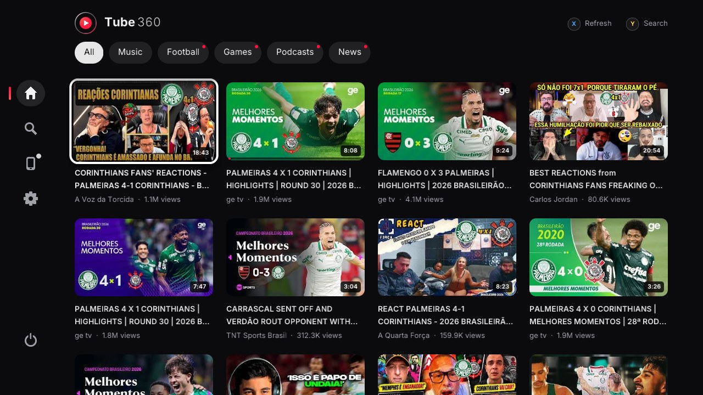 | 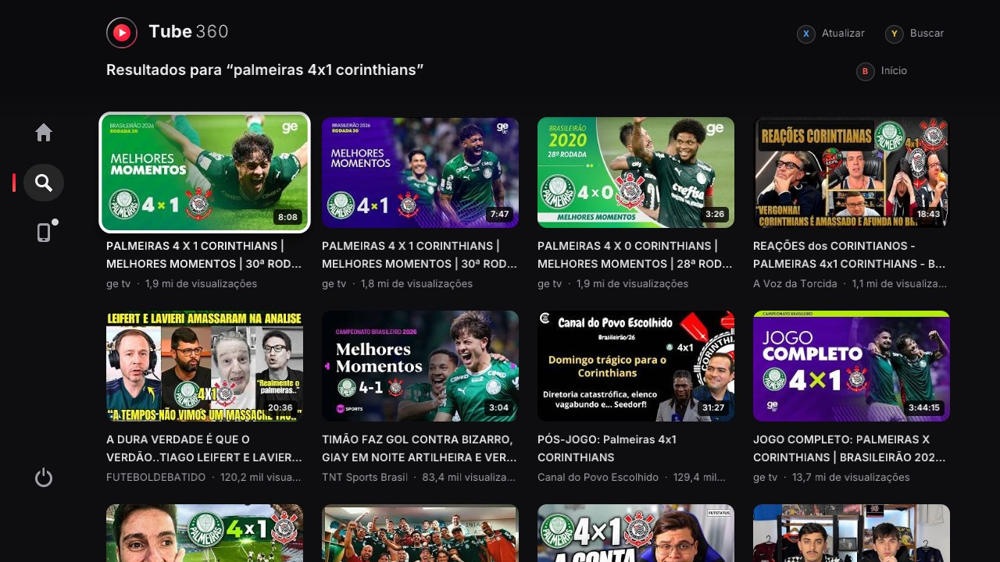 |
| **Player** | **Teclado na tela** |
| 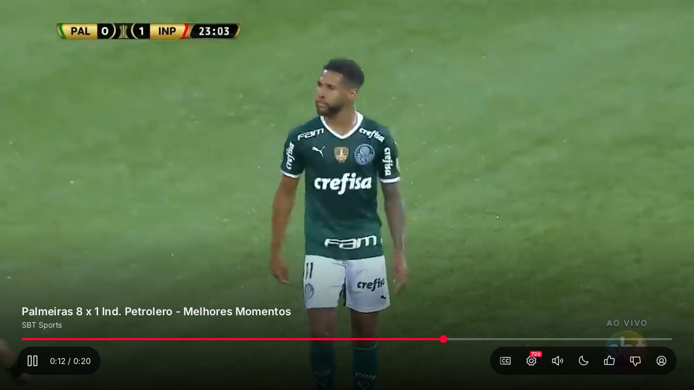 | 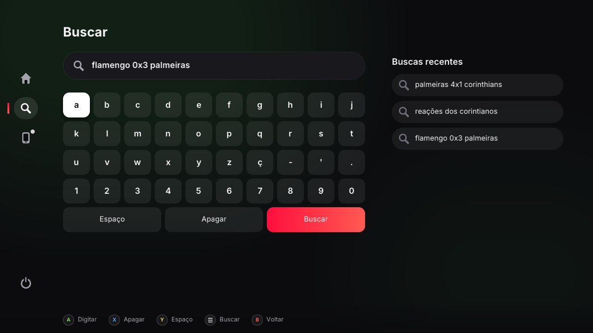 |
| **Configurações** | **Entrar no YouTube pela TV** |
| 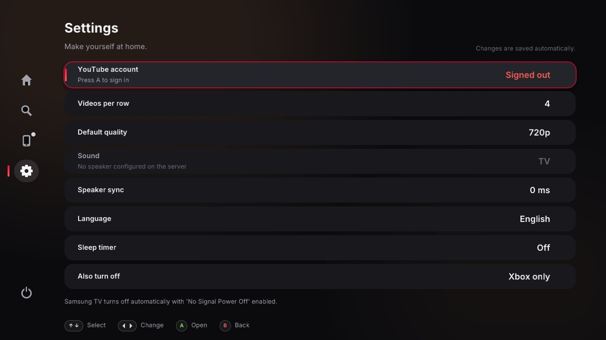 | 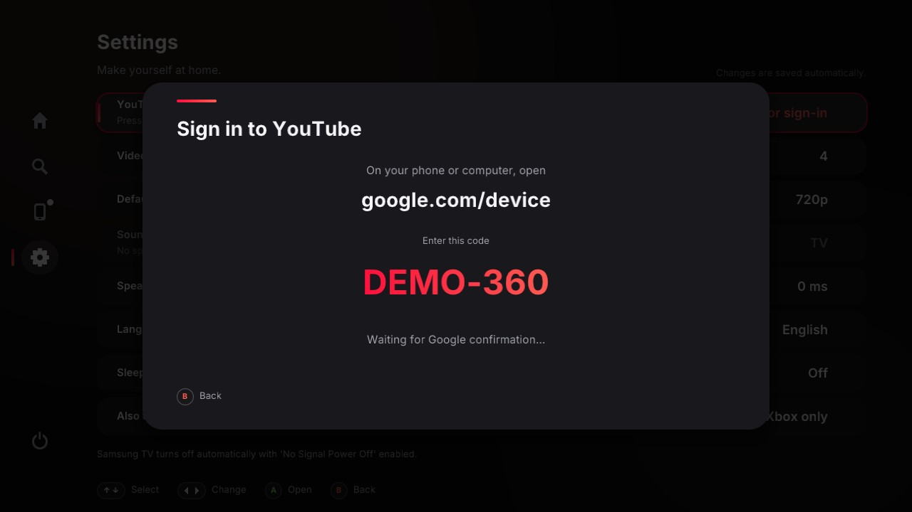 |
| **Timer de dormir** | **Transmitir do celular** |
| 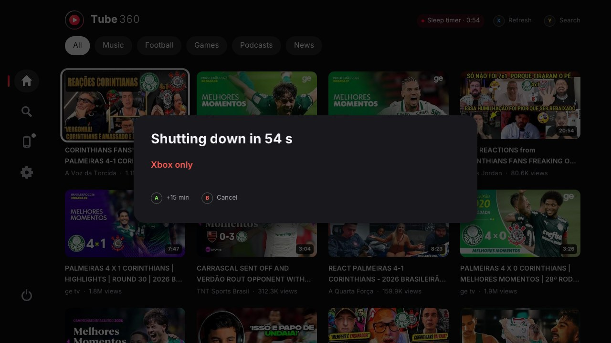 |  |
| **Gostei ou não gostei do vídeo** | **Próximo vídeo automático** |
| 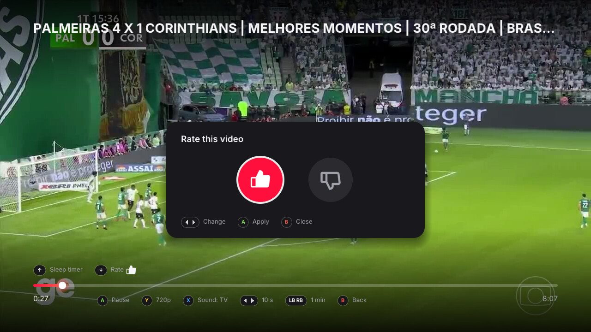 |  |

| **TV Palmeiras** | **Selo de membros** |
|---|---|
| 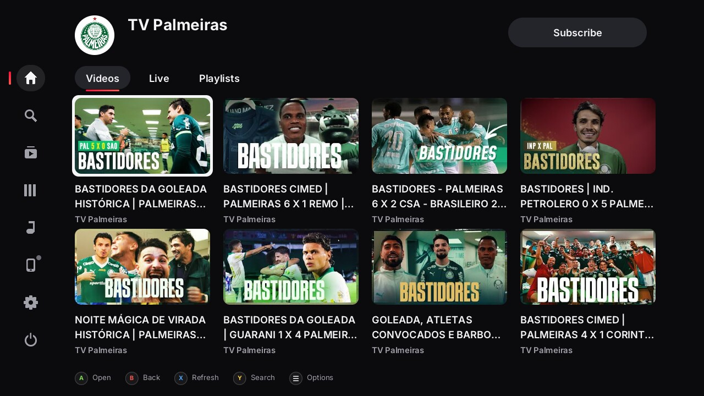 | 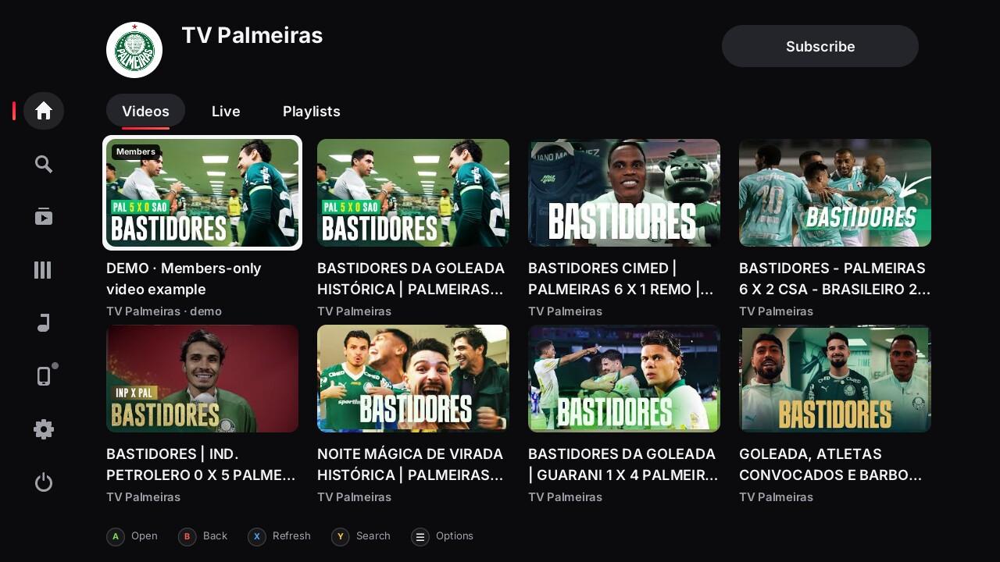 |
| **Som no Google Nest** | **Vídeo exclusivo** |
| 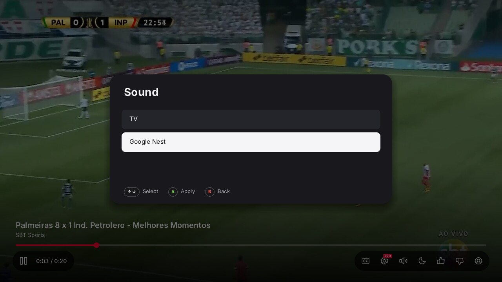 | 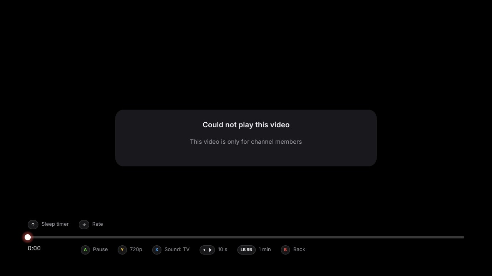 |

| **Comentários pelo controle** | **Velocidade de 0,25× a 2×** |
|---|---|
| 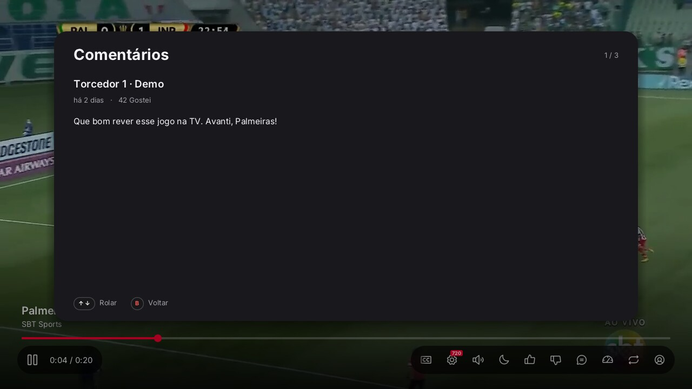 | 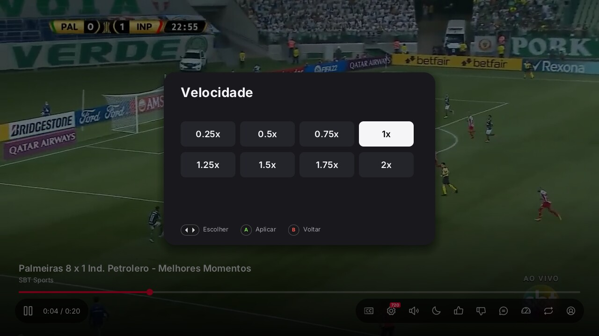 |
| **Interface em espanhol** | **TV 4:3 com ajustar** |
| 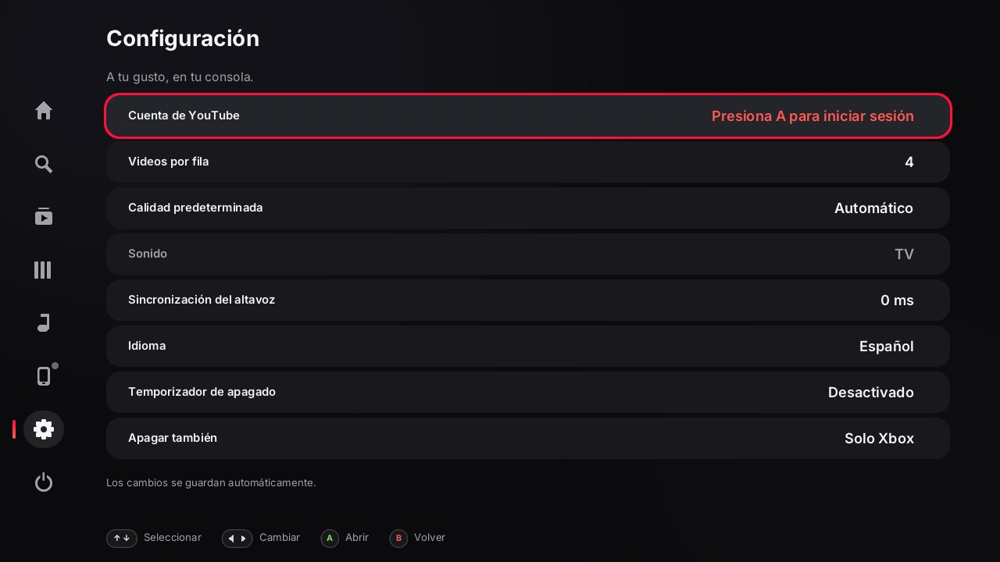 | 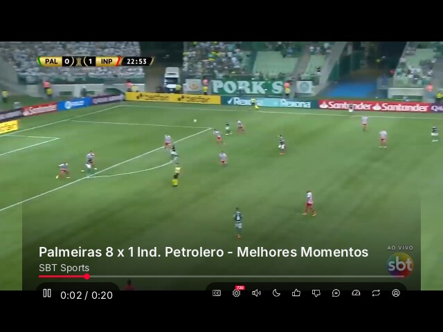 |
| **Contagem estimada de não gostei** | **Texto grande em HD** |
| 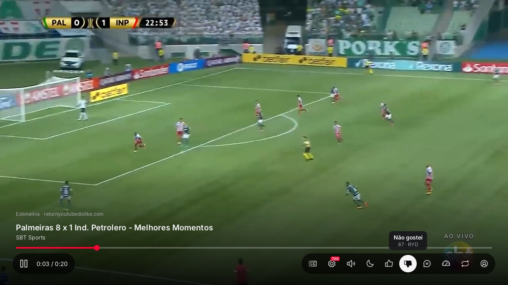 | 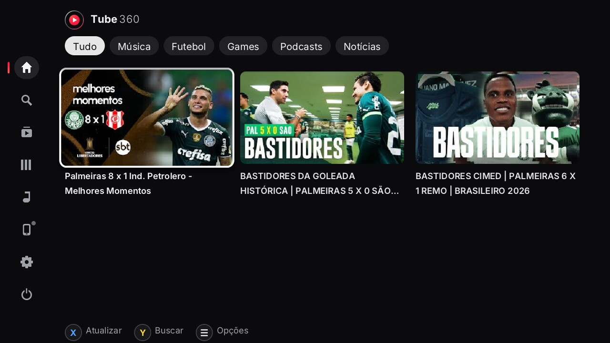 |

<sub>Capturas do app de PC atual em modo console (`server=off`), com o mesmo código e renderizador do Xbox. Conteúdo público do Palmeiras; onde necessário, conta fictícia Demo e códigos ilustrativos. O selo e a recusa de membros usam respostas sintéticas e são identificados como Demo; o print do Nest mostra configuração, sem conectar a uma caixa real. Comentários e contagens demonstrativas são fictícios e identificados no [registro das capturas](docs/SCREENSHOTS.md). Nenhuma conta pessoal foi usada. As capturas não medem o desempenho do Xbox.</sub>

---

## Por que Tube360

O Xbox 360 ainda pode ser a TV da sala. O Tube360 reúne a sua conta, o controle, transmissões ao vivo perto do ao vivo, áudio original e uma caixa Cast no mesmo app. Você abre um título próprio no Aurora e assiste sem manter outro computador ligado ou entrar no Xbox Live.

Os perfis 720p60 e 1080p ampliam as opções; a cadência e a resolução efetivas dependem do vídeo, da rede e da carga do console. O app pode reduzir a qualidade para continuar tocando. A integração com o YouTube é não oficial e pode mudar.

## Como funciona

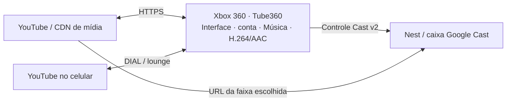

O caminho normal é H.264/AAC nativo. Automático prefere detalhe até 1080p; 720p60 prioriza cadência; 1080p30 limita a escolha a fontes de até 30 fps. O perfil é uma preferência, não uma garantia de 60 fps sustentados: o player pode reduzir a apresentação a 30 fps e escolher uma fonte direta mais leve. 720p30 é a meta do console; o desempenho precisa ser conferido no seu Xbox e conteúdo.

Escolha 480p, 360p, 240p ou 144p fixos nas Configurações ou no menu Qualidade do player (Y quando não houver ação do SponsorBlock). Durante o vídeo, a lista oferece somente as fontes H.264/AAC disponíveis nele. A seleção manual mantém altura, posição e pausa; pressão sustentada mostra um aviso e não troca a fonte. Uma qualidade salva indisponível mostra erro e permite escolher outra. Voltar a Automático reativa a escada adaptativa. Sem vídeo ativo, Configurações salva um padrão entre as sete opções.

O **1080p30 nativo** passa a usar os kernels VMX medidos no Xenon, seis workers FRAME em `0,2,4,1,3,5` e uma fila de imagens maior, com orçamento limitado. Fontes H.264 de 1080 linhas com taxa conhecida até 30,1 fps omitem o filtro de deblock; fontes menores, de taxa desconhecida ou maior mantêm o filtro completo. Para religá-lo também em 1080p, salve `h264_loop_filter=full` em `settings.txt` e reabra o app; a cadência pode cair. O decoder isolado mediu 22,57 ms/quadro; a reprodução integrada com interface, som e rede passou no Xbox do dono em 25/11/2026. A fonte 1080p também pode ser reduzida para saída 720p; **saída 1080p nativa pede HDMI e 1080p progressivo no painel do Xbox**. Em saída 720p, a redução pode serrilhar nos movimentos rápidos. Consulte os [resultados finais do console](docs/CONSOLE-032-FINAL.md).

[Arquitetura e qualificação](docs/STANDALONE.md).

## Requisitos

- Xbox 360 que execute código não assinado: **BadUpdate** (testado com XeUnshackle), **RGH** ou **JTAG**.
- Aurora, FSD ou XeXMenu para abrir `.xex`; armazenamento gravável para configurações, conta e identidade Cast.
- Internet no console e data/hora corretas para HTTPS. Cabo é preferível para fontes com bitrate alto; o consumo da mídia original varia.
- Para Nest: caixa Google Cast já configurada, com internet e alcançável pelo Xbox na mesma rede local. Para descoberta pelo celular: mesma rede e multicast liberado.
- Para saída 1080p nativa: HDMI e **1080p progressivo selecionado no painel do Xbox**. Escolher 1080p no Tube360 não muda o sinal HDMI; modos incompatíveis mantêm framebuffer 720p.

## Instalação em 3 passos

### 1. Copie a pasta do app

Baixe o ZIP ou .7z em [Releases](https://github.com/revive360/tube360/releases), extraia e copie a pasta `Tube360` inteira para `Hdd1:\Games\Tube360\` ou `Usb0:\Apps\Tube360\`. Mantenha `default.xex` (lançador), `tube360.xex` (app), as quatro fontes `inter-*.ttf` e as quatro `noto-sans-arabic-*.ttf` e as licenças juntos. Os arquivos `.example.txt` ficam inativos até serem renomeados.

### 2. Abra pelo Aurora, FSD ou XeXMenu

Adicione a pasta aos caminhos do Aurora e faça uma varredura, ou abra `default.xex` no gerenciador de arquivos. O Tube360 tem título próprio: `0x58545542`.

### 3. Escolha um vídeo e assista

Conecte o Xbox à internet, confira data e hora e navegue pelo controle. Não é preciso Xbox Live. Busca e vídeos públicos funcionam sem login; a conta abaixo é opcional.

### Conta do YouTube (opcional)

Abra **Configurações → Conta do YouTube → A**. No navegador do celular ou computador, abra a URL exibida na TV (normalmente [google.com/device](https://www.google.com/device)), digite o código e autorize sua conta. Volte ao Tube360 para usar a conta conectada. A senha não é digitada no Xbox; celular não é requisito para assistir.

A autorização fica em `yt-console-account.json`, ao lado do XEX. Use Sair da conta antes de compartilhar a pasta; nunca inclua esse arquivo, identidades Cast, logs ou registros de posse em uma release. O token de TV não garante acesso a todo vídeo ou endpoint de Música.

> Uso todo dia na minha conta Premium, sem aviso até agora; é um cliente não oficial, pode mudar; use conta secundária se preferir.

O token fica só no console, ao lado do XEX. Não vai para o site nem para um serviço do Tube360. Nunca compartilhe a pasta com a sessão salva.

### Google Nest / caixa Cast (opcional)

Ache o IP em **Google Home → dispositivo → Configurações → Informações do dispositivo** (detalhes de rede/IP), ou na lista de dispositivos conectados/DHCP do roteador. Os nomes dos menus variam com a versão do Home. Reserve o IP no DHCP para ele não mudar.

Copie `nest.example.txt` para `nest.txt`, substitua o endereço e preserve as duas linhas:

```text
192.0.2.20 8009
Google Cast speaker
```

`192.0.2.20` é um endereço de documentação: troque pelo IP local real da caixa. A primeira linha é **host, espaço, porta** (8009 se omitida); a segunda é o nome exibido, que pode ter espaços. Essas duas linhas precisam conter os valores, sem comentários antes deles. Depois escolha **Configurações → Som → Caixa**, ou pressione **X** no player.

A caixa baixa o áudio do próprio YouTube. Ela precisa de internet e de Wi-Fi funcionando entre ela e o console. Quedas breves são toleradas, mas a TV só assume depois da confirmação de silêncio da caixa; uma queda pode deixar um intervalo sem som. **Saia do vídeo com B antes de fechar o app**, dando tempo para o STOP chegar à caixa. Saída forçada ou Wi-Fi perdido podem deixar o áudio tocando.

### Transmitir pelo celular (opcional)

Abra **Celular** no Tube360. No app oficial do YouTube, use **Configurações → Assistir na TV → Inserir código da TV** e digite o código desse painel. Esse código é diferente do login da conta. Em redes que permitem descoberta, o Tube360 também aparece em Transmitir como `YouTube 360`. Não precisa de receptor Node no modo console.

### Atualizações assinadas

**Configurações → Atualizações do app** mostra versão instalada, candidata e tamanho. **A Atualizar** baixa e confere Ed25519/SHA-256; **B** volta ou cancela. A Home também avisa quando há uma versão nova (**LB** abre os detalhes). Reabra **default.xex** para instalar; se o início não for confirmado, a próxima abertura restaura o anterior.

**Vindo da v0.3.0/v0.3.1:** feche o app, guarde a pasta antiga como reserva e copie a pasta nova completa uma última vez. Mantenha os dois XEX e as oito fontes juntos; preserve configurações/conta se desejar, mas não traga journals/candidatos de atualização antigos. Depois disso, as atualizações do app chegam pela própria interface. Reserve espaço para o app instalado, o candidato e a reserva. [Detalhes e recuperação](docs/UPDATES.md).

O árabe está em **Configurações → Idioma** (`lang=ar`). Títulos árabes funcionam em qualquer idioma da interface. Blocos de texto seguem da direita para a esquerda; menus e direções do controle mantêm suas posições. RB alterna o teclado de busca árabe para latim. Copie a pasta completa uma vez na atualização para incluir as fontes Noto; atualizações só do executável não adicionam fontes ausentes. Fontes, licenças, memória e limites atuais: [texto árabe](docs/ARABIC.md).

## Controles

As dicas usam o estilo Xbox One / Series (Menu / View correspondem a Start / Back no controle do 360).

| Onde | Botão | Ação |
|---|---|---|
| Início / navegação | A · X · Y | Abrir / assistir · Atualizar · Buscar |
| | Esquerda na primeira coluna | Menu lateral |
| | Menu | Ações do card: canal, Assistir mais tarde ou rádio |
| | B | Voltar uma página |
| Teclado de busca | A · X · Y · Menu | Digitar · Apagar · Espaço · Buscar |
| Busca / resultados | LB | Filtros; A aplica, B descarta as alterações |
| Teclado de busca | Direita após a última tecla · Cima / Baixo · A | Sugestões e recentes · Escolher · Buscar na hora |
| Player | A / Menu | Pausar / continuar (A ativa a opção focada quando há painel aberto) |
| | Direção com barra oculta | Mostrar a linha do tempo |
| | Esquerda / Direita na linha do tempo | −10 s / +10 s |
| | Baixo na linha do tempo · Cima nos ícones | Opções abaixo da linha do tempo · Voltar à linha do tempo |
| | Esquerda / Direita, depois A | Selecionar / ativar ícone: legenda, qualidade, som, timer, áudio, gostei, não gostei, canal ou ao vivo |
| | LB / RB | −1 min / +1 min |
| | Y · X | Pular/voltar no SponsorBlock ou abrir Qualidade · Som TV / caixa |
| | LT / RT | Segure para voltar / avançar; acelera, solte para continuar |
| | B | Fechar um nível por vez, depois sair do vídeo |
| | View | Voltar à navegação |
| Música, Tocando agora | B | Parar e limpar fila; voltar à página de origem |
| Configurações | Cima / Baixo · Esquerda / Direita · A / B | Escolher linha · Mudar valor · Abrir / Voltar |
| Próximo vídeo | A / B | Assistir agora / Cancelar |
| Aviso do timer | A / B | +15 min / Cancelar |

## Configuração

Use Configurações na TV; os valores ficam em `settings.txt` ao lado do XEX. Os [exemplos do pacote](docs/RELEASE.md) explicam as chaves editáveis.

| Arquivo | Função |
|---|---|
| `settings.txt` | `lang=en\|pt\|es\|ar`, `cols=3\|4`, `quality=720\|480\|360`, `sound=tv\|nest`, `sync_ms`, `sponsorblock=off\|button\|auto`, `video_mode=auto\|720p60\|1080p30\|480p\|360p\|240p\|144p`, `output_height=480\|720\|1080`, `large_text=on\|off`, `video_fit=fit\|fill`, `h264_loop_filter=auto\|full`, `audio_preference=original\|interface`, `error_reports=on\|off` (ligado por padrão), legendas e alvo do timer. |
| `nest.txt` | Host e porta opcional da caixa na linha 1; nome exibido na linha 2. |
| `marca.txt` | Nome personalizado na linha 1 e `retangulo` opcional na linha 2. |
| `net_log.txt` | Destino UDP de depuração (`<IP-PC> <porta>`). Mantenha privado. |

`quality.txt` / `audio.txt` legados são lidos quando não existe `settings.txt`. O áudio original é preferido mesmo quando o YouTube marca uma dublagem automática como padrão. A preferência pelo idioma da interface recua para o original se não houver faixa correspondente. Tamanho da saída é separado da qualidade da fonte.

## Compilando do fonte

**Build de PC para desenvolvimento**, com SDL3, headers Vulkan, `glslangValidator`, CMake, compilador C++20 e bibliotecas de desenvolvimento FFmpeg (ou o build local fixado pelo script):

```bash
cmake -S client -B client/build -DCMAKE_BUILD_TYPE=Release
cmake --build client/build -j2
XT_ASSETS="$PWD/client/assets" ./client/build/tube360
```

Sem `XT_ASSETS`, o diretório padrão é `assets/` relativo ao diretório atual. Para teste isolado, use uma cópia gravável separada das fontes/configurações. Setas, Enter=A, Esc=B, Backspace=X, Tab=Y, PageUp/PageDown=LB/RB, F2=Menu e F10=View; controle também funciona.

**Build de Xbox** exige [xsdk](https://github.com/xenosworks/xsdk), [vulkan4xenon](https://github.com/xenosworks/vulkan4xenon) e [SDL-xenon](https://github.com/xenosworks/SDL-xenon) compilados, e o toolchain GCC do xsdk:

```bash
export XSDK_DIR=~/src/xsdk V4X_DIR=~/src/vulkan4xenon
export SDL3_XENON_DIR=~/src/SDL-xenon/build-xsdk XSDK_TOOLCHAIN=~/xsdk-gcc
TUBE360_VERSION=0.3.2 TUBE360_BUILD_ID=7 TUBE360_F33_BENCH=OFF TUBE360_F40_BENCH=OFF tools/build-xbox.sh
python3 tools/package-xbox.py --version 0.3.2
```

O build gera `client/build-x360/tube360.xex`. O empacotador instala o lançador como `Tube360/default.xex` e o app como `Tube360/tube360.xex` em `.work/releases/tube360-v0.3.2-xbox360.zip`, com fontes, exemplos comentados e avisos de licença. Ele usa uma lista explícita de arquivos, nunca uma pasta já usada no console. Não publica. [Dependências de build](docs/BUILD.md) · [Empacotamento e fontes/relink correspondentes](docs/RELEASE.md)

## Estrutura do projeto

```text
client/          app nativo Xbox/PC, interface, player, conta, Música, Cast e HTTPS
server/          servidor legado (última versão com suporte: v0.3.2)
cast/            ponte opcional de conta e celular no PC (Node)
bench/, tests/   fixtures isoladas e medições de desempenho
docs/            arquitetura, protocolo, build e instruções de release
tools/           builds, empacotamento e instalação opcional de serviços
```

## Limitações e solução de problemas

- Transmitir pelo celular: pareie com o código de TV do painel **Celular** (app do YouTube → Configurações → Assistir na TV → Inserir código da TV). O console ainda não aparece sozinho na lista de transmissão do celular, porque não consegue entrar no grupo de descoberta da rede. Se outro receptor da sua rede usar o mesmo nome, o celular pode transmitir para ele.
- A integração com o YouTube é não oficial e pode mudar ou ser bloqueada. Restrições de idade/região, DRM e conteúdo pago não são contornadas; login não garante acesso à mídia. Atualize o feed ou tente mais tarde.
- 720p60/1080p30 são perfis de fonte. O Xbox pode reduzir cadência ou resolução sob carga. Confira o estado real no player; 1080p nativo exige o modo HDMI do painel descrito acima. Sem promessa de 1080p60, HDR, VP9 ou AV1.
- Música tenta o catálogo musical da TV com o login existente antes da reserva pública, identificada na tela. Música da conta foi validada no Xbox do dono em 25/11/2026; a paridade de recomendações com o Music da TV não é garantida. [Funcionamento](docs/MUSIC-ACCOUNT.md). Letras são opcionais. Legendas ao vivo e Nest em live direta ainda não estão implementados; lives usam som na TV.
- Texto vazio ou saída ao abrir: copie as oito fontes junto de `default.xex`. Falha de HTTPS: confira relógio do console e internet/DNS.
- Caixa indisponível ou sem som: confira IP, internet e Wi-Fi dela; desative isolamento de convidados/clientes entre Xbox e caixa, depois tente X. Não é pareamento Bluetooth. Falta de confirmação de silêncio pode atrasar o som na TV.
- Caixa continua tocando após sair: reconecte o Wi-Fi e reabra o Tube360 para concluir o STOP pendente salvo, ou interrompa o Cast pelo Google Home. Saia da reprodução com B antes de fechar; o encerramento espera até cinco segundos, mas não consegue parar uma caixa inacessível.
- Celular não encontra o Tube360: use o código de TV do painel Celular, permita descoberta local e confira acesso ao YouTube nos dois aparelhos. Código da conta e código Cast são separados.
- Xbox não desliga a TV: o console não tem HDMI-CEC; use o desligamento sem sinal da TV. O modo console não desliga um PC independente.

## Próximos passos

Na fila (0.3.3):

- [ ] Lives com menos atraso
- [ ] Descida mais suave de 1080p para 720p
- [ ] Player de música com barra de tempo e mais controles
- [ ] Testes físicos em consoles Fat, com os logs que vocês mandarem
- [ ] Árabe revisado por quem fala a língua

Depois:

- [ ] DeArrow (títulos e capas melhores)
- [ ] O console aparecer sozinho na lista de transmissão do celular
- [ ] Achar o alto-falante sozinho, e som no Nest durante a live
- [ ] As suas recomendações do YouTube Music com conta Premium

Entregue na 0.3.2: SponsorBlock, filtros e sugestões na busca, Assistir mais tarde e continuar sem conta, árabe, 1080p30 de verdade e atualização de dentro do app. [CHANGELOG.md](CHANGELOG.md) registra cada entrega.

## IA e verificação

**Feito com ajuda de IA, revisado e testado no Xbox do dono.** A IA ajuda no desenvolvimento; as decisões e a revisão são humanas. Placas Fat continuam sem teste físico, e o árabe ainda precisa de revisão nativa.

**VirusTotal (0.3.2):** [zip](https://www.virustotal.com/gui/file/a27f8cdc408194523e6f8813cac92f00c8f5e439c3f416349c198b8da2c6e53f) 0/63 · [default.xex](https://www.virustotal.com/gui/file/c710cfc83c4c6a47fa380d99dd1b9aee5110cf339c69dde6e16569d8f8793bde) 0/57 · [tube360.xex](https://www.virustotal.com/gui/file/7ca9fa0e387392494453a75d94869afd0513d1e4126f7274d8e314d4bb2694c7) 0/60. O VirusTotal não abre zip desse tamanho, então os dois executáveis foram analisados separados. Os hashes dos pacotes acompanham os arquivos na release.

## SponsorBlock

Em **Configurações → SponsorBlock**, escolha **Desligado**, **Botão "Pular" (padrão)** ou **Pular sozinho**.
O botão **Y** pula ao fim do trecho marcado; no automático, o aviso oferece **Y Voltar** por seis segundos
depois do seek. Voltar permite assistir ao trecho sem outro pulo nessa abertura. Fora de uma ação de pular/voltar, Y abre Qualidade; A aplica a escolha e B fecha sem mudar. Patrocínios, autopromoção e lembretes de inscrição entram; vinhetas e encerramentos
continuam. As marcas aparecem na linha do tempo. Os trechos são marcados pela comunidade e podem errar.
O seek é o mesmo para vídeos transmitidos pelo celular e som no Nest; lives e Music só com áudio ficam de fora.
Em `settings.txt`, a opção é `sponsorblock=off|button|auto`.

Trechos: [SponsorBlock, sponsor.ajay.app](https://sponsor.ajay.app/), pela comunidade SponsorBlock,
sob [CC BY-NC-SA 4.0](https://creativecommons.org/licenses/by-nc-sa/4.0/). Este é um projeto não comercial;
a licença dos dados é separada do código MIT do app. A consulta envia só quatro caracteres hexadecimais do
SHA-256 do vídeo e escolhe a resposta localmente. Há cache limitado à sessão; falha da API não gera erro na tela.

## Revive360

O Tube360 mora na organização [Revive360](https://github.com/revive360), uma casa para homebrew open source de Xbox 360. Ele saiu de `PedroHenrique0713/tube360` em 2026-11-25; os links antigos redirecionam. [O que a mudança significa para apps antigos](docs/REPOSITORY-TRANSFER.md).

**Aviso de risco:** Homebrew pode causar banimento da conta/console no Xbox Live, perda de dados ou dano ao console. Use por sua conta e risco. A Revive360 é independente da Microsoft. Software **como está**, pela licença; nenhum selo ou revisão garante segurança, acesso ao serviço ou compatibilidade.

**Privacidade:** relatórios de erro opcionais vêm ligados; [veja o que é enviado e como desligar](docs/PRIVACY.md). Login e tokens ficam no console; nunca os inclua manualmente em issues ou logs.

**Responsabilidade:** Dono: [@PedroHenrique0713](https://github.com/PedroHenrique0713). Licença: MIT. Ser membro não é selo. Segurança: no repositório, **Security → Report a vulnerability**. Bugs e ideias: [issues](https://github.com/revive360/tube360/issues).

## Créditos e licença

O Tube360 tem [licença MIT](LICENSE). Você pode usar, mudar e compartilhar. Mantenha o aviso de copyright, ou seja, dê o crédito. As partes de terceiros e as licenças delas estão em [THIRD_PARTY.md](THIRD_PARTY.md). Valeu ao **pl_mpeg**, **yt-dlp**, **YouTube.js**, **yt-cast-receiver**, **FFmpeg**, **PyChromecast** e aos projetos **xsdk / vulkan4xenon / SDL-xenon**, que tornaram possível homebrew moderno no 360.

Feito por [@PedroHenrique0713](https://github.com/PedroHenrique0713).

> [!IMPORTANT]
> O Tube360 é um projeto independente. Não tem ligação, aprovação nem patrocínio do Google, do YouTube ou da Microsoft. "YouTube" e "Xbox" são marcas dos seus donos. Use para uso pessoal, por sua conta, e respeite os termos dos serviços que você conecta.

<p align="center"><b>Curtiu? Uma ⭐ no repositório é o melhor obrigado.</b></p>
