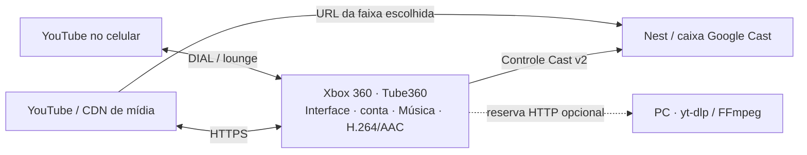

<p align="center">
  
</p>

<p align="center">
  <a href="https://github.com/PedroHenrique0713/tube360/stargazers"></a>
  
  
  <a href="LICENSE"></a>
</p>

<p align="center">
  <a href="README.md">English</a> · <b>Português</b>
</p>

> [!TIP]
> **O Tube360 é grátis e tem licença MIT.** Se ele ressuscitou o seu console, **deixa uma ⭐ no repositório**. É a única coisa que eu peço, e é assim que outras pessoas acham o projeto.

O **Tube360** é um cliente nativo do YouTube para Xbox 360. Abra o `.xex` pelo Aurora, FSD ou XeXMenu e assista ao YouTube **direto no console, sem PC**. Conta, histórico, inscrições, biblioteca, Música, transmissão pelo celular, som no Google Nest e timer também rodam no Xbox. O servidor no PC vira uma reserva opcional.

Sem TV stick, sem smart TV, sem navegador. Só o Xbox 360 que você já tem.

---

## Destaques

| | |
|---|---|
| 📺 **App nativo** | C++20, Vulkan pelo [vulkan4xenon](https://github.com/xenosworks/vulkan4xenon), SDL3 e navegação pelo controle. Title ID próprio no Aurora: `0x58545542`. |
| ⚡ **YouTube direto no Xbox** | HTTPS com o YouTube, vídeo H.264 original e áudio AAC decodificados localmente com FFmpeg. Sem conversão no PC no uso normal. |
| 👤 **Sua conta na TV** | Login por código, recomendações, inscrições, histórico e retomada, Assistir mais tarde, playlists, gostei e não gostei. O token fica no console. |
| 🧭 **Canais e biblioteca** | Vídeos, lives e playlists do canal, inscrição, avatares redondos e capas da biblioteca. |
| 🎵 **Música** | Escolhas rápidas, Explorar/paradas, mixes, busca de música/álbum/artista, rádio, filas locais, Tocando agora só com áudio e letras opcionais. |
| 📱 **App oficial do YouTube no celular** | Pareamento por código de TV ou descoberta na rede. Play, pausa, busca de posição, volume e filas usam o receptor nativo do Xbox. |
| 🔊 **Google Nest / caixa Google Cast** | O console manda a URL da faixa do YouTube à caixa e segue o relógio dela. Sem PC ou pareamento Bluetooth. Lives diretas usam som na TV por enquanto. |
| 🎞️ **Imagem e faixa de áudio** | Perfis Automático, 720p60 e 1080p30; saída 720p/1080p; faixa original por padrão e dublagens oferecidas pelo vídeo no player. Resolução e cadência se adaptam à fonte, à rede e à carga do console. |
| 💬 **Legendas e lives** | Legendas em VOD, busca de posição, botão para voltar ao vivo e próximo automático. Legendas ao vivo ainda não são suportadas. |
| 🌙 **Timer** | De 15 minutos a 2 horas, ou fim do vídeo, com aviso e redução de volume. O Xbox controla o prazo sem PC. |
| ⚙️ **Configurações na TV** | Português/inglês, 3/4 colunas, qualidade, tamanho da saída, som, sincronia e legendas. Dicas de botões no estilo Xbox One / Series. |

## Telas

| Início | Resultados da busca |
|---|---|
|  |  |
| **Player** | **Teclado na tela** |
|  |  |
| **Configurações** | **Entrar no YouTube pela TV** |
|  |  |
| **Timer de dormir** | **Transmitir do celular** |
|  |  |
| **Gostei ou não gostei do vídeo** | **Próximo vídeo automático** |
|  |  |

<sub>Estas imagens ilustram a interface anterior; a v0.3.0 acrescenta os caminhos nativos e o player revisado descritos aqui. As telas são do build de PC do cliente, que roda o mesmo código e o mesmo renderizador do build do console, aqui com a interface em inglês. A home de demonstração foi escolha do autor: Palmeiras 4×1 Corinthians e Flamengo 0×3 Palmeiras. 🟢⚪ A conta é de demonstração, e os códigos de login e do Transmitir são de exemplo.</sub>

---

## Como funciona



O caminho normal é H.264/AAC nativo. Automático prefere detalhe até 1080p; 720p60 prioriza cadência; 1080p30 limita a escolha a fontes de até 30 fps. O perfil é uma preferência, não uma garantia de 60 fps sustentados: o player pode reduzir a apresentação a 30 fps e escolher uma fonte direta mais leve antes de tentar a reserva no PC. 720p30 é a meta do console; o desempenho precisa ser conferido no seu Xbox e conteúdo.

MPEG-1 + MP2 fica como compatibilidade fornecida pelo servidor opcional, até 720p30. O pl_mpeg com decodificação por fatias continua nesse caminho. Ele deixou de ser o caminho principal do YouTube. [Arquitetura e qualificação](docs/STANDALONE.md) · [Protocolo do servidor opcional](docs/PROTOCOL.md)

## Requisitos

- Xbox 360 que execute código não assinado: **BadUpdate** (testado com XeUnshackle), **RGH** ou **JTAG**.
- Aurora, FSD ou XeXMenu para abrir `.xex`; armazenamento gravável para configurações, conta e identidade Cast.
- Internet no console e data/hora corretas para HTTPS. Cabo é preferível para fontes com bitrate alto; o consumo da mídia original varia.
- Para Nest: caixa Google Cast já configurada, com internet e alcançável pelo Xbox na mesma rede local. Para descoberta pelo celular: mesma rede e multicast liberado.
- Para saída 1080p nativa: HDMI e **1080p progressivo selecionado no painel do Xbox**. Escolher 1080p no Tube360 não muda o sinal HDMI; modos incompatíveis mantêm framebuffer 720p.

## Instalação rápida

### 1. Copie a pasta do app

1. Baixe o ZIP do app para Xbox em [Releases](https://github.com/PedroHenrique0713/tube360/releases), ou [compile e empacote](#compilando-do-fonte).
2. Extraia e copie a pasta `Tube360` inteira para armazenamento gravável do Xbox, por exemplo `Hdd1:\Games\Tube360\` ou `Usb0:\Apps\Tube360\`.
3. Mantenha `default.xex` e as quatro fontes `inter-*.ttf` juntos. Preserve também os avisos de licença.
4. **Deixe `server.txt` ausente.** Assim o app funciona só no console e não faz pedidos ao PC. Arquivos `.example.txt` só passam a valer se forem renomeados.
5. Adicione a pasta aos caminhos de varredura do Aurora/FSD e atualize a lista, ou abra `default.xex` no gerenciador deles ou no XeXMenu. Com internet já é possível navegar.

### 2. Entre na conta por código de TV (opcional)

Abra **Configurações → Conta do YouTube → A**. No navegador do celular ou computador, abra a URL exibida na TV (normalmente [google.com/device](https://www.google.com/device)), digite o código e autorize sua conta. Volte ao Tube360 para usar a conta conectada. A senha não é digitada no Xbox; celular não é requisito para assistir.

A autorização fica em `yt-console-account.json`, ao lado do XEX. Use Sair da conta antes de compartilhar a pasta; nunca inclua esse arquivo, identidades Cast, logs ou registros de posse em uma release. O token de TV não garante acesso a todo vídeo ou endpoint de Música.

### 3. Configure o Nest / caixa Google Cast (opcional)

Ache o IP em **Google Home → dispositivo → Configurações → Informações do dispositivo** (detalhes de rede/IP), ou na lista de dispositivos conectados/DHCP do roteador. Os nomes dos menus variam com a versão do Home. Reserve o IP no DHCP para ele não mudar.

Copie `nest.example.txt` para `nest.txt`, substitua o endereço e preserve as duas linhas:

```text
192.0.2.20 8009
Google Cast speaker
```

`192.0.2.20` é um endereço de documentação: troque pelo IP local real da caixa. A primeira linha é **host, espaço, porta** (8009 se omitida); a segunda é o nome exibido, que pode ter espaços. Essas duas linhas precisam conter os valores, sem comentários antes deles. Depois escolha **Configurações → Som → Caixa**, ou pressione **X** no player.

A caixa baixa o áudio do próprio YouTube. Ela precisa de internet e de Wi-Fi funcionando entre ela e o console. Quedas breves são toleradas, mas a TV só assume depois da confirmação de silêncio da caixa; uma queda pode deixar um intervalo sem som. **Saia do vídeo com B antes de fechar o app**, dando tempo para o STOP chegar à caixa. Saída forçada ou Wi-Fi perdido podem deixar o áudio tocando.

### 4. Transmita pelo celular (opcional)

Abra **Celular** no Tube360. No app oficial do YouTube, use **Configurações → Assistir na TV → Inserir código da TV** e digite o código desse painel. Esse código é diferente do login da conta. Em redes que permitem descoberta, o Tube360 também aparece em Transmitir como `YouTube 360`. Não precisa de receptor Node no modo console.

## Controles

As dicas usam o estilo Xbox One / Series (Menu / View correspondem a Start / Back no controle do 360).

| Onde | Botão | Ação |
|---|---|---|
| Início / navegação | A · X · Y | Abrir / assistir · Atualizar · Buscar |
| | Esquerda na primeira coluna | Menu lateral |
| | Menu | Ações do card: canal, Assistir mais tarde ou rádio |
| | B | Voltar uma página |
| Teclado de busca | A · X · Y · Menu | Digitar · Apagar · Espaço · Buscar |
| Player | A / Menu | Pausar / continuar (A ativa a opção focada quando há painel aberto) |
| | Direção com barra oculta | Mostrar a linha do tempo |
| | Esquerda / Direita na linha do tempo | −10 s / +10 s |
| | Baixo na linha do tempo · Cima nos ícones | Opções abaixo da linha do tempo · Voltar à linha do tempo |
| | Esquerda / Direita, depois A | Selecionar / ativar ícone: legenda, qualidade, som, timer, áudio, gostei, não gostei, canal ou ao vivo |
| | LB / RB | −1 min / +1 min |
| | Y · X | Alternar qualidade · Som TV / caixa |
| | LT / RT | Sincronia da caixa −40 ms / +40 ms (salva) |
| | B | Fechar um nível por vez, depois sair do vídeo |
| | View | Voltar à navegação |
| Música, Tocando agora | B | Parar e limpar fila; voltar à página de origem |
| Configurações | Cima / Baixo · Esquerda / Direita · A / B | Escolher linha · Mudar valor · Abrir / Voltar |
| Próximo vídeo | A / B | Assistir agora / Cancelar |
| Aviso do timer | A / B | +15 min / Cancelar |

## Configuração

Use Configurações na TV; os valores ficam em `settings.txt` ao lado do XEX. Os [exemplos do pacote](docs/RELEASE.md) explicam as chaves editáveis.

| Arquivo | Função |
|---|---|
| `settings.txt` | `lang=en|pt`, `cols=3|4`, `quality=720|480|360`, `sound=tv|nest`, `sync_ms`, `server=auto|off`, `video_mode=auto|720p60|1080p30`, `output_height=720|1080`, `audio_preference=original|interface`, legendas e alvo do timer. |
| `nest.txt` | Host e porta opcional da caixa na linha 1; nome exibido na linha 2. |
| `server.txt` | IP e porta do PC de reserva na primeira linha, por exemplo `192.0.2.10 8091`. Sem ele, só console. `server=off` também desativa a reserva mesmo com o endereço presente. |
| `marca.txt` | Nome personalizado na linha 1 e `retangulo` opcional na linha 2. |
| `net_log.txt` | Destino UDP de depuração (`<IP-PC> <porta>`). Mantenha privado. |

`quality.txt` / `audio.txt` legados são lidos quando não existe `settings.txt`. O áudio original é preferido mesmo quando o YouTube marca uma dublagem automática como padrão. A preferência pelo idioma da interface recua para o original se não houver faixa correspondente. Tamanho da saída é separado da qualidade da fonte.

## Servidor no PC opcional (reserva)

Configure apenas se quiser uma reserva para mídia direta bloqueada ou incompatível. Conta, transmissão do celular, Nest e timer funcionam sem ele. Algumas operações de conta/navegação em `server=auto` ainda usam serviços do PC; deixar `server.txt` ausente é o caminho mais claro para manter tudo nativo.

O host testado é Linux (Fedora). Instale Python 3.11+, FFmpeg e Node.js 22+ no PATH:

```bash
git clone https://github.com/PedroHenrique0713/tube360.git
cd tube360
python3 -m venv .venv
.venv/bin/pip install -r server/requirements.txt
cp server/config.example.json server/config.json
TUBE360_PYTHON="$PWD/.venv/bin/python" ./server/run.sh
```

Para a ponte opcional de conta/navegação do servidor, em outro terminal:

```bash
cd cast
npm install
node receptor.mjs
```

Abra `http://<IP-PC>:8091` para ver o estado. No Xbox, copie `server.example.txt` para `server.txt`, coloque o IP real do PC e `8091` na primeira linha e selecione **Servidor → Automático**. As fontes diretas são tentadas antes da reserva. Mantenha PC e Xbox na mesma rede e libere TCP 8091 do Xbox no firewall do host.

`server/config.json` controla `language`, `home_queries`, `warm_queries`, `brand`, `nest` opcional (`host` e `name`), e `cookies_file` / `cookies_from_browser` se o YouTube exigir autenticação no servidor. Cookies do navegador não são copiados ao console. O Nest desse arquivo só vale para reprodução de reserva; o console usa `nest.txt` para reprodução direta. A API HTTP não autentica a conta do usuário da rede; mantenha em uma LAN confiável. A descoberta nativa do celular usa UDP 1900/TCP 8134; o receptor Node opcional usa 8098 e pode anunciar um segundo dispositivo, portanto é desnecessário para parear o celular diretamente.

`tools/install-services.sh` é opcional para Linux/systemd. Desligar o PC no fim do timer e inibir suspensão pela tampa só se aplicam ao caminho com servidor. Host remoto ou Termux são experimentais, exigem configuração adicional de rede/segurança e não substituem uma conexão Cast local com sua caixa. Veja o [protocolo](docs/PROTOCOL.md).

## Compilando do fonte

**Build de PC para desenvolvimento**, com SDL3, headers Vulkan, `glslangValidator`, CMake, compilador C++20 e bibliotecas de desenvolvimento FFmpeg (ou o build local fixado pelo script):

```bash
cmake -S client -B client/build -DCMAKE_BUILD_TYPE=Release
cmake --build client/build -j3
XT_ASSETS="$PWD/client/assets" ./client/build/tube360
```

Sem `XT_ASSETS`, o diretório padrão é `assets/` relativo ao diretório atual. Para teste isolado, use uma cópia gravável separada das fontes/configurações. Setas, Enter=A, Esc=B, Backspace=X, Tab=Y, PageUp/PageDown=LB/RB, F2=Menu e F10=View; controle também funciona.

**Build de Xbox** exige [xsdk](https://github.com/xenosworks/xsdk), [vulkan4xenon](https://github.com/xenosworks/vulkan4xenon) e [SDL-xenon](https://github.com/xenosworks/SDL-xenon) compilados, e o toolchain GCC do xsdk:

```bash
export XSDK_DIR=~/src/xsdk V4X_DIR=~/src/vulkan4xenon
export SDL3_XENON_DIR=~/src/SDL-xenon/build-xsdk XSDK_TOOLCHAIN=~/xsdk-gcc
tools/build-xbox.sh
python3 tools/package-xbox.py --version 0.3.0
```

O build gera `client/build-x360/tube360.xex`. O empacotador copia como `Tube360/default.xex` para `.work/releases/tube360-0.3.0-xbox360.zip`, com fontes, exemplos comentados e avisos de licença. Ele usa uma lista explícita de arquivos, nunca uma pasta já usada no console. Não publica. [Dependências de build](docs/BUILD.md) · [Empacotamento e fontes/relink correspondentes](docs/RELEASE.md)

## Estrutura do projeto

```text
client/          app nativo Xbox/PC, interface, player, conta, Música, Cast e HTTPS
server/          reserva opcional FastAPI / yt-dlp / FFmpeg
cast/            ponte opcional de conta e celular no PC (Node)
bench/, tests/   fixtures isoladas e medições de desempenho
docs/            arquitetura, protocolo, build e instruções de release
tools/           builds, empacotamento e instalação opcional de serviços
```

## Limitações e solução de problemas

- A integração com o YouTube é não oficial e pode mudar ou ser bloqueada. Restrições de idade/região, DRM e conteúdo pago não são contornadas; login não garante acesso à mídia. Atualize o feed ou tente mais tarde; a reserva opcional pode ajudar.
- 720p60/1080p30 são perfis de fonte. O Xbox pode reduzir cadência ou resolução sob carga. Confira o estado real no player; 1080p nativo exige o modo HDMI do painel descrito acima. Sem promessa de 1080p60, HDR, VP9 ou AV1.
- Música pode recuar para navegação pública se o serviço recusar o token de TV da conta. Letras são opcionais. Legendas ao vivo e Nest em live direta ainda não estão implementados; lives usam som na TV.
- Texto vazio ou saída ao abrir: copie as quatro fontes junto de `default.xex`. Falha de HTTPS: confira relógio do console e internet/DNS.
- Caixa indisponível ou sem som: confira IP, internet e Wi-Fi dela; desative isolamento de convidados/clientes entre Xbox e caixa, depois tente X. Não é pareamento Bluetooth. Falta de confirmação de silêncio pode atrasar o som na TV.
- Caixa continua tocando após sair: reconecte o Wi-Fi e reabra o Tube360 para concluir o STOP pendente salvo, ou interrompa o Cast pelo Google Home. Saia da reprodução com B antes de fechar; o encerramento espera até cinco segundos, mas não consegue parar uma caixa inacessível.
- Celular não encontra o Tube360: use o código de TV do painel Celular, permita descoberta local e confira acesso ao YouTube nos dois aparelhos. Código da conta e código Cast são separados.
- Xbox não desliga a TV: o console não tem HDMI-CEC; use o desligamento sem sinal da TV. O modo console não desliga um PC independente.

## Próximos passos

- [x] Conta, canais, biblioteca, Música, Cast do celular e Nest para VOD nativos
- [x] Legendas em VOD e escolha de áudio original/dublado
- [ ] Relógio das legendas ao vivo e sincronia do Nest em live direta
- [ ] Testes em mais consoles/redes para desempenho HD sustentado

Pull requests são bem-vindos. As mudanças desde a última release pública estão em [CHANGELOG.md](CHANGELOG.md).

## Créditos e licença

O Tube360 tem [licença MIT](LICENSE). Você pode usar, mudar e compartilhar. Mantenha o aviso de copyright, ou seja, dê o crédito. As partes de terceiros e as licenças delas estão em [THIRD_PARTY.md](THIRD_PARTY.md). Valeu ao **pl_mpeg**, **yt-dlp**, **YouTube.js**, **yt-cast-receiver**, **FFmpeg**, **PyChromecast** e aos projetos **xsdk / vulkan4xenon / SDL-xenon**, que tornaram possível homebrew moderno no 360.

Feito por [Pedro Henrique Quadro](https://github.com/PedroHenrique0713).

> [!IMPORTANT]
> O Tube360 é um projeto independente. Não tem ligação, aprovação nem patrocínio do Google, do YouTube ou da Microsoft. "YouTube" e "Xbox" são marcas dos seus donos. Use para uso pessoal, por sua conta, e respeite os termos dos serviços que você conecta.

<p align="center"><b>Curtiu? Uma ⭐ no repositório é o melhor obrigado.</b></p>
