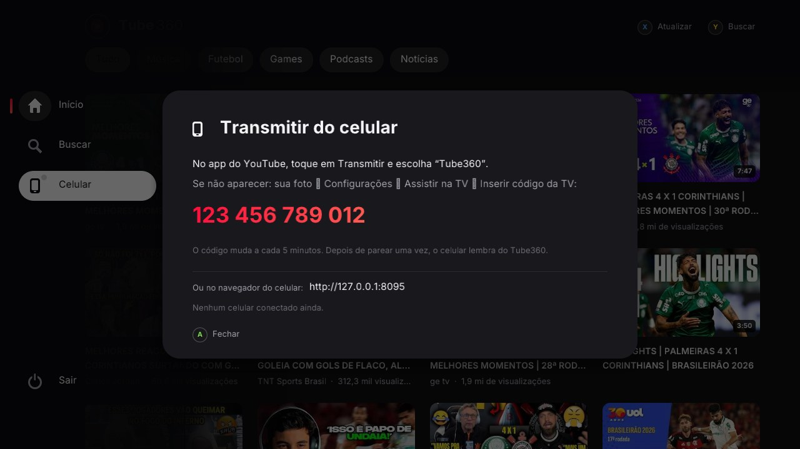
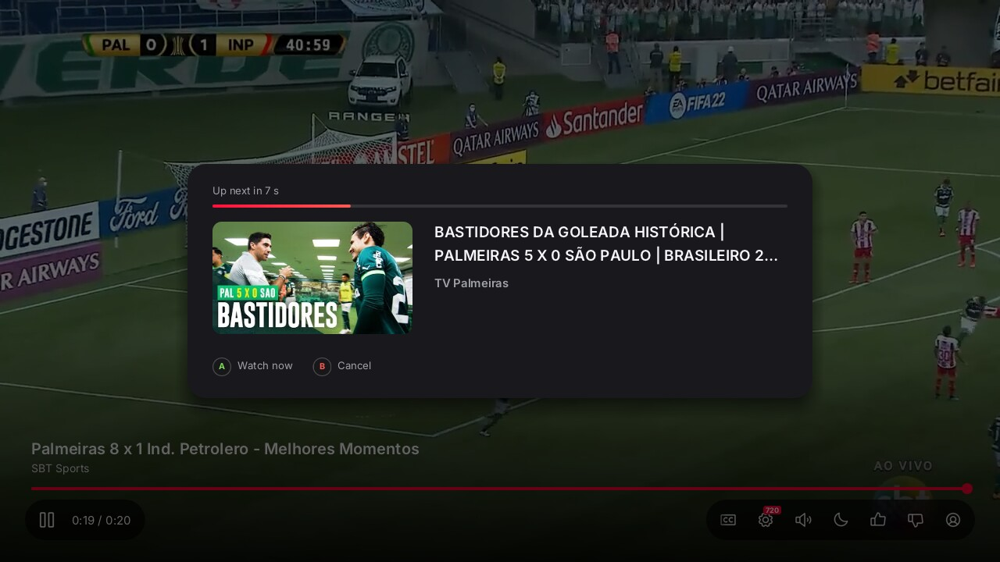
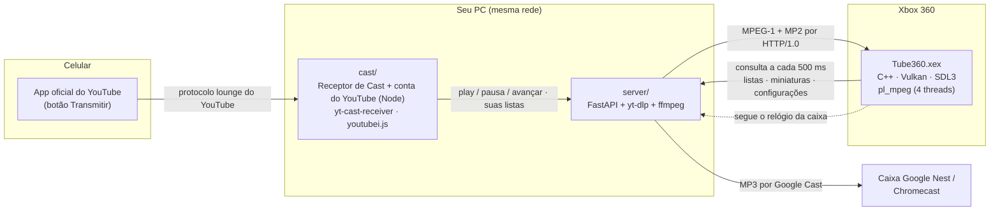

<p align="center">
  
</p>

<p align="center">
  <a href="https://github.com/PedroHenrique0713/tube360/stargazers"></a>
  
  
  <a href="LICENSE"></a>
</p>

<p align="center">
  <a href="README.md">English</a> · <b>Português</b>
</p>

> [!TIP]
> **O Tube360 é grátis e tem licença MIT.** Se ele ressuscitou o seu console, **deixa uma ⭐ no repositório**. É a única coisa que eu peço, e é assim que outras pessoas acham o projeto.

O **Tube360** é um cliente nativo de YouTube para o Xbox 360. É um `.xex` de verdade, que abre pelo Aurora como qualquer jogo. Tem grade no estilo do YouTube, busca com teclado na tela, a sua conta do YouTube e um player que decodifica **720p a 30 fps na própria CPU do console**. Um servidor pequeno no seu PC (ou numa VPS barata, ou num Android velho) faz o trabalho pesado. Dá também para escolher o vídeo **pelo app oficial do YouTube no celular**, com o botão Transmitir de sempre, mandar o som para uma **caixa Google Nest / Chromecast** sincronizada com a imagem e programar um **timer de dormir** que desliga o console (e o PC também, se você quiser).

Sem TV stick, sem smart TV, sem navegador. Só o Xbox 360 que você já tem.

---

## Destaques

| | |
|---|---|
| 📺 **App nativo, não página web** | C++ com Vulkan (na GPU Xenos pelo [vulkan4xenon](https://github.com/xenosworks/vulkan4xenon)) e SDL3. Aparece no Aurora com Title ID próprio (`0x58545542`), capa e fundo. |
| ⚡ **720p a 30 fps numa CPU de 2005** | O decodificador MPEG-1 é dividido entre 4 threads de hardware do Xenon, fatia por fatia. Cada quadro leva ~22 ms, contra ~40 ms numa thread só. |
| 👤 **A sua conta do YouTube, sem celular** | Entre uma vez pela TV com um código em google.com/device, como app de smart TV. Depois o console mostra as suas recomendações, inscrições, continuar assistindo (com a barrinha vermelha) e Assistir mais tarde, e o que você assiste vai para o seu histórico do YouTube. |
| 🧭 **Canais e biblioteca** | Menu abre o canal do vídeo: vídeos/ao vivo/playlists, inscrição, canais inscritos por avatar e playlists da conta ou Assistir mais tarde em sequência. |
| 🎵 **Música** | Área própria com capas quadradas, escolhas rápidas, Explorar/paradas e mixes, busca de músicas/álbuns/artistas, rádio e Tocando agora com letra quando disponível. |
| 📱 **Transmitir pelo app oficial do YouTube** | O Tube360 aparece no menu Transmitir do celular como uma smart TV. Pareie uma vez com o código de TV (ou deixe o celular achar pelo Wi-Fi). Play, pausa, avançar, volume e "a seguir" funcionam pelo celular. |
| 🔊 **Som na caixa Google, sincronizado** | A caixa toca o áudio e o console segue o relógio dela, que um teste com microfone coloca a ~20 ms do som que sai da caixa. Se a caixa cair, o som volta para a TV sozinho. |
| 👍 **Gostei, não gostei e próximo automático** | O direcional ↓ no player avalia o vídeo na sua conta. Quando um vídeo acaba, o próximo que o YouTube sugere começa depois de 8 s de contagem (A assiste na hora, B cancela). Vídeos só para membros ficam fora da grade. |
| 🔴 **Lives** | A live abre como qualquer vídeo, perto do ao vivo, com imagem e som do mesmo trecho (na caixa também). Pausar e continuar volta para o ao vivo. |
| 🌙 **Timer de dormir** | De 15 min a 2 h, ou "no fim deste vídeo". Aviso 60 s antes (A para +15 min, B para cancelar) com o som abaixando. Depois o console se desliga sozinho, e o PC também, se você quiser. |
| ⚙️ **Configurações na TV** | 3 ou 4 vídeos por linha, qualidade padrão, som na TV ou na caixa, sincronia da caixa, português ou inglês. Botões no estilo do Xbox One / Series. |
| 🪶 **Leve no PC, ou fora dele** | Parado: ~140 MB de RAM e ~0% de CPU. Tocando 720p: uns três quartos de um núcleo. Roda como serviço de prioridade baixa, ou numa [VPS pequena ou num Android velho](#rodar-sem-o-seu-pc). |

## Telas

| Início | Resultados da busca |
|---|---|
|  |  |
| **Player** | **Teclado na tela** |
|  |  |
| **Configurações** | **Entrar no YouTube pela TV** |
|  |  |
| **Timer de dormir** | **Transmitir do celular** |
|  |  |
| **Gostei ou não gostei do vídeo** | **Próximo vídeo automático** |
|  |  |

<sub>As telas são do build de PC do cliente, que roda o mesmo código e o mesmo renderizador do build do console, aqui com a interface em inglês. A home de demonstração foi escolha do autor: Palmeiras 4×1 Corinthians e Flamengo 0×3 Palmeiras. 🟢⚪ A conta é de demonstração, e os códigos de login e do Transmitir são de exemplo.</sub>

---

## Como funciona



### Por que MPEG-1?

O Xbox 360 não tem decodificador H.264/VP9 aberto que homebrew possa usar. MPEG-1 é antigo, mas é simples o bastante para decodificar na CPU, e o [pl_mpeg](https://github.com/phoboslab/pl_mpeg) é um decodificador de um arquivo só que compila no toolchain do console sem mudança. Então o PC pega o vídeo do YouTube com o `yt-dlp` (H.264 primeiro, porque abrir AV1 custa o dobro de CPU) e o `ffmpeg` converte na hora. O vídeo começa em poucos segundos e nunca é convertido inteiro antes.

| Qualidade | Tamanho | Bitrate do vídeo | Observação |
|---|---|---|---|
| **720p** (padrão) | 1280×720 | 5,5 Mbit/s | 30 fps, GOP 15, 2 quadros B |
| 480p | 854×480 | 2,5 Mbit/s | troca com **Y** no player |
| 360p | 640×360 | 1,5 Mbit/s | |

O áudio é MP2, 44,1 kHz estéreo, 192 kbit/s, no mesmo fluxo MPEG-PS.

### Decodificar 720p no Xenon

Do jeito que vem, o pl_mpeg decodifica 720p real do YouTube a cerca de **40 ms por quadro** numa thread de hardware. É lento demais para 30 fps. O Tube360 muda ele em dois pontos (`client/third_party/pl_mpeg.h`):

1. **Decodificação paralela por fatias.** Um quadro MPEG-1 é feito de fatias independentes, uma por linha de macroblocos. A thread do decodificador acha o início de cada fatia, divide o quadro em tarefas e roda em 3 threads ajudantes, cada uma presa a uma thread de hardware diferente (`xsdk_thread_move`). Cada tarefa tem sua própria cópia do leitor de bits, então não há trava dentro do laço quente. Resultado: **21 a 23 ms por quadro** em 720p.
2. **Pular quadro B quando aperta.** Se o decodificador ficar mais de 40 ms atrás do relógio (120 ms no modo caixa), ele pula o próximo quadro B. Quadro B nunca serve de referência, então pular nunca estraga a imagem. Tocando normal, nenhum é pulado.

Cada thread pesada é presa de propósito. Principal/desenho na HW 0, decodificador na HW 2, ajudantes nas HW 3, 1 e 4, rede na HW 4. Sem isso, as threads do xsdk ficam no mesmo núcleo de quem as criou.

### Som na caixa Google, sincronizado

Com um Google Nest ou Chromecast no `config.json`, o servidor manda para ele **só o áudio**, em MP3 pelo Google Cast. O console recebe **só o vídeo** e usa a caixa como relógio mestre:

- Ele pergunta ao servidor a posição da caixa a cada 200 ms.
- O servidor carimba cada posição com a hora em que a resposta da caixa *chegou*. (Carimbar com "agora" deixava a imagem ~214 ms atrás do som: o `update_status()` da `pychromecast` só envia o pedido, então o status lido em seguida é a resposta anterior.) Medido com o microfone do notebook e bipes de 1 kHz: a posição informada fica a ~20 ms do som.
- Respostas que levaram mais de 120 ms são descartadas, porque a oscilação do Wi-Fi faria o relógio pular. Diferenças pequenas entram devagar; um salto de verdade só reancora depois de duas amostras seguidas discordarem em mais de 0,5 s.
- Se a caixa falhar, o som volta para a TV e um aviso aparece na tela. LT/RT ajustam a sincronia em 40 ms se a sua TV atrasa a imagem.

### A sua conta do YouTube

A conta roda no mesmo processo Node do receptor de Cast (`cast/account.mjs`), pelo [YouTube.js](https://github.com/LuanRT/YouTube.js). O login usa o fluxo de TV: o console mostra um código, você confirma em google.com/device e o token fica no seu PC (`~/.cache/tube360/yt-conta.json`, modo 600). Token de login de TV só é aceito pelo cliente de TV do YouTube, então as listas vêm por ele. Gravar o que você assiste precisa do rastreio de reprodução do YouTube, que o cliente de TV desta biblioteca não recebe mais ("A página precisa ser atualizada"), então essa chamada se apresenta como cliente de TV Samsung, a mesma identidade do `tv_samsung` do yt-dlp. O console guarda o próprio histórico também.

Se o YouTube começar a responder "Faça login para confirmar que você não é um robô" para o seu IP (acontece depois de muitos pedidos), ponha no `config.json` o `cookies_from_browser` apontando para um perfil do navegador logado no YouTube. O servidor usa esses cookies **só enquanto o YouTube pedir**, tentando sem eles de novo a cada 30 minutos, porque sem cookies o vídeo abre em ~3 s e com eles em ~8 s.

### Timer de dormir

O timer mora no servidor, então continua contando mesmo se o console for desligado na mão. Quando vence, o servidor para a caixa e manda `desligar` ao console, que se desliga pelo kernel (`HalReturnToFirmware(HalPowerDownRoutine)`, achado pelo número dentro do `xboxkrnl.exe`). Com "Xbox e PC", o servidor desliga o PC pelo logind 20 s depois, e os programas fecham normalmente.

O Xbox 360 não tem HDMI-CEC, então não consegue desligar a TV. Quase toda TV tem uma opção de "desligar quando não há sinal" (na Samsung: **Sistema → Solução Eco → Desligamento sem sinal**); com ela ligada, a TV apaga alguns minutos depois do console.

Enquanto o console usa o servidor (ou há timer ligado), o servidor também segura a tampa pelo logind: dá para fechar a tampa do notebook e desligar o monitor sem o PC suspender no meio do vídeo.

### Transmitir pelo app oficial

O `cast/receptor.mjs` usa o [yt-cast-receiver](https://github.com/patrickkfkan/yt-cast-receiver) para falar o protocolo "Assistir na TV" (lounge) do YouTube e transforma cada comando do celular num comando para o console. O painel **Celular** do console mostra um código de TV. Digite uma vez no celular (YouTube → Configurações → Assistir na TV → Inserir código da TV) e o celular lembra do aparelho. Em redes que deixam passar multicast, o celular também acha o Tube360 sozinho pelo DIAL (porta 8098).

---

## Requisitos

**Console**
- Um Xbox 360 que rode código não assinado: **BadUpdate** (testado com XeUnshackle), **RGH** ou **JTAG**.
- **Aurora** (ou outra dashboard que abra `.xex`).
- Rede: uns 6 Mbit/s para 720p. Cabo ou Wi-Fi.

**PC (na mesma rede)**
- Linux. Testado no Fedora. O servidor é Python puro e deve rodar em macOS ou Windows, mas os scripts de serviço são só para systemd.
- Python 3.11+ e `ffmpeg` no `PATH`.
- Node.js 22+. O yt-dlp usa para ler as páginas do YouTube, e o receptor de Cast e a conta rodam nele.

## Começo rápido

### 1. Servidor no PC

```bash
git clone https://github.com/PedroHenrique0713/tube360.git
cd tube360
python3 -m venv .venv && .venv/bin/pip install -r server/requirements.txt
cp server/config.example.json server/config.json   # edite se quiser (veja Configuração)
TUBE360_PYTHON=$PWD/.venv/bin/python ./server/run.sh   # escuta na porta 8091
```

Abra `http://<IP-do-PC>:8091` no navegador: uma página de status mostra o servidor, o console, o código de TV do Transmitir e a sua conta.

### 2. Receptor de Cast e conta do YouTube (opcional)

```bash
(cd cast && npm install)
node cast/receptor.mjs
```

### 3. Os dois como serviço (ligam no login, prioridade baixa)

```bash
TUBE360_NAME="TV da Sala" tools/install-services.sh
```

Ele também instala o `tube360-update.timer`, que mantém o yt-dlp em dia: confere de hora em hora, atualiza mais ou menos uma vez por dia e só reinicia o servidor quando nada está tocando.

### 4. Console

1. Baixe o `default.xex` em [Releases](https://github.com/PedroHenrique0713/tube360/releases) ou [compile](#compilar-do-código).
2. Crie uma pasta como `Hdd1:\Games\Tube360\` e copie para ela:
   - `default.xex`
   - `client/assets/inter-300.ttf`, `inter-400.ttf`, `inter-600.ttf`, `inter-700.ttf`
   - um `server.txt` com o IP e a porta do PC, por exemplo `192.168.0.10 8091`
3. No Aurora, adicione a pasta aos caminhos de busca (ou mande varrer de novo). O Tube360 aparece como jogo.
4. Para usar a sua conta: **Configurações → Conta do YouTube → A** e digite o código que aparece na TV em google.com/device.

> [!NOTE]
> No Linux com firewalld, libere as portas: `sudo firewall-cmd --add-port=8091/tcp --add-port=8098/tcp --add-service=ssdp --permanent && sudo firewall-cmd --reload`.

## Rodar sem o seu PC

O servidor não precisa ser o seu computador. Qualquer coisa com Linux que fique ligada serve. Medido num núcleo de um notebook Intel i5-1035G1, convertendo 30 s de melhores momentos de futebol em 720p:

| Qualidade | CPU (um núcleo, em tempo real) | Memória |
|---|---|---|
| 720p | ~73% | ~400 MB para servidor e ffmpeg juntos, ~60 MB para o receptor de Cast |
| 480p | ~52% | igual |

### Opção A: uma VPS pequena

- **Tamanho:** 2 vCPU e 1 GB de RAM para 720p. 1 vCPU basta para 480p. 10 GB de disco sobram.
- **Tráfego:** 720p manda uns 2,6 GB por hora de vídeo para o console (≈ 5,7 Mbit/s). Duas horas por dia dão uns 160 GB por mês, o que cabe no tráfego incluído da maioria dos planos de entrada.

No Debian ou Ubuntu:

```bash
sudo apt install -y git ffmpeg python3-venv ufw
# Node.js 22+ (o pacote da distro costuma ser mais velho): https://nodejs.org/en/download
git clone https://github.com/PedroHenrique0713/tube360.git && cd tube360
python3 -m venv .venv && .venv/bin/pip install -r server/requirements.txt
(cd cast && npm install)
tools/install-services.sh

# o servidor não tem senha: libere só para o IP da sua casa
sudo ufw allow OpenSSH
sudo ufw allow from <IP-da-sua-casa> to any port 8091 proto tcp
sudo ufw enable
```

Depois coloque o endereço da VPS no `server.txt` do console (ex.: `203.0.113.7 8091`).

> [!WARNING]
> O servidor do Tube360 não tem login. Quem alcançar a porta 8091 consegue usar e mandar vídeo para o seu console. Mantenha a regra de firewall acima e atualize se o IP da sua casa mudar (confira com `curl ifconfig.me` em casa).

O que muda numa VPS:
- **Transmitir pelo app oficial** funciona com o código de TV, porque o pareamento passa pelos servidores do YouTube. O celular achar o console sozinho pelo Wi-Fi não funciona.
- **A caixa Google não funciona.** Ela precisa estar na mesma rede do servidor.
- **O timer de dormir só desliga o Xbox**, não o seu PC.
- **O YouTube costuma pedir login para IP de datacenter** ("confirme que você não é um robô"). Exporte um `cookies.txt` de uma conta reserva do YouTube ([guia do yt-dlp](https://github.com/yt-dlp/yt-dlp/wiki/Extractors#exporting-youtube-cookies)), copie para a VPS e ponha `"cookies_file": "~/cookies.txt"` no `server/config.json`.
- Começar e avançar o vídeo demora um pouco mais, porque agora ele atravessa a internet.

### Opção B: um celular Android velho

Um celular velho na tomada pode ser o servidor da sala. Isso usa o [Termux](https://termux.dev) e é **experimental**: ainda não foi testado em vários aparelhos, então relatos são bem-vindos.

1. Instale o **Termux pelo [F-Droid](https://f-droid.org/packages/com.termux/)**. A versão da Play Store está desatualizada.
2. No Termux:

   ```bash
   pkg update && pkg upgrade
   pkg install git python python-pillow ffmpeg nodejs rust clang binutils
   export ANDROID_API_LEVEL=$(getprop ro.build.version.sdk)   # necessário para compilar o pydantic-core
   git clone https://github.com/PedroHenrique0713/tube360.git && cd tube360
   pip install -r server/requirements.txt    # a primeira vez compila o pydantic-core: 10 a 30 min num celular velho
   (cd cast && npm install)
   termux-wake-lock
   ./server/run.sh & node cast/receptor.mjs &
   ```

3. Nas configurações do Android, deixe a bateria do Termux como **Sem restrições**, mantenha o celular na tomada e dê a ele um IP fixo no roteador (reserva de DHCP).
4. Coloque o IP do celular no `server.txt` do console.
5. Para tudo ligar sozinho depois de reiniciar, instale o **Termux:Boot** (também no F-Droid) e ponha os dois comandos num script em `~/.termux/boot/`.

**Comece em 480p** (Configurações → Qualidade padrão). O celular converte em tempo real, e 720p pede uns três quartos de um núcleo de notebook, coisa que muita CPU de celular só alcança dividindo o trabalho entre vários núcleos. Se 480p rodar liso, tente 720p. A caixa Google e o Transmitir por código de TV funcionam, porque o celular está na rede da sua casa.

## Controles

Os botões aparecem na tela no estilo do Xbox One / Series.

| Onde | Botão | Ação |
|---|---|---|
| **Início** | A | Assistir (retoma de onde você parou) |
| | X | Atualizar a lista |
| | Y | Buscar |
| | Direcional ← (na primeira coluna) | Menu lateral (Início · Buscar · Celular · Configurações · Sair) |
| | Direcional ↑ (na primeira linha) | Chips de categoria e da conta |
| | View | Voltar ao Aurora |
| **Busca** | A / X / Y | Digitar / Apagar / Espaço |
| | Menu | Buscar |
| | B | Voltar |
| **Player** | A ou Menu | Pausar / continuar |
| | Direcional ← → | −10 s / +10 s |
| | Direcional ↑ | Timer de dormir |
| | Direcional ↓ | Gostei / Não gostei |
| | LB / RB | −1 min / +1 min |
| | Y | 720p ↔ 480p |
| | X | Som na TV ↔ na caixa |
| | LT / RT | Sincronia da caixa −40 ms / +40 ms (fica salva) |
| | B ou View | Voltar à grade |
| **Configurações** | Direcional ↑ ↓ / ← → | Escolher a linha / trocar o valor |
| | A / B | Abrir (entrar, sair da conta) / Voltar |
| **A seguir** | A / B | Assistir agora / Cancelar |
| **Aviso do timer** | A / B | +15 min / Cancelar |

## Configuração

**No console**, tudo fica em **Configurações** e é salvo no `settings.txt` ao lado do `.xex` (`lang`, `cols`, `quality`, `sound`, `sync_ms`, `sleep_what`). Outros arquivos ao lado do `.xex`:

| Arquivo | Conteúdo | O que faz |
|---|---|---|
| `server.txt` | `192.168.0.10 8091` | Onde está o servidor (obrigatório). |
| `marca.txt` | linha 1: um nome; linha 2 (opcional): `retangulo` | Nome e estilo do logo no topo do app. |
| `net_log.txt` | `192.168.0.10 7400` | Manda o log do app por UDP para o PC (depuração). |

Os antigos `quality.txt` e `audio.txt` ainda são lidos na primeira vez; depois o `settings.txt` assume.

**`server/config.json`** (copie do `config.example.json`):

| Chave | Significado |
|---|---|
| `language` | `en` ou `pt`: idioma dos títulos das listas, das mensagens e dos dados do YouTube. |
| `home_queries` | Temas que montam a home quando não há conta. Seis são sorteados a cada atualização. |
| `warm_queries` | Buscas carregadas por trás enquanto o console está em uso, para os chips de categoria abrirem na hora. |
| `nest` | `{"host": "192.168.0.20", "name": "Caixa da sala"}`. Use o IP, porque muita rede doméstica bloqueia mDNS. |
| `cookies_from_browser` | ex. `"chrome:~/.config/google-chrome/Default"`. Só é usado quando o YouTube pede login (veja [A sua conta do YouTube](#a-sua-conta-do-youtube)). |
| `cookies_file` | Mesma ideia com um `cookies.txt` exportado (para VPS sem navegador). |
| `brand` | Nome mostrado na página de status. |

## Compilar do código

**Build de PC** (mesma interface, para desenvolver, em janela com o Vulkan da Mesa):

```bash
cmake -S client -B client/build -DCMAKE_BUILD_TYPE=Release
cmake --build client/build -j
XT_SERVER=127.0.0.1:8091 ./client/build/tube360
```

Precisa de SDL3, dos headers do Vulkan e do `glslangValidator`. Teclado: setas, Enter = A, Esc = B, Backspace = X, Tab = Y, PageUp/PageDown = LB/RB, F2 = Menu, F10 = View. Controle também funciona.

**Build do Xbox 360** precisa do toolchain [xsdk](https://github.com/xenosworks/xsdk), mais o [vulkan4xenon](https://github.com/xenosworks/vulkan4xenon) e o [SDL-xenon](https://github.com/xenosworks/SDL-xenon) já compilados:

```bash
export XSDK_DIR=~/src/xsdk V4X_DIR=~/src/vulkan4xenon SDL3_XENON_DIR=~/src/SDL-xenon/build-xsdk XSDK_TOOLCHAIN=~/xsdk-gcc
tools/build-xbox.sh          # → client/build-x360/tube360.xex
```

Os shaders são GLSL, compilados para a GPU Xenos pelo `build_shaders.py` do vulkan4xenon.

## Organização

```
client/          o app do console (C++20): src/main.cpp (interface), gfx.hpp (renderizador 2D em Vulkan), player.hpp
                 (decodificação, A/V, sincronia da caixa), i18n.hpp (inglês/português), settings.hpp, sleep.hpp (desligar)
client/third_party/pl_mpeg.h   pl_mpeg com as mudanças do Tube360 (fatias em paralelo e pulo de quadro B)
server/          servidor FastAPI: listas, miniaturas, fluxo do ffmpeg, áudio por Google Cast, timer, página de status
cast/            receptor de Cast para o app oficial do YouTube e a conta do YouTube (Node)
bench/           o primeiro teste de decodificação rodado no console
docs/PROTOCOL.md o protocolo console ⇄ servidor
tools/           build do console e instalador dos serviços
```

## Próximos passos

- [ ] Legendas
- [x] Gravar no seu histórico do YouTube o que você assiste no console (v0.2.0)
- [ ] Testar em mais celulares Android

Pull requests são bem-vindos.

## Créditos e licença

O Tube360 tem [licença MIT](LICENSE). Você pode usar, mudar e compartilhar. Mantenha o aviso de copyright, ou seja, dê o crédito. As partes de terceiros e as licenças delas estão em [THIRD_PARTY.md](THIRD_PARTY.md). Valeu ao **pl_mpeg**, **yt-dlp**, **YouTube.js**, **yt-cast-receiver**, **FFmpeg**, **PyChromecast** e aos projetos **xsdk / vulkan4xenon / SDL-xenon**, que tornaram possível homebrew moderno no 360.

Feito por [Pedro Henrique Quadro](https://github.com/PedroHenrique0713).

> [!IMPORTANT]
> O Tube360 é um projeto independente. Não tem ligação, aprovação nem patrocínio do Google, do YouTube ou da Microsoft. "YouTube" e "Xbox" são marcas dos seus donos. Use para uso pessoal, por sua conta, e respeite os termos dos serviços que você conecta.

<p align="center"><b>Curtiu? Uma ⭐ no repositório é o melhor obrigado.</b></p>
