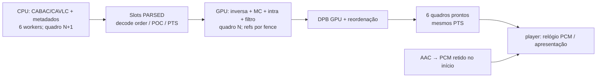

# F30 — fronteira CPU/GPU e linha de montagem

Proposta, **não implementação nem orçamento medido**. O piso executável está no README.
Domínio inicial: High, 8-bit, 4:2:0, progressivo, até 1920×1088 codificados, quatro referências
no DPB. MBAFF/PAFF, 10-bit, 4:2:2/4:4:4, FMO e streams fora dos limites continuam na CPU.
GOP I/P/B, direct temporal/espacial, subpartições, pesos, PCM, slice boundaries e transformação
4×4/8×8 precisam existir antes de chamar isso de decoder High.

## Onde tirar os dados

Na fonte FFmpeg 7.1.5 usada pelo app:

1. `h264_cabac.c:ff_h264_decode_mb_cabac` e `h264_cavlc.c:ff_h264_decode_mb_cavlc`
   já terminam tipo, CBP, NNZ, QP, modos e coeficientes; `write_back_motion` e direct já resolvem MVs.
2. No início de `h264_mb.c:ff_h264_hl_decode_mb`, **antes** de IDCT/MC limparem/modificarem o scratch,
   gravar o registro do MB no índice raster `mb_y*120+mb_x` do slot do quadro. Esse é o hook F30.
   Os índices `mb_xy`/`scan8` do FFmpeg têm strides/padding; não são índices lineares da ABI.
3. Copiar `cur_pic.mb_type`, QPs Y/Cb/Cr, `sl->intra4x4_pred_mode_cache[scan8[i]]`,
   intra16/chroma, flags de disponibilidade normativa e slice id. Não confundir vizinho geometricamente
   próximo com vizinho disponível na ordem de blocos H.264/slice/constrained-intra.
4. Só exportar listas realmente usadas pelo tipo/subtipo. Cache de MV/ref de uma lista não usada
   pode conter lixo válido de outro MB; os testes desta bancada usam essa mesma normalização.
   Para cada bloco 4×4: MVs já preditos em quartos de pixel de luma, DPB slot estável e índice
   original na lista da slice. Direct temporal **continua** esperando metadados da referência.
5. Coeficientes: coletar Y 256 + Cb 64 + Cr 64, removendo os buracos do layout FFmpeg; mais os
   16 DC de intra16 em campo separado. `sl->mb` já contém dequantização de AC; o primeiro
   protótipo pode mantê-la na CPU, sinalizada na ABI. Para transferir também a dequantização,
   o hook precisa capturar levels antes de `level*qmul` nos dois parsers e enviar QP/scaling lists.
   Não contabilizar isso como ganho já medido pela F30: a bancada conserva esse trabalho.
6. `h264_slice.c:fill_filter_caches`, `h264_loopfilter.c:ff_h264_filter_mb[_fast]` mostram as
   entradas de força de borda: intra/inter, NNZ, diferença de MV, identidade da referência,
   QP dos dois lados e restrição de slice. Calcular bS em shader a partir dos registros adjacentes
   e gravar 32 bytes/MB. O hook da bancada não mede esse cálculo nem o faz na CPU.
   Comparar **identidade do quadro**, não só ref_idx: índices distintos podem nomear a mesma imagem.

O fim do parse publica um token `(generation, decode_index, POC, PTS, DPB slots)` com barreira release;
a thread de submit consome com acquire. O fence GPU transforma PARSED → RECONSTRUCTED → REFERENCE_READY.
O avanço dos metadados de FFmpeg não é esse fence e não pode liberar uma referência de pixels.
Um seek incrementa generation; conclusões antigas são descartadas após suas fences, sem reutilizar
memória ainda em leitura. Preservar MMCO/long-term/ref lists/POC do FFmpeg na CPU.

## ABI proposta e bytes

[`pipeline_layout.hpp`](pipeline_layout.hpp) fixa tamanhos/offsets com static_assert nos builds PC/Xbox.
É documentação compilável; o exportador ainda não existe. Serializar explicitamente little endian,
inclusive no Xenon big endian; não dar memcpy do struct nativo para a GPU. A primeira leitura pode
usar texturas de bytes/RGBA8 com `floor(sample*255+.5)`, sem filtragem, em vez de presumir SSBO.

| Registro por MB | Bytes | Conteúdo |
|---|---:|---|
| Cabeçalho | 32 | tipo/flags, offset de coeficientes, slice/availability, QPs, offsets do filtro, índices de pesos/scaling, modos 16/chroma |
| Modos intra | 16 | um byte por bloco 4×4; 8×8 usa o modo do grupo e flag de tamanho |
| NNZ | 24 | 16 Y + 4 Cb + 4 Cr, forma normativa para deblocking |
| bS | 32 | `[direção][4 arestas][4 segmentos]`; 0xff significa calcular na GPU |
| Referências | 32 | `[2 listas][16 blocos]`; -1 ausente, demais codificam DPB slot em 2 bits + ref_idx da slice em 5 |
| MVs | 128 | `[2][16][x,y]`, int16 qpel |
| Reserva/alinhamento | 56 | mantém stride de 320 bytes, múltiplo de 64 |
| **Descritor total** | **320** | duas listas e partições de 4×4, sem crescimento por tipo B |
| Coeficientes int16 | **800** | 400 valores; DC extra incluído; PCM usa 384 bytes do mesmo payload |
| Alternativa int32 | **1.600** | para implementação/ranges que precisarem dela, não assumir que custa igual |

Cabeçalho de quadro de 64 KiB: até 32 descritores de slice de 1.536 bytes (listas/pesos/denominadores,
limites/deblock/scaling), parâmetros do quadro, tokens/fences e tabelas. Acima de 32 slices, reserva
ou fallback explícito; não truncar. A normalização dos modos e layouts precisa de testes contra a norma.

| 1080p, 120×68 = 8.160 MB | int16 | int32 |
|---|---:|---:|
| Descritores | 2.611.200 B | 2.611.200 B |
| Coeficientes | 6.528.000 B | 13.056.000 B |
| Cabeçalho | 65.536 B | 65.536 B |
| **Total/quadro** | **9.204.736 B = 8,778 MiB** | **15.732.736 B = 15,004 MiB** |
| Escritas de export a 30 fps | **276,142 MB/s** | **471,982 MB/s** |
| Escritas de export a 60 fps | **552,284 MB/s** | **943,964 MB/s** |

São bytes densos, sem padding de texturas, flushes ou leituras da GPU. O encoder pode deixar muito
zero, mas esta primeira ABI não promete compressão. Empacotar só blocos não nulos é uma segunda
medição, não desconto no piso. Enviar `sl->mb` inteiro seria 3.072 B/MB: **25.067.520 B/quadro**
só de scratch, porque inclui espaço para high bit depth e canais não usados. A F30 limpa esse
scratch local; não o exporta. Não copiar os buracos para o barramento da GPU.

## Superfícies e passes: o limite da primeira implementação

YUV420 codificado tem 3.133.440 amostras. O backend atual não oferece R8 como render target.
Usar RGBA8 com **quatro amostras adjacentes nos canais**, não quatro cópias da mesma luma:
Y em 480×1088 texels, Cb/Cr em 240×544 cada, lado a lado abaixo de Y. Atlas 480×1632 RGBA8:
**3.133.440 B** lógicos, contra 12.533.760 B para três planos com um byte repetido em RGBA.
Reservar 4 MiB por atlas e consultar `vkGetImageMemoryRequirements`; pitch/tiling podem aumentar.
Precisão intermediária da IDCT/qpel exige inteiro exato; R16F não garante isso. R32F só serve
enquanto todos os intermediários relevantes forem representáveis exatamente; provar limites e
confrontar pixels/overflow antes de aceitar. Não presumir inteiro nativo só porque o GLSL usa int.

Fase de referência, que prioriza correção e torna o custo explícito:

| Trabalho | Passes completos ou ondas por quadro |
|---|---:|
| Dequant/DC/Hadamard + inversa separável 4×4/8×8 | 2; repetir produtos locais onde necessário, sem arredondar entre eixos |
| MC de lista 0 e lista 1 | 2; cada pixel escolhe suas referências/MVs, qpel completo e croma; filtro 2D direto pode exigir 36 taps |
| Pesos/bi-predição + resíduo dos inter | 1; respeitar ordem normativa de arredondamento/clipping |
| bS | 1; 8 texels RGBA8/MB, 261.120 B lógicos |
| Inicializar o segundo atlas de reconstrução | 1 cópia desenhada |
| Intra | **2 × W_intra**: reconstruir onda A→B, copiar apenas regiões atualizadas B→A com shader |
| Deblocking | **4 × W_deblock**: vertical A→B + cópia B→A; horizontal A→B + cópia B→A |
| YUV→RGB + UI | 1, incorporado ao desenho normal do player |
| **Total** | **8 + 2×W_intra + 4×W_deblock** |

São **8** passes fixos. Em tudo inter, W_intra=0 e W_deblock≤254: **até 1.024**.
No pior I4×4, W_intra≤1.022 e W_deblock≤254: **até 3.068**. São passes de desenho/resolve,
não quantidade de programas shader. Se o compilador não comportar os taps/temporários de MC,
ele exige nova divisão e a conta aumenta; o protótipo ainda precisa compilar esses kernels.

### Intra em frente de onda

O pixel intra usa vizinhos **reconstruídos e ainda não deblocked**. Não aplicar deblocking antes
de acabar o intra do quadro. Fazer todos os inter antes do intra satisfaz suas dependências de
amostras, mantendo máscaras de disponibilidade normativa para não usar vizinhos proibidos.

Para blocos 4×4 de luma, a grade é 480×272. A ordenação conservadora é **t=x+2y**: esquerda,
topo e topo-direita têm t menor; x+y deixaria topo-direita na mesma onda e criaria uma corrida.
`t_max=479+2*271=1021`: **1.022 ondas**. Dentro de uma predição 4×4, todos os pixels dependem
somente das bordas, então podem ser desenhados juntos. Nós 8×8 e 16×16 seguem seu DAG de
blocos/modos e disponibilidade; o limite acima é para a grade inteira de 4×4. Chroma intra
8×8 tem grade 120×68 e só topo/esquerda: até **187 ondas** x+y, intercaláveis com as de luma
no mesmo atlas. Não considerar quatro blocos intra dependentes como quatro fragmentos paralelos.

Não se pode amostrar a imagem usada simultaneamente como attachment. A→B e cópia desenhada
B→A conservam uma imagem de leitura atualizada sem feedback ilegal. Desenhar/copiar regiões
com máscara, preservando os demais texels com LOAD; granularidade de resolve de 8×8 texels
obriga expandir áreas e conservar os pixels extras. `vkCmdCopyImage` não é atalho GPU aqui;
o backend faz cópias por linhas na CPU. Blit desenhado só aceita retângulos/formats específicos,
então a referência usa nosso shader de cópia. **Nunca readback por onda.**

### Deblocking em frente de onda

Um simples “todas as verticais do quadro, depois todas as horizontais” não preserva automaticamente
a ordem por MB da norma. Para uma primeira versão progressiva, cada nó MB faz todas as suas
arestas verticais na ordem e depois as horizontais, com fragmentos calculando localmente os
vizinhos necessários à sequência das quatro arestas. A caixa escrita inclui até três amostras
à esquerda/acima do MB. Nós da mesma onda **t=mb_x+2*mb_y** não sobrepõem essas caixas;
topo-direita da linha anterior já terminou. A grade 120×68 dá `119+2*67+1=254` ondas.
A ordem/ranges/casos fortes ainda exigem prova pixel a pixel contra FFmpeg; este é o
agendamento conservador proposto, não um deblock shader validado nesta frente.

**Consequência numérica:** mesmo usando só os bytes lógicos, resolver o atlas completo nas
3.068 passagens escreveria **9,613 GB/quadro**, **288,4 GB/s a 30 fps**, antes de leituras/LOADs.
Isso torna a versão de passes completos inadequada como plano de performance. Áreas parciais
diminuem bytes, mas não removem milhares de comandos/serializações. O teto exploratório de
17 ms GPU da F28 permitiria apenas **5,54 µs/passe** para 3.068 passes, sem nenhuma ALU/fetch.
Logo não há fundamento para reutilizar aquele teto como previsão deste desenho.

Antes do decoder completo, medir uma onda/um GOP I com superfícies reais e resolve parcial;
depois reduzir comandos por blocos/tiles, executar dependências internas em shader ou implementar
uma capacidade nova no backend. Um shader que calcule MB inteiro pode reduzir W_intra para
até 254, mas sem compute/memexport teria de recomputar resultados internos por fragmento ou
expandir armazenamento/registradores: não assumir esse ganho sem medir. O backend inspecionado
recusa compute/storage shaders. Uma proposta que dependa deles é mudança de backend, não
troca de ponteiro DSP no FFmpeg. Os **4,08 ms** medidos pelo coordenador na F28 cobrem apenas
meio-pixel horizontal de luma em um passe; não validam esta organização nem o MC completo.

## Filas, atraso e memória

A sobreposição elimina esperas por **pixels** do parse; não elimina a espera por MVs do direct.
GPU segue a ordem de decodificação quando houver referências, e só apresenta por POC/PTS.
Com seis workers, reservar **nove slots de comandos**: até seis em parse, dois esperando submit
e um na GPU. Backpressure por créditos, sem alocar a cada quadro. Não reaproveitar um slot
até o fence que consumiu seus dados. Não bloquear o worker segurando locks de FFmpeg.

Meta inicial: até **três quadros adicionais** entre fim do parse e fila pronta: **100 ms** a 30
ou 50 ms a 60. Não é necessário esperar os três quando GPU/fence já terminaram; são capacidade
e margem, não um sleep. O throughput mínimo ideal é max(T_CPU,T_GPU), e a latência de um
quadro ainda inclui ambos. Se a média for 35 ms, uma fila de 100 ms só adia o esvaziamento.

O player atual já pede seis quadros prontos antes de iniciar H.264 e tem `maxFrames=10`.
Isso representa 200 ms de conteúdo a 30 fps (intervalo entre primeiro e sexto PTS = 166,7 ms).
Frame threading com seis pode adicionar até cinco quadros de retenção, e a fixture tem até
dois B de reorder. Para dimensionar o início, reservar até **5+2+3+6=16 períodos = 533,3 ms**
a 30 fps (266,7 ms a 60), além de rede/dispositivo. Parte dessas retenções se sobrepõe e
deve ser medida pelos timestamps; não somar isso como latência observada do app.

Orçamento conservador do protótipo 1080p, **não consumo medido**:

| Reserva | int16 | int32 |
|---|---:|---:|
| 9 slots, arredondados para 9/16 MiB | 81 MiB | 144 MiB |
| 14 atlas × 4 MiB: 4 refs + 2 reorder + 6 prontos + 1 exibido + 1 em reconstrução | 56 MiB | 56 MiB |
| 2 atlas de trabalho reutilizáveis MC/ping-pong | 8 MiB | 8 MiB |
| 2 intermediários R32F de inversa, até 16 MiB cada | 32 MiB | 32 MiB |
| AVFrames CPU ainda retidos pelo fork inicial | 64 MiB | 64 MiB |
| metadados de DPB, bS, pacotes, pilhas e margem | 24 MiB | 24 MiB |
| **Reserva total do protótipo** | **265 MiB; teto de 288 MiB** | **328 MiB; teto de 352 MiB** |
| Futuro sem planos CPU duplicados | **201 MiB; teto de 224 MiB** | **264 MiB; teto de 288 MiB** |

DPB/reorder/display podem compartilhar atlas; a soma acima os mantém separados para não
depender de aliases corretos antes de implementar refcounts. Com 512 MiB unificados totais,
medir memória efetivamente disponível junto ao app/kernel/UI antes de habilitar o protótipo.
O pool atual do player limita **48 superfícies / 160 MiB**; ele não contabiliza os novos comandos
e intermediários. Não adicionar esses 265 MiB por cima de outro decoder ativo.
PCM estéreo float 44,1 kHz de 100 ms custa **35.280 B**; de 200 ms, 70.560 B.
O reserve de áudio VOD atual de 6 s já corresponde a 2.116.800 B, independente da GPU.

## Integração com o relógio de player.hpp

Não deslocar PTS de vídeo ou áudio. O atraso vira **pré-roll de reprodução**, com o mesmo
domínio de timestamps nos dois. `enqueuePlanes`/a futura entrada de superfície GPU só recebem
quadros depois do fence final; nunca publicar PARSED como se fosse uma imagem pronta.

Pontos concretos do código atual, para a implementação futura (nenhum foi editado nesta frente):

- `Frame` ganha token de superfície/fence/generation; `enqueuePlanes` passa a receber atlas GPU.
  `video::Surface`/`gfx_video_memory.hpp` e `video.frag` precisam saber amostrar o atlas packed.
- O gate de `firstPts < 0` já espera seis frames e pelo menos 100 ms PCM. Estabelecer `firstPts`
  e `wallStart` somente depois de seis **GPU-ready**; manter SDL pausado até esse instante.
  O estágio extra de até 100 ms é absorvido antes de `SDL_ResumeAudioStreamDevice`.
- `tvClock` é `audioBaseMs/1000 + max(0,pushed/44100 - queued - deviceMs/1000)*speed`.
  Reter PCM antes de tocar mantém o relógio junto à imagem, sem somar 100 ms duas vezes.
  A seleção `frames.front()->pts <= screenSec + .010` pode continuar igual.
- Se faltar vídeo GPU durante reprodução, pausar PCM e o avanço do relógio até repor o watermark;
  a lógica atual `refill` cobre **fila PCM vazia**, não fence de vídeo atrasado. Precisa dessa
  nova condição. Preservar o quadro exibido; não deixar o loop descartar seis frames atrasados
  enquanto áudio avança sozinho. Pausa/seek/fim precisam drenar/cancelar tokens por generation.
- Nest é relógio externo: o gate atual pode encontrar `speaker` já avançado e descartar o atraso
  adicional. Preparar a fila GPU **antes** de iniciar/resumir o áudio no Nest (LOAD pausado e
  PLAY quando ambos estiverem prontos, ou horário/posição coerente no protocolo existente).
  Não usar `nestOffset` do ajuste A/V do usuário para esconder os 100 ms internos. Isso ainda
  precisa de integração e teste próprios; a F30 não conecta ao Nest.

CPU/GPU/áudio precisam ser ensaiados juntos em GOPs longos. Os primeiros critérios são: CPU
com empacotamento dentro de 29 ms, GPU+UI dentro de 29 ms, fila sem crescimento infinito,
zero diferenças de pixels com filtro, e erro A/V dentro dos 22 ms que o player já usa para
alinhar TV. Os limiares são metas de projeto, não resultados desta bancada.

## Fontes primárias

- [ITU-T H.264](https://www.itu.int/rec/T-REC-H.264), processos de reconstrução/intra/inter e
  deblocking da seção 8; não deriva de shaders GPL.
- [FFmpeg 7.1 h264_slice.c](https://ffmpeg.org/doxygen/7.1/h264__slice_8c_source.html) e fonte
  local fixada em 7.1.5, com o SHA do script do app; os offsets do relatório se referem à fonte local.
- [vulkan4xenon SUPPORT.md, revisão usada pela F28](https://github.com/xenosworks/vulkan4xenon/blob/df25dc50e6296d89822626b433f4080db05bccc8/docs/SUPPORT.md):
  formatos, compute ausente, render areas, cópias/blits e resolves; conferido também na cópia local.
- Código local do Tube360: `client/src/player.hpp`, `player_h264.hpp`, `h264.hpp`,
  `gfx_video_memory.hpp` e `client/x360/ffmpeg-libc.c`.
